# APP_FLOW — TestKo PH Application Flows

## 0. Document control
| Field | Value |
|---|---|
| Document | `APP_FLOW.md` (03) |
| Version | 0.3.0 · draft |
| Date | 2026-10-11 |
| Upstream | PRD 0.2.0, TRD 0.2.0 |
| Downstream | DESIGN_BRIEF, DATABASE_SCHEMA, IMPLEMENTATION_PLAN |

## 1. Conventions
- **Swimlanes are horizontal:** each **row is a lane** (a user role or a system), and the flow reads **left to right** with arrows.
  - Shapes: green pill = start/end · white box = step · amber diamond = decision · red box = error/alternate outcome.
  - Solid arrow = next step; **dashed arrow = go back / retry**; arrow labels give the decision answer.
  - Numbered badges give the reading order.
- Diagrams are images in `docs/diagrams/FLOW-###.svg`, generated from the diagram data `docs/diagrams/flows.json` by the EC2Build agent tool (`skills/ec2build/scripts/swimlanes.py`, bundled with the ec2build skill). Under each image a generated Mermaid text version (lanes as `subgraph`s) is kept for diffing and for tools that only read Mermaid.
- **To change a flow diagram**, use `/ec2build update --name "TestKo PH" --doc FLOW --change "..."` (the agent edits `flows.json` and re-renders); never hand-edit the SVGs or the text between `<!-- swimlane:... -->` markers.
- Standard failure handling that applies to **every** flow (not repeated in each diagram unless flow-specific):
  | Condition | Behaviour |
  |---|---|
  | **Unauthenticated** (no/expired session) | API 401 `UNAUTHENTICATED`; UI redirects to UI-003 with `?next=<path>`; after login returns to the step |
  | **Forbidden** (wrong role/owner) | API 403; UI shows UI-025 403 state with link home; event logged (warn) |
  | **Suspended** | API 403 `ACCOUNT_SUSPENDED` on mutations; banner on all pages |
  | **Validation error** | API 422 with field `details`; UI keeps input, shows inline errors, focuses first invalid field, announces summary (aria-live) |
  | **Timeout / network offline** | Client fetch timeout 15 s → toast "Connection problem — your data wasn't lost" + Retry; forms keep state; mutations are safe to retry (state guards / idempotency) |
  | **Service unavailable** (DB/provider 5xx) | API 502/503 `PROVIDER_UNAVAILABLE`/`INTERNAL`; UI shows retry with backoff; no partial money state (single DB transaction) |
  | **Duplicate submission** | Submit buttons disabled while pending; server guards (status checks, unique indexes) make repeats no-ops or 409 `INVALID_STATE` which UI treats as "already done" and refreshes |
  | **Rate limited** | 429 + `Retry-After`; UI shows wait time |
- Offline-first behaviour is out of scope (PROJECT_CONTEXT §6); reconnect = user retries.

## 2. Flow index
| Flow | Name | Actors | FR | UI | API |
|---|---|---|---|---|---|
| FLOW-001 | Sign-up, verification & onboarding | Guest | FR-001, FR-002, FR-032 | UI-002, UI-005 | API-001, API-002 |
| FLOW-002 | Sign-in, sign-out & password reset | User | FR-001 | UI-003, UI-004 | API-001 |
| FLOW-003 | Tester identity & PayPal profile setup | Tester | FR-003, FR-004 | UI-006 | API-002, API-003 |
| FLOW-004 | Create campaign & pay | Developer, Stripe | FR-005…FR-007 | UI-012…UI-014 | API-004, API-005, API-006 |
| FLOW-005 | Admin campaign review | Admin, Stripe | FR-008, FR-013 | UI-019 | API-016 |
| FLOW-006 | Browse & join campaign / withdraw before start | Tester | FR-009, FR-015, FR-016, FR-019 | UI-007, UI-008, UI-009 | API-007, API-008 |
| FLOW-007 | Grant access & start testing | Developer | FR-010, FR-011 | UI-015 | API-009, API-010 |
| FLOW-008 | Opt-in proof & periodic/final check-ins | Tester, Cron | FR-017, FR-018, FR-019, FR-026 | UI-009, UI-010 | API-011, API-021 |
| FLOW-009 | Developer verdicts & auto-pass | Developer, Cron | FR-012, FR-021 | UI-016 | API-012, API-021 |
| FLOW-010 | Dispute | Tester, Admin | FR-024 | UI-010, UI-020 | API-013 |
| FLOW-011 | Settlement & refund | Cron, Stripe | FR-013 | UI-015 | API-021, API-006 |
| FLOW-012 | Payout request & PayPal execution | Tester, Admin, PayPal | FR-020…FR-023 | UI-011, UI-021 | API-014, API-015, API-017, API-018 |
| FLOW-013 | Campaign cancellation & recruiting expiry | Developer, Cron, Stripe | FR-014 | UI-012, UI-015 | API-024, API-021 |
| FLOW-014 | Admin suspension | Admin | FR-025 | UI-022 | API-019 |
| FLOW-015 | Account deletion | User | FR-031 | UI-006 | API-023 |

---

## FLOW-001 — Sign-up, verification & onboarding
| Field | Value |
|---|---|
| Trigger | Guest clicks "Join as tester" / "Post your app" on UI-001 or "Sign up" anywhere |
| Actors | Guest → User |
| Preconditions | Not signed in |
| Entry / exit | UI-002 → UI-005 → role home (tester: UI-007; developer: UI-012) |
| Links | FR-001, FR-002, FR-032 · UI-002, UI-005 · API-001, API-002 · DB-001, DB-002 |

<!-- swimlane:FLOW-001 -->
**Sign-up, verification & onboarding**

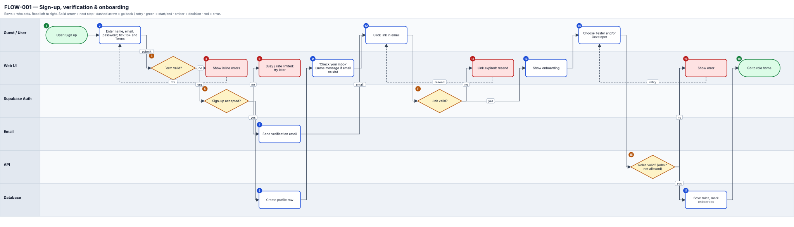

Text version (Mermaid, generated)

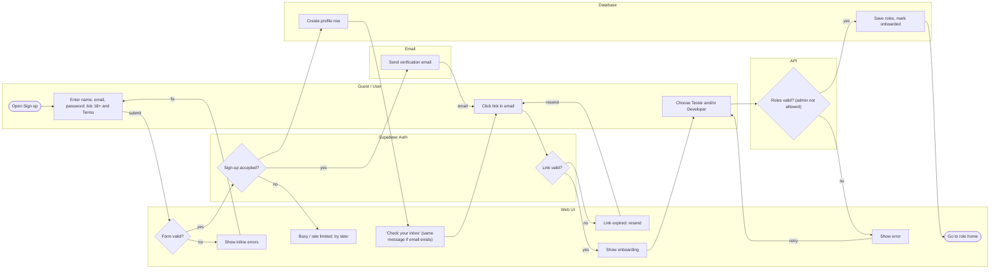

<!-- /swimlane:FLOW-001 -->
| # | Lane | Input | Output | Next |
|---|---|---|---|---|
| 1 | Guest | name, email, password, 18+, terms_version | — | 2 |
| 2 | UI | form | Zod check (email, password ≥10, name 2–50, both boxes ticked) | 3 / errors |
| 3 | Auth | `signUp` with `options.data` | user (unconfirmed); trigger creates DB-001 | 4 |
| 4 | UI | — | Neutral "check your inbox" (no account enumeration) | 5 |
| 5 | Guest | email link → `/auth/callback` | session cookie | 6 |
| 6 | UI | — | UI-005 forced until ≥1 role (FR-002 AC1) | 7 |
| 7 | API | `{roles}` | user_roles rows, `onboarded_at`, audit `auth.role_granted` | role home |

| Path | Outcome / final state |
|---|---|
| Success | Verified, onboarded user with ≥1 role |
| Cancel | Guest leaves; unverified auth user remains (Supabase cleans per config) |
| Validation error | Inline errors; nothing created |
| Duplicate submission / existing email | Same neutral response; existing owner gets no extra account |
| Expired link | Error on callback page with "Resend verification" |
| Unauthorized/forbidden | Requesting `admin` role → 403 |
| Timeout / unavailable | Auth outage → "Sign-up temporarily unavailable, try again" |
| Recovery | Resend verification (rate-limited) |

---

## FLOW-002 — Sign-in, sign-out & password reset
| Field | Value |
|---|---|
| Trigger | User opens UI-003 or is redirected by guard |
| Preconditions | Verified account |
| Exit | Original `next` path or role home; UI-003 after sign-out |
| Links | FR-001 · UI-003, UI-004 · API-001 · DB-001 |

<!-- swimlane:FLOW-002 -->
**Sign-in**

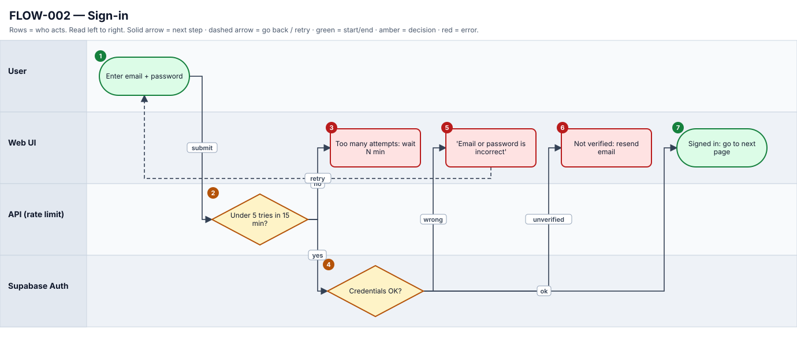

Text version (Mermaid, generated)

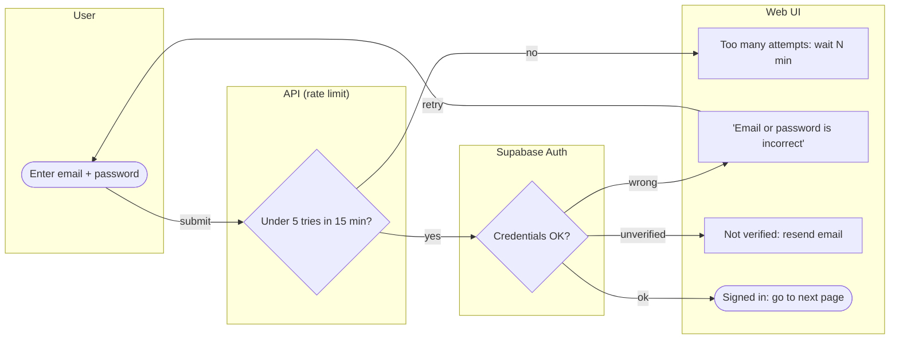

**Password reset & sign-out**

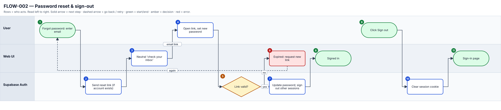

Text version (Mermaid, generated)

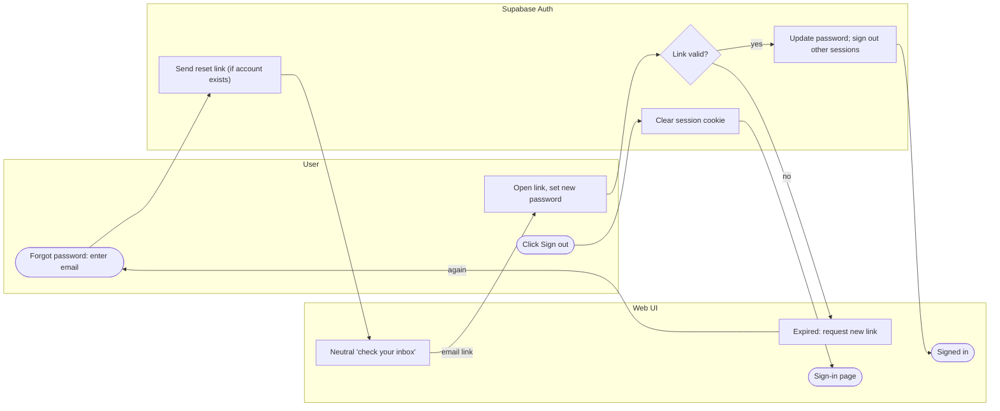

<!-- /swimlane:FLOW-002 -->
Notes: suspended users can sign in (read-only + banner, FR-025). Password change signs out other sessions (`scope: 'global'`).

| Path | Outcome |
|---|---|
| Success | Session cookie; protected routes accessible |
| Validation / invalid creds | Generic error; counter increments |
| Throttled | 429 with wait time (FR-001 AC5) |
| Reset for unknown email | Same neutral message (AC4) |
| Expired reset link | Offer new link |
| Sign-out | Cookie cleared server-side; back button shows UI-003 (no cached private pages: `Cache-Control: no-store`) |
| Unavailable | "Sign-in temporarily unavailable" |

---

## FLOW-003 — Tester identity & PayPal profile setup
| Field | Value |
|---|---|
| Trigger | Tester opens UI-006, or is sent there by IDENTITY_REQUIRED / PAYPAL_EMAIL_REQUIRED |
| Preconditions | Signed in; Tester role |
| Links | FR-003, FR-004, FR-026 · UI-006 · API-002, API-003 · DB-001, DB-003, DB-013 |

<!-- swimlane:FLOW-003 -->
**Tester identity & PayPal profile**

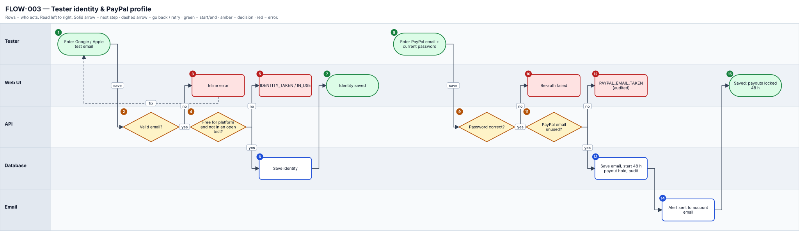

Text version (Mermaid, generated)

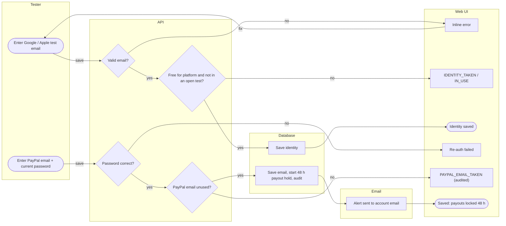

<!-- /swimlane:FLOW-003 -->
| Path | Outcome |
|---|---|
| Success | Identity/PayPal saved; PayPal change starts 48 h hold (A-019) |
| Validation | Bad email format → 422 |
| Duplicate | IDENTITY_TAKEN / PAYPAL_EMAIL_TAKEN |
| Forbidden | Non-tester calling identity API → 403 |
| Conflict | Identity used by open enrollment → IDENTITY_IN_USE |
| Recovery | Contact support link (mailto admin) for taken emails |

---

## FLOW-004 — Create campaign & pay
| Field | Value |
|---|---|
| Trigger | Developer clicks "New campaign" on UI-012 |
| Preconditions | Developer role, active account |
| Entry / exit | UI-013 → Stripe Checkout → UI-014 → UI-015 (status `pending_review`) |
| Links | FR-005, FR-006, FR-007, FR-033 · UI-012, UI-013, UI-014 · API-004, API-005, API-006 · DB-004, DB-005, DB-014, DB-015, DB-018 |

<!-- swimlane:FLOW-004 -->
**Create campaign & pay**

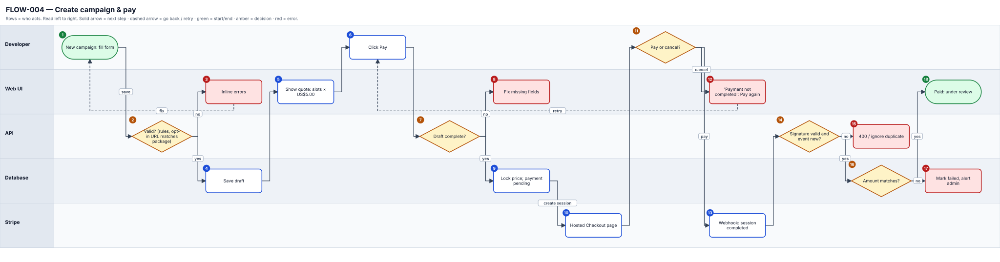

Text version (Mermaid, generated)

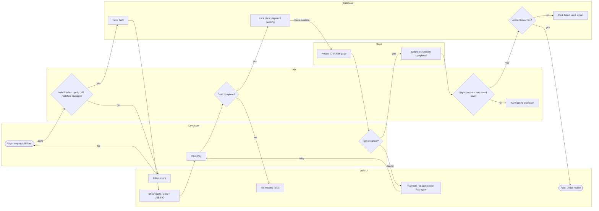

<!-- /swimlane:FLOW-004 -->
| # | Lane | Input | Output | Next |
|---|---|---|---|---|
| 1 | Developer | form fields | — | 2 |
| 2 | API | Zod + platform rules (FR-033) | DB-004 draft; `min_testers` snapshot | 3 |
| 3 | API | Pay | prices snapshotted (FR-006), DB-005 `pending`, campaign `pending_payment`, Stripe session URL | 4 |
| 4 | Stripe | card / wallet | session completed | 5 |
| 5 | API webhook | event | DB-014 row; `svc_mark_payment_paid` | 6 |
| 6 | UI-014 | `session_id` | polls `GET /dev/campaigns/:id` every 3 s up to 60 s | UI-015 |

| Path | Outcome / final state |
|---|---|
| Success | Campaign `pending_review`, payment `paid`, developer emailed |
| Cancel on Stripe | Campaign `pending_payment`; "Pay again" reuses unexpired session; after 24 h JOB-003 → `draft` |
| Validation | OPT_IN_URL_MISMATCH, slot/duration bounds, icon type/size |
| Duplicate webhook | No-op (unique event id) |
| Webhook before row exists | `svc_mark_payment_paid` raises NOT_FOUND → 500 → Stripe retries |
| Amount mismatch | Payment `failed`, campaign stays `pending_payment`, admin alerted |
| Async method fails | `async_payment_failed` → payment failed; developer emailed to retry |
| Unavailable | Stripe down → 502, retry later |
| Forbidden | Editing another developer's campaign → 404 (no existence leak) |

---

## FLOW-005 — Admin campaign review
| Field | Value |
|---|---|
| Trigger | Campaign enters `pending_review`; admin opens UI-019 |
| Preconditions | Admin role |
| Exit | `recruiting` (published) or `rejected` + full refund |
| Links | FR-008, FR-013 · UI-019 · API-016 · DB-004, DB-006, DB-013 |

<!-- swimlane:FLOW-005 -->
**Admin campaign review**

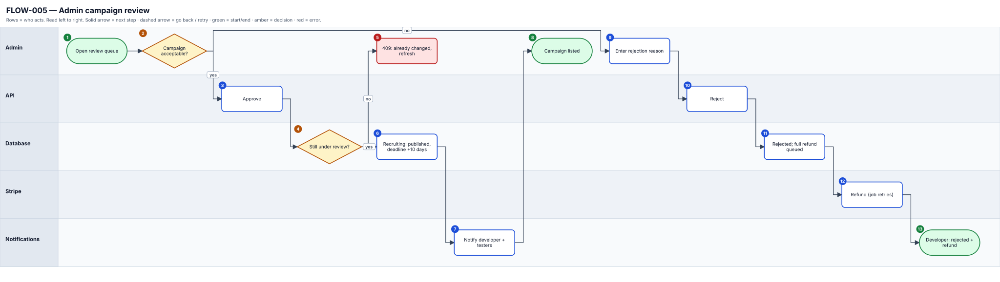

Text version (Mermaid, generated)

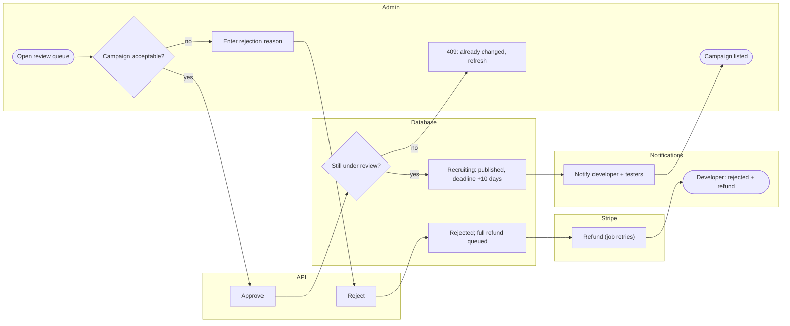

<!-- /swimlane:FLOW-005 -->
| Path | Outcome |
|---|---|
| Approve | Campaign listed (UI-007), testers notified |
| Reject | `rejected`, full refund; reason shown to developer |
| Missing reason | 422 REASON_REQUIRED |
| Concurrent developer cancel | One wins via row lock; loser gets 409 |
| Stripe refund failure | refund `failed`, retried by JOB-006; admin alert after 5 attempts |

---

## FLOW-006 — Browse & join campaign / withdraw before start
| Field | Value |
|---|---|
| Trigger | Tester opens UI-007 (or shared link to UI-008) |
| Preconditions | Listing public; joining requires Tester role, active, identity for platform |
| Exit | Enrollment `applied` (UI-009) or `withdrawn` |
| Links | FR-009, FR-015, FR-016, FR-019 · UI-007, UI-008, UI-009 · API-007, API-008 · DB-004, DB-007, v_campaign_listings |

<!-- swimlane:FLOW-006 -->
**Browse & join / withdraw before start**

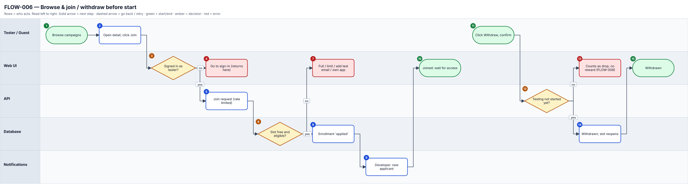

Text version (Mermaid, generated)

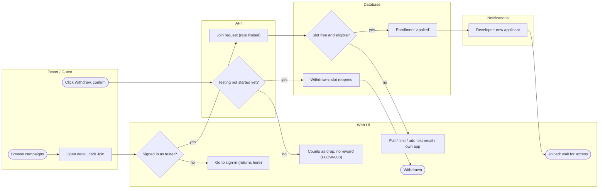

<!-- /swimlane:FLOW-006 -->
| Path | Outcome |
|---|---|
| Success | `applied`; slot reserved |
| Race for last slot | Exactly one succeeds (TEST-013) |
| Duplicate click | Second call → ALREADY_ENROLLED treated as success refresh |
| Guest | Redirect to sign-in, returns to UI-008 |
| Campaign not recruiting | 409 INVALID_STATE, detail shows status |
| Withdraw before start | `withdrawn`, no penalty |

---

## FLOW-007 — Grant access & start testing
| Field | Value |
|---|---|
| Trigger | Developer opens UI-015 for a `recruiting` campaign |
| Preconditions | Owner developer; campaign `recruiting` |
| Exit | Campaign `testing`; check-ins scheduled |
| Links | FR-010, FR-011, FR-018 · UI-015 · API-009, API-010 · DB-004, DB-007, DB-008, DB-013 |

<!-- swimlane:FLOW-007 -->
**Grant access & start testing**

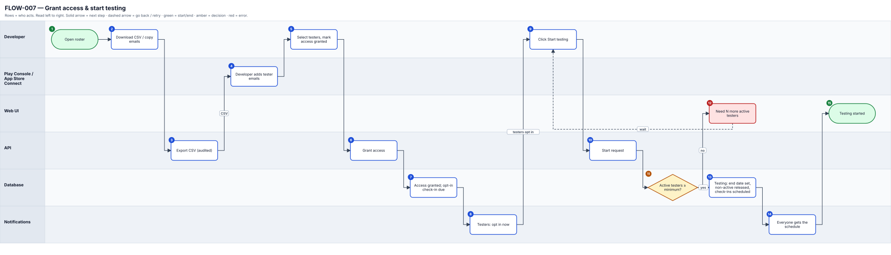

Text version (Mermaid, generated)

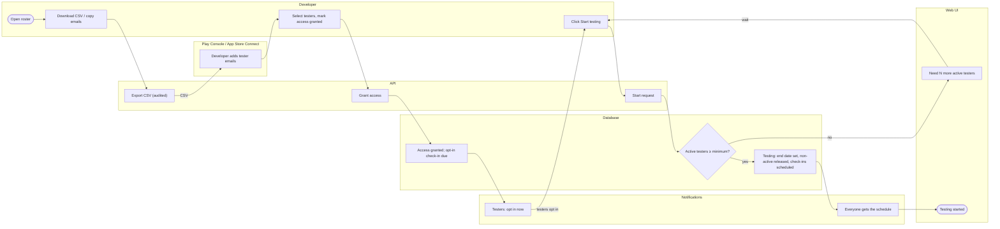

<!-- /swimlane:FLOW-007 -->
| Path | Outcome |
|---|---|
| Success | `testing`, `testing_ends_at = start + duration`, `review_ends_at = +3 d`; non-active testers released |
| Not enough active | 409 with `{active, required}`; developer waits or cancels (FLOW-013) |
| Developer never starts | Recruiting expiry (FLOW-013) |
| Forbidden | Other developer's campaign → 404 |
| Duplicate start | Second request 409; UI refreshes |

---

## FLOW-008 — Opt-in proof & periodic/final check-ins
| Field | Value |
|---|---|
| Trigger | Enrollment `access_granted` (opt-in) or a check-in window opens (reminder) |
| Preconditions | Tester owns enrollment |
| Exit | Enrollment `active` → `awaiting_verdict`, or `dropped` |
| Links | FR-017, FR-018, FR-019, FR-026 · UI-009, UI-010 · API-011, API-021 · DB-007, DB-008, DB-017 |

<!-- swimlane:FLOW-008 -->
**Opt-in proof & check-ins**

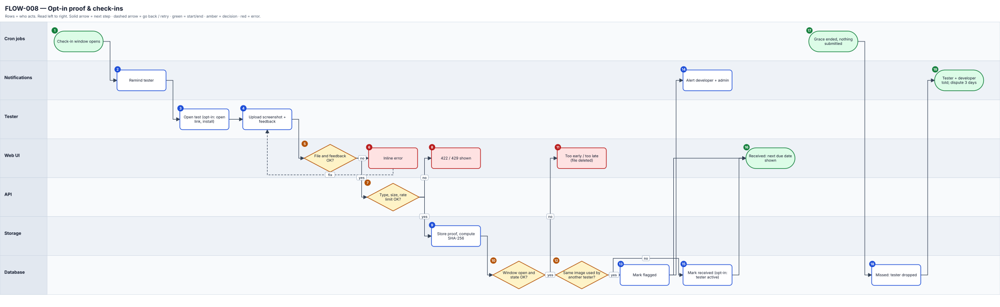

Text version (Mermaid, generated)

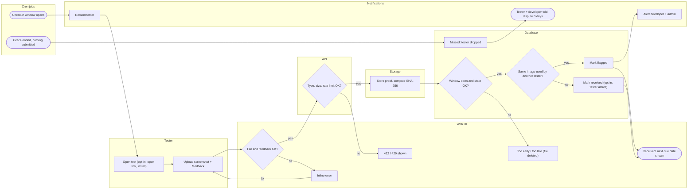

<!-- /swimlane:FLOW-008 -->
Schedule example (Android, 16 days, start Day 0): opt-in before start; periodic due Day 4, 8, 12 (open 24 h before, grace 48 h after); final due Day 16 (open 48 h before, grace 24 h).

| Path | Outcome |
|---|---|
| Success opt-in | Enrollment `active` |
| Success periodic/final | Check-in `submitted` (or `flagged`) |
| Too early / too late | 409 with open/close time |
| Invalid file | 422, nothing stored |
| Upload ok but RPC fails | Object deleted, error shown, retry possible |
| Duplicate submit | Second submit → 409 INVALID_STATE (already submitted), UI shows submitted |
| Missed grace | `missed` → enrollment `dropped`; tester may dispute within 3 days (FLOW-010) |
| Offline | Retry; window countdown shown so tester knows deadline |

---

## FLOW-009 — Developer verdicts & auto-pass
| Field | Value |
|---|---|
| Trigger | JOB-002 moves campaign to `developer_review` at `testing_ends_at` |
| Preconditions | Owner developer; enrollments `awaiting_verdict` |
| Exit | Each enrollment `passed` (reward credited) / `failed` / `dropped` |
| Links | FR-012, FR-021 · UI-016 · API-012, API-021 · DB-007, DB-008, DB-010 |

<!-- swimlane:FLOW-009 -->
**Developer verdicts & auto-pass**

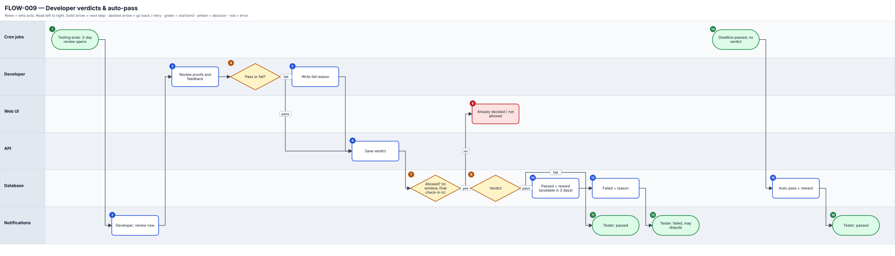

Text version (Mermaid, generated)

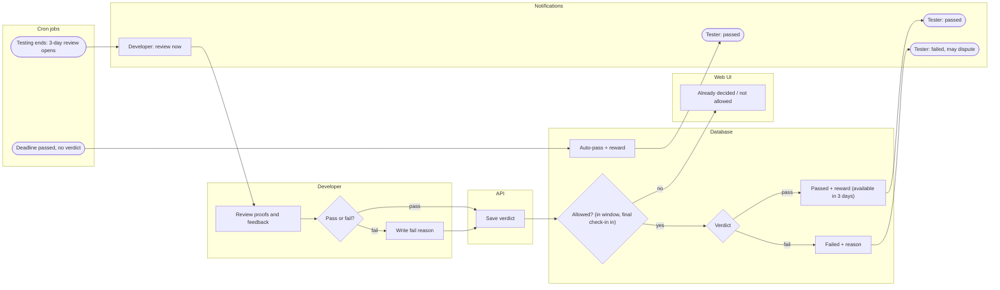

<!-- /swimlane:FLOW-009 -->
| Path | Outcome |
|---|---|
| Pass | Reward credited exactly once (TEST-022) |
| Fail | Requires reason; tester can dispute |
| No action | Auto-pass at deadline (FR-012 AC1) |
| Changing verdict | 409 VERDICT_FINAL |
| Forbidden | Non-owner → 404 |

---

## FLOW-010 — Dispute
| Field | Value |
|---|---|
| Trigger | Tester clicks "Dispute" on a failed or missed-check-in dropped enrollment |
| Preconditions | Within 3 days of `ended_at`; no existing dispute |
| Exit | Dispute `upheld` (enrollment `passed`) or `rejected` |
| Links | FR-024 · UI-010, UI-020 · API-013 · DB-009, DB-007, DB-010 |

<!-- swimlane:FLOW-010 -->
**Dispute**

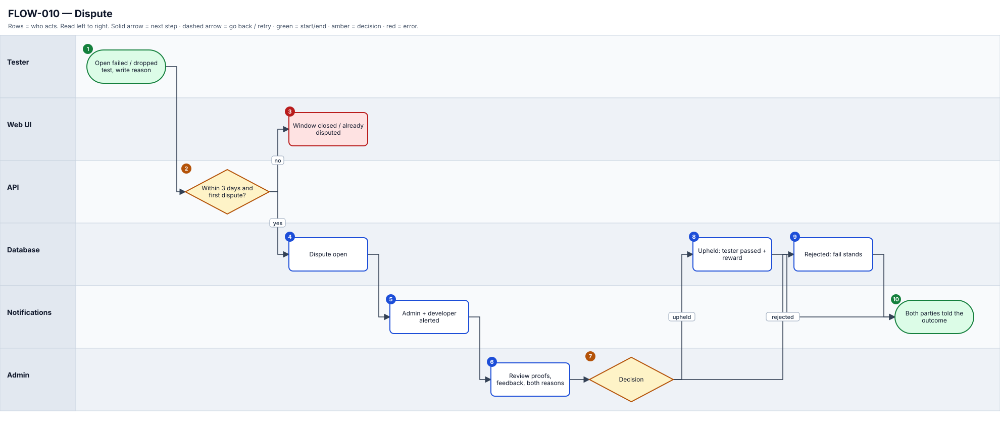

Text version (Mermaid, generated)

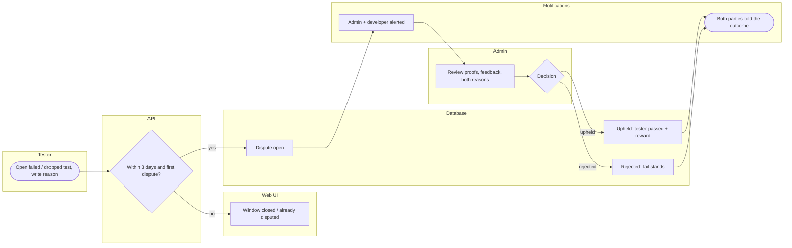

<!-- /swimlane:FLOW-010 -->
Settlement of the campaign waits until no dispute is `open` (FLOW-011).

---

## FLOW-011 — Settlement & refund
| Field | Value |
|---|---|
| Trigger | JOB-002: campaign `developer_review` with `now ≥ review_ends_at + 3 d` and no open disputes |
| Exit | Campaign `completed`; refund of unearned rewards |
| Links | FR-013 · UI-015 · API-021, API-006 · DB-004, DB-005, DB-006 |

<!-- swimlane:FLOW-011 -->
**Settlement & refund**

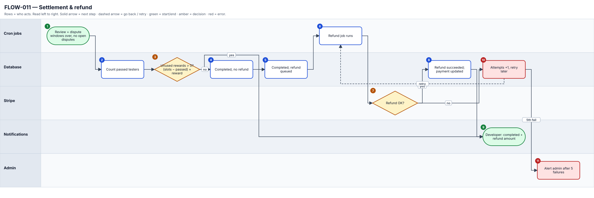

Text version (Mermaid, generated)

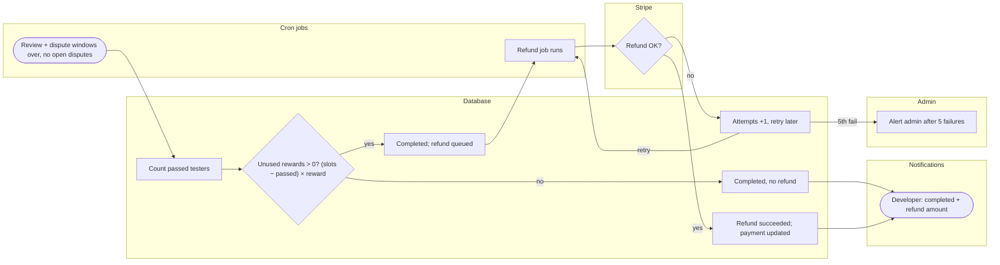

<!-- /swimlane:FLOW-011 -->
Example: 15 slots × US$3.50 reward; 13 passed → rewards US$45.50, refund 2 × 3.50 = US$7.00; platform keeps 15 × 1.50 = US$22.50 (A-011).

---

## FLOW-012 — Payout request & PayPal execution
| Field | Value |
|---|---|
| Trigger | Tester clicks "Withdraw to PayPal" on UI-011 |
| Preconditions | Available ≥ US$25.00, PayPal email set and not in hold, no open payout, active |
| Exit | Payout `paid`, or released back to balance (`rejected`/`cancelled`/`failed`/`returned`) |
| Links | FR-020…FR-023 · UI-011, UI-021 · API-014, API-015, API-017, API-018 · DB-010, DB-011, DB-014 |

<!-- swimlane:FLOW-012 -->
**Payout request & PayPal**

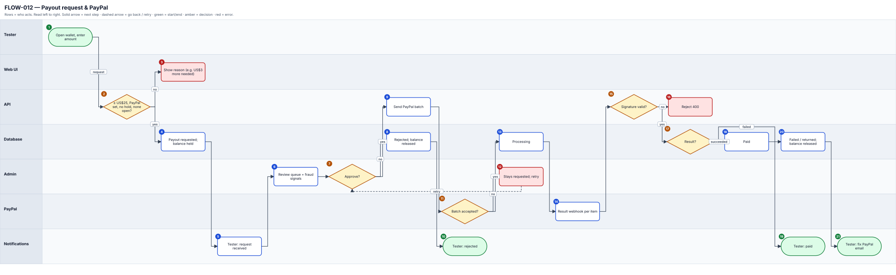

Text version (Mermaid, generated)

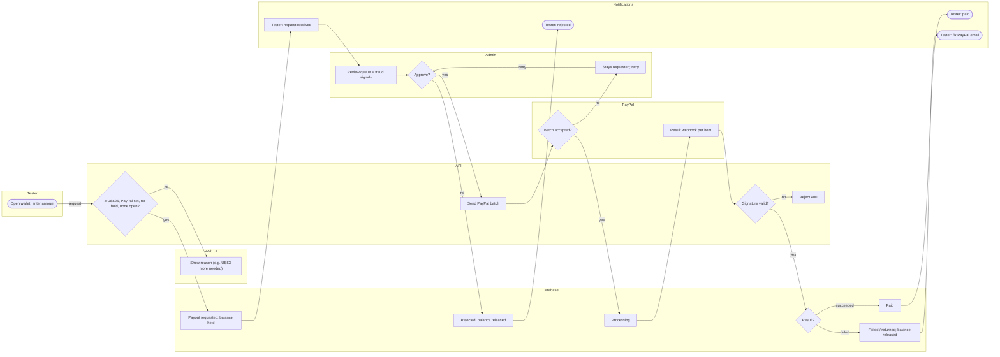

<!-- /swimlane:FLOW-012 -->
| Path | Outcome |
|---|---|
| Success | `paid`; ledger shows hold; balance reduced |
| Below minimum | 422 with remaining needed ("US$3.00 more to withdraw") |
| Double request | One open payout max (TEST-020) |
| PayPal down | Payouts stay `requested`; JOB-004 reconciles any ambiguous batch |
| Wrong PayPal email | Unclaimed → returned → released; tester prompted to fix email (48 h hold applies) |
| Suspension while open | Requested payout rejected + released (FLOW-014) |

---

## FLOW-013 — Campaign cancellation & recruiting expiry
| Field | Value |
|---|---|
| Trigger | Developer clicks Cancel (UI-012/UI-015) or JOB-002 detects `recruiting_ends_at` passed |
| Preconditions | Status ∈ draft, pending_payment, pending_review, recruiting |
| Exit | `cancelled`; full refund if paid; enrollments released |
| Links | FR-014, FR-013 · UI-012, UI-015 · API-024, API-021 · DB-004, DB-006, DB-007 |

<!-- swimlane:FLOW-013 -->
**Cancellation & recruiting expiry**

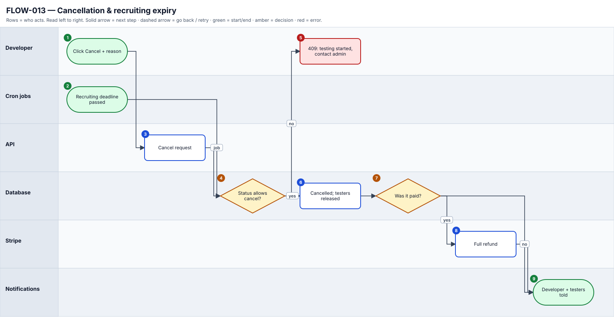

Text version (Mermaid, generated)

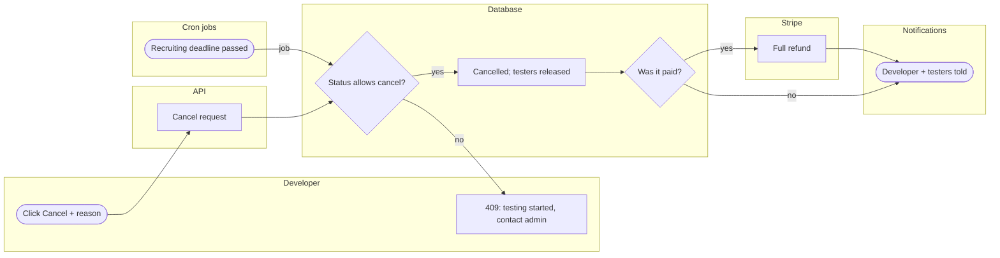

<!-- /swimlane:FLOW-013 -->

---

## FLOW-014 — Admin suspension
| Field | Value |
|---|---|
| Trigger | Admin decides to suspend user (fraud, policy) on UI-022 |
| Exit | User `suspended`; side effects applied; reinstatement restores status only |
| Links | FR-025 · UI-022 · API-019 · DB-001, DB-007, DB-011, DB-004, DB-013 |

<!-- swimlane:FLOW-014 -->
**Admin suspension**

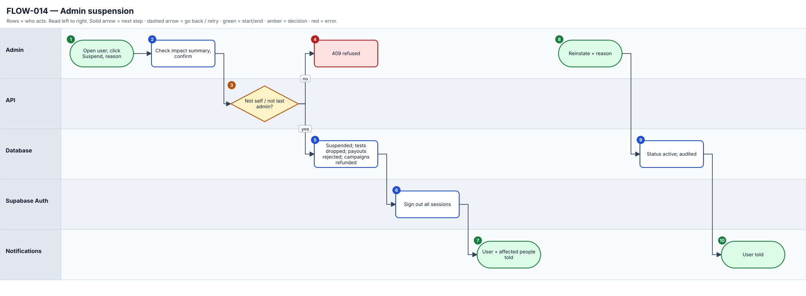

Text version (Mermaid, generated)

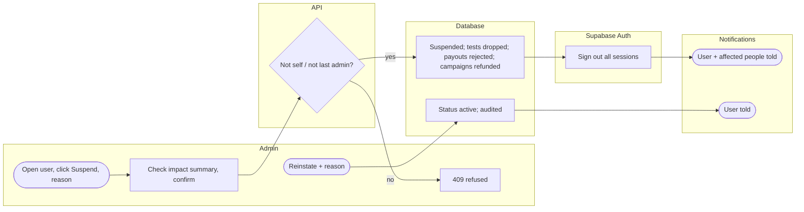

<!-- /swimlane:FLOW-014 -->
Processing payouts (`processing`) cannot be recalled; admin is shown them in the impact summary.

---

## FLOW-015 — Account deletion
| Field | Value |
|---|---|
| Trigger | User clicks "Delete account" in UI-006 |
| Preconditions | Signed in; password re-entry |
| Exit | Account anonymised and signed out, or blocked with reasons |
| Links | FR-031 · UI-006 · API-023 · DB-001, DB-003, DB-017 |

<!-- swimlane:FLOW-015 -->
**Account deletion**

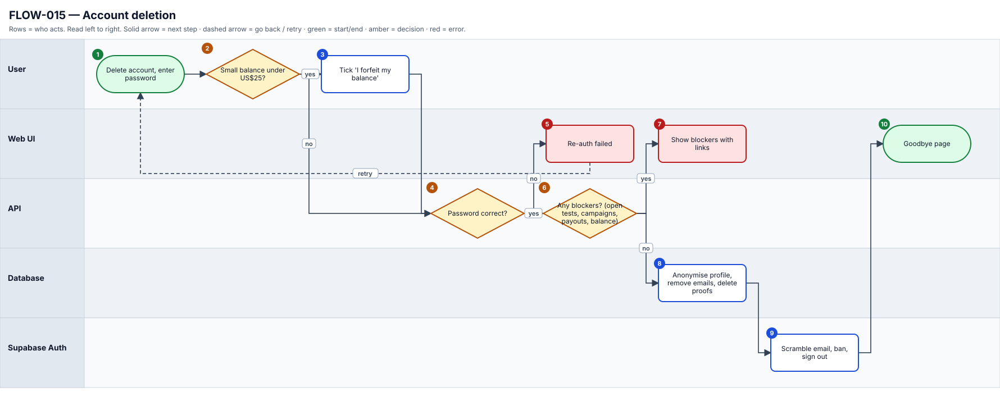

Text version (Mermaid, generated)

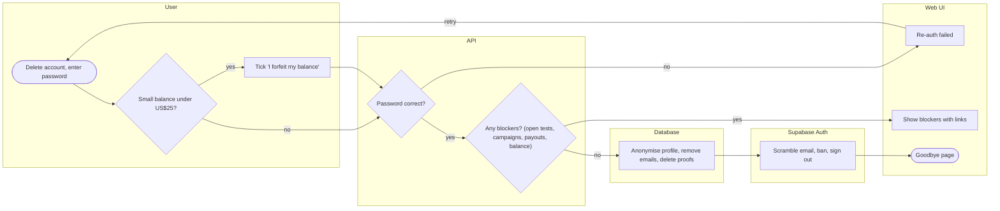

<!-- /swimlane:FLOW-015 -->

## 3. Screen navigation map
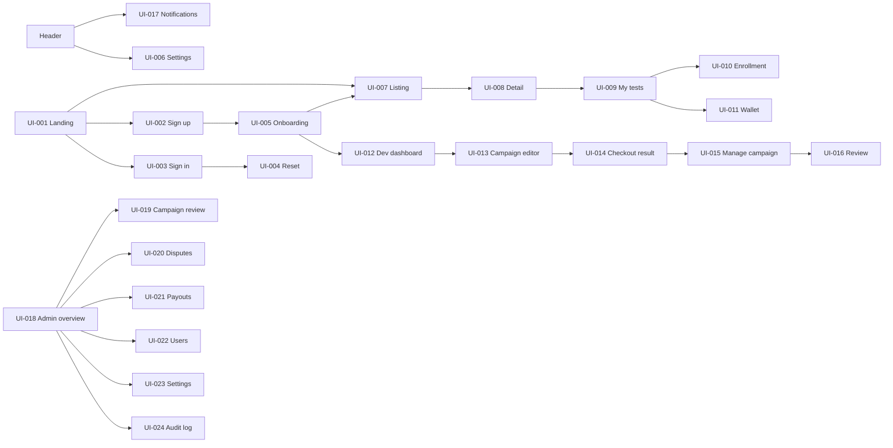
