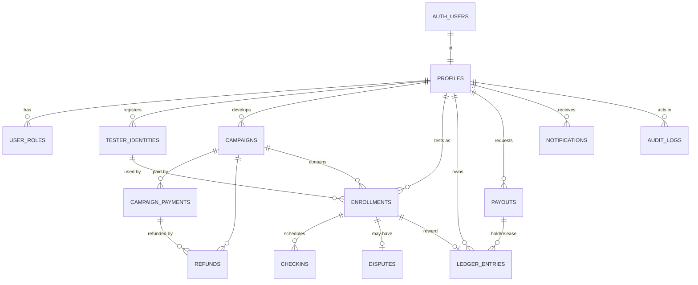
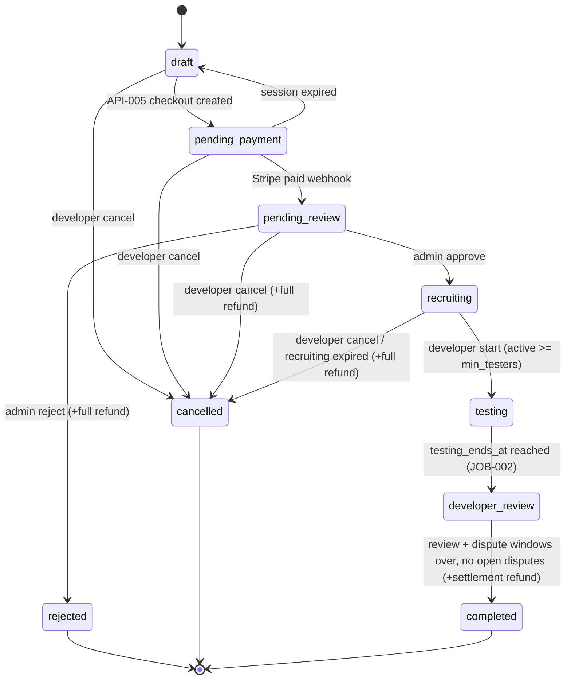
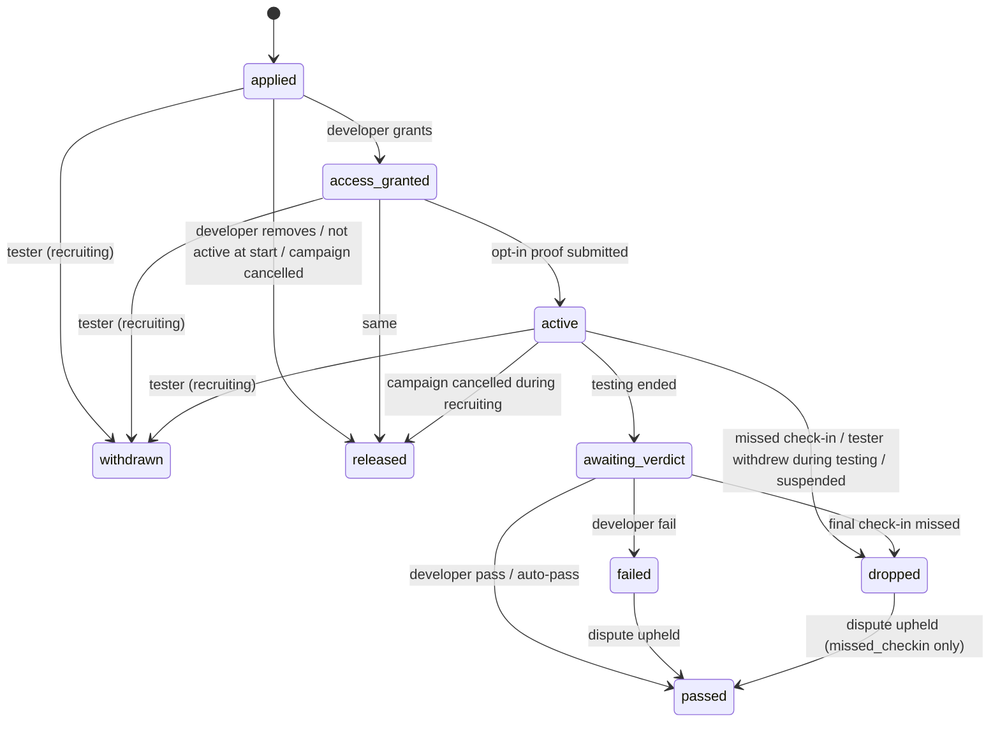

# DATABASE_SCHEMA — TestKo PH

## 0. Document control
| Field | Value |
|---|---|
| Document | `DATABASE_SCHEMA.md` (05) |
| Version | 0.2.0 · draft |
| Date | 2026-10-11 |
| Upstream | PRD 0.3.0, TRD 0.2.1, APP_FLOW 0.3.1 |
| Downstream | IMPLEMENTATION_PLAN 0.5.0 |
| Engine | PostgreSQL (Supabase Cloud, Singapore) — exact major version recorded at TASK-004 |

## 1. Storage choice
PostgreSQL via Supabase (ADR-002): relational integrity for money (FKs, CHECKs, partial unique indexes, row locks), Row Level Security for read isolation, managed Auth and Storage, and point-in-time recovery on paid plans. All monetary values are `integer` cents in USD (A-004); `integer` max ≈ US$21.4M per row is sufficient.

### 1.1 Access model (critical)
1. **Clients (anon/authenticated) can only `SELECT`**, and only rows allowed by RLS. No INSERT/UPDATE/DELETE grants exist for `anon`/`authenticated` on any table.
2. **All writes** go through Next.js route handlers (API-###) that authenticate, authorise, validate with Zod and then call `svc_*` PL/pgSQL functions or table writes using the **service-role** client. `svc_*` functions have `EXECUTE` revoked from `public`, `anon`, `authenticated`.
3. Money-state transitions happen **inside single `svc_*` functions** with row locks (`FOR UPDATE`) so invariants hold under concurrency.
4. `ledger_entries` and `audit_logs` are append-only (triggers reject UPDATE/DELETE).

### 1.2 Bounded contexts and PII classification
| Context | Tables | PII class |
|---|---|---|
| Identity | DB-001 profiles, DB-002 user_roles, DB-003 tester_identities | **Personal**: display name, PayPal email, store emails, country |
| Campaigns | DB-004 campaigns, DB-005 campaign_payments, DB-006 refunds | Business; Stripe IDs (non-sensitive references) |
| Testing | DB-007 enrollments, DB-008 checkins, DB-009 disputes, DB-017 proofs bucket | **Personal**: store email snapshot, screenshots (may show device/account info), feedback text |
| Money | DB-010 ledger_entries, DB-011 payouts | **Financial/Personal**: PayPal email snapshot, amounts |
| Ops | DB-012 notifications, DB-013 audit_logs, DB-014 webhook_events, DB-015 platform_settings, DB-016 rate_limits, DB-018 app-icons bucket | audit IP stored as salted hash only; webhook payloads may contain emails (restricted) |

Auth credentials live in Supabase `auth` schema (managed); never duplicated.

## 2. ERD


## 3. Model map
| ID | Object | Purpose | Main FRs | Main APIs | Main flows |
|---|---|---|---|---|---|
| DB-001 | `profiles` | User profile, status, PayPal email, terms | FR-001,002,004,025,031,032 | API-002,019,023 | FLOW-001,003,014,015 |
| DB-002 | `user_roles` | Tester/developer/admin roles | FR-002,025 | API-002,019 | FLOW-001,014 |
| DB-003 | `tester_identities` | Store emails per platform | FR-003,016,026 | API-003,008 | FLOW-003,006 |
| DB-004 | `campaigns` | Campaign definition + lifecycle | FR-005…014,033 | API-004,005,007,009,010,016,024 | FLOW-004,005,007,009,011,013 |
| DB-005 | `campaign_payments` | Stripe Checkout payments | FR-007,013 | API-005,006 | FLOW-004,011 |
| DB-006 | `refunds` | Stripe refunds | FR-008,013,014 | API-016,021,024 | FLOW-005,011,013 |
| DB-007 | `enrollments` | Tester participation | FR-010…012,016,017,019 | API-008,009,010,012 | FLOW-006…010 |
| DB-008 | `checkins` | Opt-in/periodic/final proofs | FR-017,018,026 | API-011,021 | FLOW-008 |
| DB-009 | `disputes` | Tester disputes | FR-024 | API-013 | FLOW-010 |
| DB-010 | `ledger_entries` | Append-only tester balance | FR-020…023 | API-014,015,017,018 | FLOW-009…012 |
| DB-011 | `payouts` | PayPal payouts | FR-022,023 | API-015,017,018 | FLOW-012 |
| DB-012 | `notifications` | In-app notifications | FR-027 | API-022 | all |
| DB-013 | `audit_logs` | Immutable audit trail | FR-030 | API-016…020 | all admin flows |
| DB-014 | `webhook_events` | Webhook idempotency/log | FR-007,023 | API-006,018 | FLOW-004,012 |
| DB-015 | `platform_settings` | Pricing & timing config | FR-006,029,033 | API-020 | FLOW-004 |
| DB-016 | `rate_limits` | Fixed-window counters | NFR-011, FR-026 | all mutating APIs | — |
| DB-017 | Storage bucket `proofs` (private) | Check-in screenshots | FR-017,018 | API-011 | FLOW-008 |
| DB-018 | Storage bucket `app-icons` (public read) | Campaign icons | FR-005 | API-004 | FLOW-004 |
| — | View `v_campaign_listings` | Public safe listing | FR-009,015 | API-007 | FLOW-006 |
| — | View `wallet_balances` | Available/pending balance | FR-020,022 | API-014,015 | FLOW-012 |

## 4. Enumerations
| Type | Values | Notes |
|---|---|---|
| `app_role` | tester, developer, admin | |
| `user_status` | active, suspended, deleted | |
| `store_platform` | android, ios | |
| `campaign_status` | draft, pending_payment, pending_review, rejected, recruiting, testing, developer_review, completed, cancelled | state machine §6.1 |
| `enrollment_status` | applied, access_granted, active, awaiting_verdict, passed, failed, dropped, withdrawn, released | §6.2 |
| `enrollment_end_reason` (text CHECK) | missed_checkin, tester_withdrew, suspended, not_active_at_start, developer_removed, campaign_cancelled | |
| `checkin_kind` | opt_in, periodic, final | |
| `checkin_status` | due, submitted, flagged, missed, cancelled | |
| `dispute_status` | open, upheld, rejected | |
| `payment_status` | pending, paid, failed, expired, refunded, partially_refunded | |
| `refund_reason` | admin_rejected, developer_cancelled, recruiting_expired, settlement_unearned, admin_cancelled | |
| `refund_status` | pending, succeeded, failed | |
| `ledger_entry_type` | reward, payout_hold, payout_release, adjustment | |
| `payout_status` | requested, processing, paid, unclaimed, returned, failed, rejected, cancelled | §6.3 |
| `webhook_provider` | stripe, paypal | |
| `webhook_status` | received, processed, failed, ignored | |

## 5. Tables (summary; authoritative definitions are the DDL in §9)

### DB-001 `profiles`
| Column | Type | Null | Default | Constraints / notes |
|---|---|---|---|---|
| id | uuid | no | — | PK, FK → auth.users(id) ON DELETE RESTRICT |
| display_name | text | no | — | 2–50 chars |
| country_code | char(2) | no | 'PH' | `^[A-Z]{2}$` |
| status | user_status | no | 'active' | |
| status_reason | text | yes | | required when suspended (app rule) |
| paypal_email | citext | yes | | unique where not null and deleted_at null |
| paypal_email_updated_at | timestamptz | yes | | 48 h hold (A-019) |
| terms_version | text | yes | | FR-032 |
| terms_accepted_at | timestamptz | yes | | |
| age_confirmed_at | timestamptz | yes | | 18+ attestation |
| notify_new_campaigns | boolean | no | true | |
| onboarded_at | timestamptz | yes | | set when ≥1 role chosen |
| created_at / updated_at | timestamptz | no | now() | trigger updates `updated_at` |
| deleted_at | timestamptz | yes | | anonymised deletion |

### DB-002 `user_roles`
PK (user_id, role); `granted_by uuid` FK profiles null (self-service roles), `granted_at timestamptz default now()`.

### DB-003 `tester_identities`
`id uuid PK`, `user_id` FK profiles, `platform store_platform`, `store_email citext` (email regex, ≤254), timestamps, `deleted_at`. Unique (user_id, platform) and (platform, store_email) where `deleted_at is null`.

### DB-004 `campaigns`
| Column | Type | Null | Default | Notes |
|---|---|---|---|---|
| id | uuid | no | gen_random_uuid() | PK |
| developer_id | uuid | no | | FK profiles |
| platform | store_platform | no | | immutable after draft |
| app_name | text | no | | 2–60 |
| package_name | text | no | | reverse-DNS regex |
| short_description | text | no | | ≤140 |
| description | text | no | '' | ≤4000 |
| icon_path | text | yes | | key in `app-icons` |
| opt_in_url | text | yes | | required for android before checkout; https only |
| testing_instructions | text | no | '' | ≤4000 |
| tester_slots | integer | no | | min_testers..100 |
| min_testers | integer | no | | snapshot from settings at create |
| duration_days | integer | no | | 7–30; android ≥ 14 |
| price_per_slot_cents | integer | yes | | snapshot at checkout |
| tester_reward_cents | integer | yes | | snapshot; < price |
| total_amount_cents | integer | yes | | = slots × price |
| currency | char(3) | no | 'USD' | CHECK = 'USD' |
| status | campaign_status | no | 'draft' | |
| rejection_reason / cancel_reason | text | yes | | |
| reviewed_by | uuid | yes | | FK profiles (admin) |
| submitted_at, published_at, recruiting_ends_at, testing_started_at, testing_ends_at, review_ends_at, completed_at, cancelled_at | timestamptz | yes | | lifecycle |
| created_at / updated_at / deleted_at | timestamptz | | | |
Indexes: (status, published_at desc) for listing; (developer_id, created_at desc); partial (status, recruiting_ends_at) where status='recruiting'; partial (status, testing_ends_at) where status='testing'; partial (status, review_ends_at) where status='developer_review'.

### DB-005 `campaign_payments`
`id`, `campaign_id` FK, `stripe_checkout_session_id text unique not null`, `stripe_payment_intent_id text unique null`, `amount_cents int >0`, `currency`, `status payment_status default 'pending'`, `refunded_cents int default 0 check (0 ≤ refunded ≤ amount)`, `paid_at`, `expires_at`, timestamps. Partial unique: one `paid` payment per campaign.

### DB-006 `refunds`
`id`, `campaign_id`, `payment_id` FK, `amount_cents >0`, `reason refund_reason`, `status refund_status default 'pending'`, `stripe_refund_id unique null`, `attempts smallint default 0`, `last_error text`, timestamps. Unique (payment_id, reason) — idempotency.

### DB-007 `enrollments`
| Column | Type | Null | Default | Notes |
|---|---|---|---|---|
| id | uuid | no | gen_random_uuid() | PK |
| campaign_id | uuid | no | | FK campaigns |
| tester_id | uuid | no | | FK profiles |
| tester_identity_id | uuid | no | | FK tester_identities |
| store_email | citext | no | | snapshot (developer sees this) |
| reward_cents | integer | no | | snapshot of campaign reward |
| status | enrollment_status | no | 'applied' | |
| applied_at | timestamptz | no | now() | |
| access_granted_at, activated_at, ended_at | timestamptz | yes | | |
| end_reason | text | yes | | CHECK list §4 |
| verdict | text | yes | | 'pass' / 'fail' |
| verdict_reason | text | yes | | required for fail, 20–500 |
| verdict_by | uuid | yes | | FK profiles |
| verdict_at | timestamptz | yes | | |
| auto_passed | boolean | no | false | |
| created_at / updated_at | timestamptz | no | now() | |
Unique (campaign_id, tester_id), (campaign_id, store_email). Index (tester_id, status), (campaign_id, status).

### DB-008 `checkins`
`id`, `enrollment_id` FK, `kind`, `seq smallint` (0 = opt_in, 1..n periodic, n+1 final), `opens_at`, `due_at`, `grace_ends_at`, `status default 'due'`, `submitted_at`, `proof_path`, `proof_sha256 char(64)`, `feedback text` (20–1000 when kind ≠ opt_in and submitted), `flag_reason`, `flagged_by`, timestamps. Unique (enrollment_id, seq). Indexes: partial (grace_ends_at) where status='due'; (proof_sha256) where not null.

### DB-009 `disputes`
`id`, `enrollment_id unique`, `opened_by` FK, `reason` 20–1000, `status default 'open'`, `resolution_note`, `resolved_by`, `resolved_at`, timestamps. Partial index (status) where status='open'.

### DB-010 `ledger_entries` (append-only)
`id bigint identity PK`, `user_id`, `entry_type`, `amount_cents int ≠ 0`, `available_at default now()`, `enrollment_id`, `payout_id`, `note`, `created_by`, `created_at`. Sign/shape CHECK per type; unique reward per enrollment; unique (payout_id, entry_type). Index (user_id, created_at desc).

### DB-011 `payouts`
`id`, `user_id`, `amount_cents ≥ 2500 (CHECK ≥ 100; business minimum enforced from settings)`, `currency 'USD'`, `paypal_email citext` snapshot, `status default 'requested'`, `requested_at`, `reviewed_by`, `reviewed_at`, `rejection_reason`, `paypal_sender_batch_id`, `paypal_batch_id`, `paypal_item_id unique null`, `paypal_transaction_status`, `failure_reason`, `paid_at`, timestamps. Partial unique (user_id) where status in ('requested','processing','unclaimed').

### DB-012 `notifications`
`id`, `user_id`, `type text`, `title ≤120`, `body ≤500`, `link_path` (must start with '/'), `read_at`, `emailed_at`, `created_at`. Index (user_id, created_at desc), partial (user_id) where read_at is null.

### DB-013 `audit_logs` (append-only)
`id bigint identity`, `actor_id null` (null = system/job), `actor_role text`, `action text` (PRD §8.2), `entity_type`, `entity_id text`, `metadata jsonb default '{}'`, `ip_hash text`, `created_at`. Indexes (entity_type, entity_id), (actor_id, created_at desc), (action, created_at desc).

### DB-014 `webhook_events`
`id`, `provider`, `event_id`, `event_type`, `payload jsonb`, `status default 'received'`, `error`, `received_at`, `processed_at`. Unique (provider, event_id).

### DB-015 `platform_settings`
`key text PK`, `value jsonb`, `description text`, `updated_by`, `updated_at`. Seeded keys in §10.

### DB-016 `rate_limits`
PK (`bucket_key text`, `window_start timestamptz`), `hits int`. Purged by JOB-005 after 1 day.

### DB-017 / DB-018 Storage
| Bucket | Public | Path | Allowed types | Max | Access |
|---|---|---|---|---|---|
| `proofs` | no | `{campaign_id}/{enrollment_id}/{checkin_id}.{ext}` | image/png, image/jpeg, image/webp | 5 MB | server-only upload (service role); read via signed URL (120 s) issued after authz (tester owner, campaign developer, admin) |
| `app-icons` | yes (read) | `{campaign_id}/{uuid}.{ext}` | png, jpeg, webp | 1 MB | server-only upload |

## 6. State machines and lifecycle rules
### 6.1 Campaign

### 6.2 Enrollment

### 6.3 Payout
`requested → processing → paid | unclaimed → returned | failed`; `requested → rejected | cancelled`; `processing → failed | returned`. Every transition into `rejected|cancelled|failed|returned` inserts exactly one `payout_release` ledger credit.

### 6.4 Lifecycle, retention, soft delete
| Data | Policy |
|---|---|
| profiles | soft delete + anonymise (FR-031): display_name → 'Deleted user', paypal_email → null, identities soft-deleted, proofs deleted, auth email scrambled + banned |
| campaigns | soft delete only for `draft`; others retained |
| proofs | deleted 90 days after campaign `completed_at`/`cancelled_at` (JOB-005); `proof_path` set to null, `proof_sha256` kept for fraud |
| notifications | deleted after 180 days |
| rate_limits | deleted after 1 day |
| webhook_events | payload redacted after 90 days, row kept 5 years |
| ledger, payouts, payments, refunds, audit_logs | retained ≥ 5 years (OD-004) |

### 6.5 Concurrency and transactions
| Operation | Lock | Guard |
|---|---|---|
| Enrol | `campaigns` row FOR UPDATE + tester `profiles` row FOR UPDATE | status, slot count, open-enrollment count |
| Start testing | `campaigns` FOR UPDATE | status = recruiting, active count |
| Verdict / auto-pass / dispute upheld | `enrollments` FOR UPDATE | status guard; reward unique index |
| Payout request | `profiles` FOR UPDATE | open-payout partial unique + balance recomputed under lock |
| Payment paid | `campaign_payments` FOR UPDATE | already-paid short-circuit, amount check |
| Settlement / cancel | `campaigns` FOR UPDATE | status guard; refund unique (payment_id, reason) |
| Webhooks | insert into `webhook_events` ON CONFLICT DO NOTHING | duplicate → 200 without reprocessing |

### 6.6 Query and index rationale
| Query | Index |
|---|---|
| Listing recruiting campaigns newest first | `campaigns_status_published_idx (status, published_at desc)` |
| Slots remaining | `enrollments_campaign_status_idx (campaign_id, status)` |
| "My tests" | `enrollments_tester_status_idx (tester_id, status)` |
| Missed check-in sweep | `checkins_due_grace_idx (grace_ends_at) where status='due'` |
| Duplicate proof lookup | `checkins_sha_idx (proof_sha256)` |
| Wallet balance | `ledger_user_created_idx (user_id, created_at desc)` (sum per user; ≤ few hundred rows/user) |
| Payout queue | `payouts_status_requested_idx (status, requested_at)` |
| Job sweeps on campaign deadlines | partial indexes per status (§5 DB-004) |

## 7. Row-level security
| Table | SELECT policy (authenticated) | anon |
|---|---|---|
| profiles | `id = auth.uid()` or `is_admin()` | none |
| user_roles | `user_id = auth.uid()` or admin | none |
| tester_identities | own (not deleted) or admin | none |
| campaigns | `developer_id = auth.uid()` or `is_enrolled(id)` or admin | none (use view) |
| campaign_payments, refunds | `owns_campaign(campaign_id)` or admin | none |
| enrollments | `tester_id = auth.uid()` or `owns_campaign(campaign_id)` or admin | none |
| checkins | `can_view_enrollment(enrollment_id)` | none |
| disputes | `can_view_enrollment(enrollment_id)` | none |
| ledger_entries, payouts | own or admin | none |
| notifications | own | none |
| audit_logs, platform_settings | admin | none |
| webhook_events, rate_limits | none (service role only) | none |
| `v_campaign_listings` (view, definer) | granted | granted |

No INSERT/UPDATE/DELETE policies exist → denied for clients. Helper functions are `SECURITY DEFINER` with `search_path=''` to avoid policy recursion between `campaigns` and `enrollments`.

**Isolation tests (pgTAP, TASK-005):** tester A cannot read tester B's enrollments/ledger/payouts/identities; developer X cannot read developer Y's roster or proofs; tester cannot read `campaigns.opt_in_url` of campaigns where not enrolled; anon can read only `v_campaign_listings`; authenticated cannot execute any `svc_*` function; INSERT/UPDATE/DELETE by authenticated on every table fails.

## 8. Migration sequence
| # | File | Content | Reversible? |
|---|---|---|---|
| 0001 | `supabase/migrations/20261011000001_extensions_types.sql` | extensions, enums, default-privilege revokes, `set_updated_at`, `forbid_mutation` | yes (drop) |
| 0002 | `…000002_identity.sql` | profiles, user_roles, tester_identities, platform_settings, new-user trigger | yes |
| 0003 | `…000003_campaigns.sql` | campaigns, campaign_payments, refunds | yes |
| 0004 | `…000004_testing.sql` | enrollments, checkins, disputes | yes |
| 0005 | `…000005_money.sql` | payouts, ledger_entries, wallet_balances | yes before production data |
| 0006 | `…000006_ops.sql` | notifications, audit_logs, webhook_events, rate_limits | yes |
| 0007 | `…000007_rls.sql` | helper functions, RLS enable, policies, listing view, grants | yes |
| 0008 | `…000008_service_functions.sql` | `svc_*` functions | yes (replace) |
| 0009 | `…000009_storage.sql` | buckets | yes |
| seed | `supabase/seed.sql` | platform_settings defaults; local-only demo users | n/a |

Rules: after first production deploy, migrations are **forward-only and additive** (expand → backfill → contract across releases); never drop/rename a column used by the deployed app in the same release; every migration runs on a staging branch with production-like data first; take an on-demand backup before applying to production.

## 9. Executable DDL

### 9.1 `0001_extensions_types.sql`
```sql
create extension if not exists citext with schema extensions;

-- Functions must not be callable by clients unless explicitly granted.
alter default privileges in schema public revoke execute on functions from public;
alter default privileges in schema public revoke execute on functions from anon, authenticated;

create type public.app_role as enum ('tester','developer','admin');
create type public.user_status as enum ('active','suspended','deleted');
create type public.store_platform as enum ('android','ios');
create type public.campaign_status as enum ('draft','pending_payment','pending_review','rejected','recruiting','testing','developer_review','completed','cancelled');
create type public.enrollment_status as enum ('applied','access_granted','active','awaiting_verdict','passed','failed','dropped','withdrawn','released');
create type public.checkin_kind as enum ('opt_in','periodic','final');
create type public.checkin_status as enum ('due','submitted','flagged','missed','cancelled');
create type public.dispute_status as enum ('open','upheld','rejected');
create type public.payment_status as enum ('pending','paid','failed','expired','refunded','partially_refunded');
create type public.refund_reason as enum ('admin_rejected','developer_cancelled','recruiting_expired','settlement_unearned','admin_cancelled');
create type public.refund_status as enum ('pending','succeeded','failed');
create type public.ledger_entry_type as enum ('reward','payout_hold','payout_release','adjustment');
create type public.payout_status as enum ('requested','processing','paid','unclaimed','returned','failed','rejected','cancelled');
create type public.webhook_provider as enum ('stripe','paypal');
create type public.webhook_status as enum ('received','processed','failed','ignored');

create function public.set_updated_at() returns trigger
language plpgsql set search_path = '' as $$
begin new.updated_at := now(); return new; end $$;

create function public.forbid_mutation() returns trigger
language plpgsql set search_path = '' as $$
begin raise exception 'APPEND_ONLY: % is immutable', tg_table_name; end $$;
```

### 9.2 `0002_identity.sql`
```sql
create table public.profiles (
  id uuid primary key references auth.users(id) on delete restrict,
  display_name text not null check (char_length(display_name) between 2 and 50),
  country_code char(2) not null default 'PH' check (country_code ~ '^[A-Z]{2}$'),
  status public.user_status not null default 'active',
  status_reason text,
  paypal_email extensions.citext check (paypal_email is null or (paypal_email ~ '^[^@\s]+@[^@\s]+\.[^@\s]+$' and char_length(paypal_email) <= 254)),
  paypal_email_updated_at timestamptz,
  terms_version text,
  terms_accepted_at timestamptz,
  age_confirmed_at timestamptz,
  notify_new_campaigns boolean not null default true,
  onboarded_at timestamptz,
  created_at timestamptz not null default now(),
  updated_at timestamptz not null default now(),
  deleted_at timestamptz
);
create unique index profiles_paypal_email_uq on public.profiles (paypal_email)
  where paypal_email is not null and deleted_at is null;
create trigger profiles_updated_at before update on public.profiles
  for each row execute function public.set_updated_at();

create table public.user_roles (
  user_id uuid not null references public.profiles(id) on delete restrict,
  role public.app_role not null,
  granted_by uuid references public.profiles(id),
  granted_at timestamptz not null default now(),
  primary key (user_id, role)
);

create table public.tester_identities (
  id uuid primary key default gen_random_uuid(),
  user_id uuid not null references public.profiles(id) on delete restrict,
  platform public.store_platform not null,
  store_email extensions.citext not null
    check (store_email ~ '^[^@\s]+@[^@\s]+\.[^@\s]+$' and char_length(store_email) <= 254),
  created_at timestamptz not null default now(),
  updated_at timestamptz not null default now(),
  deleted_at timestamptz
);
create unique index tester_identities_user_platform_uq on public.tester_identities (user_id, platform) where deleted_at is null;
create unique index tester_identities_platform_email_uq on public.tester_identities (platform, store_email) where deleted_at is null;
create trigger tester_identities_updated_at before update on public.tester_identities
  for each row execute function public.set_updated_at();

create table public.platform_settings (
  key text primary key check (key ~ '^[a-z_]+\.[a-z_]+$'),
  value jsonb not null,
  description text not null default '',
  updated_by uuid references public.profiles(id),
  updated_at timestamptz not null default now()
);

create function public.get_setting_int(p_key text) returns integer
language sql stable security definer set search_path = '' as $$
  select (value #>> '{}')::integer from public.platform_settings where key = p_key
$$;

-- Profile row for each new auth user (display_name comes from sign-up metadata).
create function public.handle_new_user() returns trigger
language plpgsql security definer set search_path = '' as $$
begin
  insert into public.profiles (id, display_name, terms_version, terms_accepted_at, age_confirmed_at)
  values (
    new.id,
    coalesce(nullif(trim(new.raw_user_meta_data->>'display_name'), ''), 'New user'),
    new.raw_user_meta_data->>'terms_version',
    case when new.raw_user_meta_data ? 'terms_version' then now() end,
    case when (new.raw_user_meta_data->>'age_confirmed')::boolean then now() end
  );
  return new;
end $$;
create trigger on_auth_user_created after insert on auth.users
  for each row execute function public.handle_new_user();
```

### 9.3 `0003_campaigns.sql`
```sql
create table public.campaigns (
  id uuid primary key default gen_random_uuid(),
  developer_id uuid not null references public.profiles(id) on delete restrict,
  platform public.store_platform not null,
  app_name text not null check (char_length(app_name) between 2 and 60),
  package_name text not null check (package_name ~ '^[A-Za-z][A-Za-z0-9_-]*(\.[A-Za-z0-9_-]+)+$' and char_length(package_name) <= 150),
  short_description text not null check (char_length(short_description) between 10 and 140),
  description text not null default '' check (char_length(description) <= 4000),
  icon_path text,
  opt_in_url text check (opt_in_url is null or (opt_in_url ~ '^https://' and char_length(opt_in_url) <= 500)),
  testing_instructions text not null default '' check (char_length(testing_instructions) <= 4000),
  tester_slots integer not null,
  min_testers integer not null check (min_testers >= 1),
  duration_days integer not null check (duration_days between 7 and 30),
  price_per_slot_cents integer check (price_per_slot_cents > 0),
  tester_reward_cents integer check (tester_reward_cents > 0),
  total_amount_cents integer check (total_amount_cents > 0),
  currency char(3) not null default 'USD' check (currency = 'USD'),
  status public.campaign_status not null default 'draft',
  rejection_reason text,
  cancel_reason text,
  reviewed_by uuid references public.profiles(id),
  submitted_at timestamptz,
  published_at timestamptz,
  recruiting_ends_at timestamptz,
  testing_started_at timestamptz,
  testing_ends_at timestamptz,
  review_ends_at timestamptz,
  completed_at timestamptz,
  cancelled_at timestamptz,
  created_at timestamptz not null default now(),
  updated_at timestamptz not null default now(),
  deleted_at timestamptz,
  constraint campaigns_slots_ck check (tester_slots between min_testers and 100),
  constraint campaigns_android_duration_ck check (platform <> 'android' or duration_days >= 14),
  constraint campaigns_reward_lt_price_ck check (tester_reward_cents is null or tester_reward_cents < price_per_slot_cents),
  constraint campaigns_total_ck check (total_amount_cents is null or total_amount_cents = tester_slots * price_per_slot_cents),
  constraint campaigns_priced_after_draft_ck check (status = 'draft' or total_amount_cents is not null),
  constraint campaigns_android_optin_ck check (status = 'draft' or platform <> 'android' or opt_in_url is not null)
);
create index campaigns_status_published_idx on public.campaigns (status, published_at desc) where deleted_at is null;
create index campaigns_developer_idx on public.campaigns (developer_id, created_at desc);
create index campaigns_recruiting_due_idx on public.campaigns (recruiting_ends_at) where status = 'recruiting';
create index campaigns_testing_due_idx on public.campaigns (testing_ends_at) where status = 'testing';
create index campaigns_review_due_idx on public.campaigns (review_ends_at) where status = 'developer_review';
create trigger campaigns_updated_at before update on public.campaigns
  for each row execute function public.set_updated_at();

create table public.campaign_payments (
  id uuid primary key default gen_random_uuid(),
  campaign_id uuid not null references public.campaigns(id) on delete restrict,
  stripe_checkout_session_id text not null unique,
  stripe_payment_intent_id text unique,
  amount_cents integer not null check (amount_cents > 0),
  currency char(3) not null default 'USD' check (currency = 'USD'),
  status public.payment_status not null default 'pending',
  refunded_cents integer not null default 0,
  paid_at timestamptz,
  expires_at timestamptz not null,
  created_at timestamptz not null default now(),
  updated_at timestamptz not null default now(),
  constraint payments_refund_ck check (refunded_cents between 0 and amount_cents)
);
create unique index campaign_payments_one_paid_uq on public.campaign_payments (campaign_id)
  where status in ('paid','partially_refunded','refunded');
create index campaign_payments_pending_idx on public.campaign_payments (expires_at) where status = 'pending';
create trigger campaign_payments_updated_at before update on public.campaign_payments
  for each row execute function public.set_updated_at();

create table public.refunds (
  id uuid primary key default gen_random_uuid(),
  campaign_id uuid not null references public.campaigns(id) on delete restrict,
  payment_id uuid not null references public.campaign_payments(id) on delete restrict,
  amount_cents integer not null check (amount_cents > 0),
  reason public.refund_reason not null,
  status public.refund_status not null default 'pending',
  stripe_refund_id text unique,
  attempts smallint not null default 0,
  last_error text,
  created_at timestamptz not null default now(),
  updated_at timestamptz not null default now(),
  unique (payment_id, reason)
);
create index refunds_retry_idx on public.refunds (updated_at) where status in ('pending','failed');
create trigger refunds_updated_at before update on public.refunds
  for each row execute function public.set_updated_at();
```

### 9.4 `0004_testing.sql`
```sql
create table public.enrollments (
  id uuid primary key default gen_random_uuid(),
  campaign_id uuid not null references public.campaigns(id) on delete restrict,
  tester_id uuid not null references public.profiles(id) on delete restrict,
  tester_identity_id uuid not null references public.tester_identities(id) on delete restrict,
  store_email extensions.citext not null,
  reward_cents integer not null check (reward_cents > 0),
  status public.enrollment_status not null default 'applied',
  applied_at timestamptz not null default now(),
  access_granted_at timestamptz,
  activated_at timestamptz,
  ended_at timestamptz,
  end_reason text check (end_reason in ('missed_checkin','tester_withdrew','suspended','not_active_at_start','developer_removed','campaign_cancelled')),
  verdict text check (verdict in ('pass','fail')),
  verdict_reason text check (verdict_reason is null or char_length(verdict_reason) between 20 and 500),
  verdict_by uuid references public.profiles(id),
  verdict_at timestamptz,
  auto_passed boolean not null default false,
  created_at timestamptz not null default now(),
  updated_at timestamptz not null default now(),
  unique (campaign_id, tester_id),
  unique (campaign_id, store_email),
  constraint enrollments_fail_reason_ck check (verdict is distinct from 'fail' or verdict_reason is not null)
);
create index enrollments_campaign_status_idx on public.enrollments (campaign_id, status);
create index enrollments_tester_status_idx on public.enrollments (tester_id, status);
create trigger enrollments_updated_at before update on public.enrollments
  for each row execute function public.set_updated_at();

create table public.checkins (
  id uuid primary key default gen_random_uuid(),
  enrollment_id uuid not null references public.enrollments(id) on delete restrict,
  kind public.checkin_kind not null,
  seq smallint not null check (seq >= 0),
  opens_at timestamptz not null,
  due_at timestamptz not null,
  grace_ends_at timestamptz not null,
  status public.checkin_status not null default 'due',
  submitted_at timestamptz,
  proof_path text,
  proof_sha256 char(64) check (proof_sha256 is null or proof_sha256 ~ '^[0-9a-f]{64}$'),
  feedback text check (feedback is null or char_length(feedback) between 20 and 1000),
  flag_reason text,
  flagged_by uuid references public.profiles(id),
  created_at timestamptz not null default now(),
  updated_at timestamptz not null default now(),
  unique (enrollment_id, seq),
  constraint checkins_window_ck check (opens_at <= due_at and due_at <= grace_ends_at),
  constraint checkins_kind_seq_ck check ((kind = 'opt_in') = (seq = 0)),
  constraint checkins_submitted_ck check (status not in ('submitted','flagged') or (submitted_at is not null and proof_sha256 is not null)),
  constraint checkins_feedback_ck check (kind = 'opt_in' or status not in ('submitted','flagged') or feedback is not null)
);
create index checkins_due_grace_idx on public.checkins (grace_ends_at) where status = 'due';
create index checkins_sha_idx on public.checkins (proof_sha256) where proof_sha256 is not null;
create trigger checkins_updated_at before update on public.checkins
  for each row execute function public.set_updated_at();

create table public.disputes (
  id uuid primary key default gen_random_uuid(),
  enrollment_id uuid not null unique references public.enrollments(id) on delete restrict,
  opened_by uuid not null references public.profiles(id),
  reason text not null check (char_length(reason) between 20 and 1000),
  status public.dispute_status not null default 'open',
  resolution_note text check (resolution_note is null or char_length(resolution_note) between 10 and 1000),
  resolved_by uuid references public.profiles(id),
  resolved_at timestamptz,
  created_at timestamptz not null default now(),
  updated_at timestamptz not null default now(),
  constraint disputes_resolved_ck check ((status = 'open') = (resolved_at is null))
);
create index disputes_open_idx on public.disputes (created_at) where status = 'open';
create trigger disputes_updated_at before update on public.disputes
  for each row execute function public.set_updated_at();
```

### 9.5 `0005_money.sql`
```sql
create table public.payouts (
  id uuid primary key default gen_random_uuid(),
  user_id uuid not null references public.profiles(id) on delete restrict,
  amount_cents integer not null check (amount_cents >= 100),
  currency char(3) not null default 'USD' check (currency = 'USD'),
  paypal_email extensions.citext not null,
  status public.payout_status not null default 'requested',
  requested_at timestamptz not null default now(),
  reviewed_by uuid references public.profiles(id),
  reviewed_at timestamptz,
  rejection_reason text,
  paypal_sender_batch_id text,
  paypal_batch_id text,
  paypal_item_id text unique,
  paypal_transaction_status text,
  failure_reason text,
  paid_at timestamptz,
  created_at timestamptz not null default now(),
  updated_at timestamptz not null default now()
);
create unique index payouts_one_open_uq on public.payouts (user_id)
  where status in ('requested','processing','unclaimed');
create index payouts_status_requested_idx on public.payouts (status, requested_at);
create trigger payouts_updated_at before update on public.payouts
  for each row execute function public.set_updated_at();

create table public.ledger_entries (
  id bigint generated always as identity primary key,
  user_id uuid not null references public.profiles(id) on delete restrict,
  entry_type public.ledger_entry_type not null,
  amount_cents integer not null check (amount_cents <> 0),
  available_at timestamptz not null default now(),
  enrollment_id uuid references public.enrollments(id) on delete restrict,
  payout_id uuid references public.payouts(id) on delete restrict,
  note text,
  created_by uuid references public.profiles(id),
  created_at timestamptz not null default now(),
  constraint ledger_shape_ck check (
       (entry_type = 'reward'         and amount_cents > 0 and enrollment_id is not null and payout_id is null)
    or (entry_type = 'payout_hold'    and amount_cents < 0 and payout_id is not null and enrollment_id is null)
    or (entry_type = 'payout_release' and amount_cents > 0 and payout_id is not null and enrollment_id is null)
    or (entry_type = 'adjustment'     and note is not null and created_by is not null)
  )
);
create unique index ledger_reward_uq on public.ledger_entries (enrollment_id) where entry_type = 'reward';
create unique index ledger_payout_uq on public.ledger_entries (payout_id, entry_type) where payout_id is not null;
create index ledger_user_created_idx on public.ledger_entries (user_id, created_at desc);
create trigger ledger_no_update before update or delete on public.ledger_entries
  for each row execute function public.forbid_mutation();

create view public.wallet_balances with (security_invoker = true) as
select user_id,
       coalesce(sum(amount_cents) filter (where available_at <= now()), 0)::bigint as available_cents,
       coalesce(sum(amount_cents) filter (where available_at >  now()), 0)::bigint as pending_cents
from public.ledger_entries
group by user_id;
```

### 9.6 `0006_ops.sql`
```sql
create table public.notifications (
  id uuid primary key default gen_random_uuid(),
  user_id uuid not null references public.profiles(id) on delete restrict,
  type text not null check (type ~ '^[a-z_]+\.[a-z_]+$'),
  title text not null check (char_length(title) <= 120),
  body text not null check (char_length(body) <= 500),
  link_path text check (link_path is null or link_path ~ '^/[^/]'),
  read_at timestamptz,
  emailed_at timestamptz,
  created_at timestamptz not null default now()
);
create index notifications_user_created_idx on public.notifications (user_id, created_at desc);
create index notifications_unread_idx on public.notifications (user_id) where read_at is null;

create table public.audit_logs (
  id bigint generated always as identity primary key,
  actor_id uuid references public.profiles(id),
  actor_role text,
  action text not null check (action ~ '^[a-z_]+\.[a-z_]+$'),
  entity_type text not null,
  entity_id text not null,
  metadata jsonb not null default '{}',
  ip_hash text,
  created_at timestamptz not null default now()
);
create index audit_entity_idx on public.audit_logs (entity_type, entity_id);
create index audit_actor_idx on public.audit_logs (actor_id, created_at desc);
create index audit_action_idx on public.audit_logs (action, created_at desc);
create trigger audit_no_update before update or delete on public.audit_logs
  for each row execute function public.forbid_mutation();

create table public.webhook_events (
  id uuid primary key default gen_random_uuid(),
  provider public.webhook_provider not null,
  event_id text not null,
  event_type text not null,
  payload jsonb not null,
  status public.webhook_status not null default 'received',
  error text,
  received_at timestamptz not null default now(),
  processed_at timestamptz,
  unique (provider, event_id)
);
create index webhook_events_failed_idx on public.webhook_events (received_at) where status in ('received','failed');

create table public.rate_limits (
  bucket_key text not null,
  window_start timestamptz not null,
  hits integer not null default 0,
  primary key (bucket_key, window_start)
);
```

### 9.7 `0007_rls.sql`
```sql
create function public.is_admin() returns boolean
language sql stable security definer set search_path = '' as $$
  select exists (
    select 1 from public.user_roles r join public.profiles p on p.id = r.user_id
    where r.user_id = (select auth.uid()) and r.role = 'admin' and p.status = 'active')
$$;
create function public.owns_campaign(p_campaign_id uuid) returns boolean
language sql stable security definer set search_path = '' as $$
  select exists (select 1 from public.campaigns where id = p_campaign_id and developer_id = (select auth.uid()))
$$;
create function public.is_enrolled(p_campaign_id uuid) returns boolean
language sql stable security definer set search_path = '' as $$
  select exists (select 1 from public.enrollments where campaign_id = p_campaign_id and tester_id = (select auth.uid()))
$$;
create function public.can_view_enrollment(p_enrollment_id uuid) returns boolean
language sql stable security definer set search_path = '' as $$
  select exists (
    select 1 from public.enrollments e join public.campaigns c on c.id = e.campaign_id
    where e.id = p_enrollment_id
      and (e.tester_id = (select auth.uid()) or c.developer_id = (select auth.uid()) or public.is_admin()))
$$;
grant execute on function public.is_admin(), public.owns_campaign(uuid), public.is_enrolled(uuid),
  public.can_view_enrollment(uuid) to authenticated;

-- Enable RLS everywhere; revoke client writes.
do $$
declare t text;
begin
  foreach t in array array['profiles','user_roles','tester_identities','platform_settings','campaigns',
    'campaign_payments','refunds','enrollments','checkins','disputes','payouts','ledger_entries',
    'notifications','audit_logs','webhook_events','rate_limits']
  loop
    execute format('alter table public.%I enable row level security', t);
    execute format('revoke insert, update, delete, truncate on public.%I from anon, authenticated', t);
    execute format('revoke all on public.%I from anon', t);
  end loop;
end $$;

create policy profiles_select on public.profiles for select to authenticated
  using (id = (select auth.uid()) or public.is_admin());
create policy user_roles_select on public.user_roles for select to authenticated
  using (user_id = (select auth.uid()) or public.is_admin());
create policy tester_identities_select on public.tester_identities for select to authenticated
  using ((user_id = (select auth.uid()) and deleted_at is null) or public.is_admin());
create policy platform_settings_select on public.platform_settings for select to authenticated
  using (public.is_admin());
create policy campaigns_select on public.campaigns for select to authenticated
  using (developer_id = (select auth.uid()) or public.is_enrolled(id) or public.is_admin());
create policy campaign_payments_select on public.campaign_payments for select to authenticated
  using (public.owns_campaign(campaign_id) or public.is_admin());
create policy refunds_select on public.refunds for select to authenticated
  using (public.owns_campaign(campaign_id) or public.is_admin());
create policy enrollments_select on public.enrollments for select to authenticated
  using (tester_id = (select auth.uid()) or public.owns_campaign(campaign_id) or public.is_admin());
create policy checkins_select on public.checkins for select to authenticated
  using (public.can_view_enrollment(enrollment_id));
create policy disputes_select on public.disputes for select to authenticated
  using (public.can_view_enrollment(enrollment_id));
create policy payouts_select on public.payouts for select to authenticated
  using (user_id = (select auth.uid()) or public.is_admin());
create policy ledger_select on public.ledger_entries for select to authenticated
  using (user_id = (select auth.uid()) or public.is_admin());
create policy notifications_select on public.notifications for select to authenticated
  using (user_id = (select auth.uid()));
create policy audit_logs_select on public.audit_logs for select to authenticated
  using (public.is_admin());
-- webhook_events, rate_limits: no policies => no client access.

-- Public listing (definer view by design: exposes only safe columns of recruiting campaigns).
create view public.v_campaign_listings as
select c.id, c.platform, c.app_name, c.short_description, c.description, c.icon_path,
       c.tester_slots, c.duration_days, c.tester_reward_cents, c.published_at, c.recruiting_ends_at,
       p.display_name as developer_display_name,
       greatest(c.tester_slots - (select count(*) from public.enrollments e
         where e.campaign_id = c.id and e.status in ('applied','access_granted','active')), 0)::int as slots_remaining
from public.campaigns c
join public.profiles p on p.id = c.developer_id
where c.status = 'recruiting' and c.deleted_at is null and c.recruiting_ends_at > now();
grant select on public.v_campaign_listings to anon, authenticated;
grant select on public.wallet_balances to authenticated;
```

### 9.8 `0008_service_functions.sql` (service role only)
All functions: `language plpgsql security definer set search_path = ''`, raise `exception '<ERROR_CODE>'` (mapped to HTTP by `src/server/db-errors.ts`, TRD §5.3), and end with:
```sql
revoke execute on function public.<fn>(...) from public, anon, authenticated;
grant execute on function public.<fn>(...) to service_role;
```

Fully specified reference implementations (others follow the same pattern; behaviour table below):
```sql
create function public.svc_enroll(p_campaign_id uuid, p_tester_id uuid)
returns public.enrollments language plpgsql security definer set search_path = '' as $$
declare
  v_c public.campaigns;
  v_identity public.tester_identities;
  v_row public.enrollments;
begin
  perform 1 from public.profiles where id = p_tester_id and status = 'active' for update;
  if not found then raise exception 'ACCOUNT_SUSPENDED'; end if;
  select * into v_c from public.campaigns where id = p_campaign_id and deleted_at is null for update;
  if not found then raise exception 'NOT_FOUND'; end if;
  if v_c.status <> 'recruiting' or now() >= v_c.recruiting_ends_at then raise exception 'INVALID_STATE'; end if;
  if v_c.developer_id = p_tester_id then raise exception 'OWN_CAMPAIGN'; end if;
  if not exists (select 1 from public.user_roles where user_id = p_tester_id and role = 'tester') then
    raise exception 'ROLE_REQUIRED'; end if;
  select * into v_identity from public.tester_identities
    where user_id = p_tester_id and platform = v_c.platform and deleted_at is null;
  if not found then raise exception 'IDENTITY_REQUIRED'; end if;
  if exists (select 1 from public.enrollments where campaign_id = p_campaign_id and tester_id = p_tester_id) then
    raise exception 'ALREADY_ENROLLED'; end if;
  if (select count(*) from public.enrollments where tester_id = p_tester_id
        and status in ('applied','access_granted','active','awaiting_verdict'))
     >= public.get_setting_int('tester.max_open_enrollments') then
    raise exception 'ENROLLMENT_LIMIT'; end if;
  if (select count(*) from public.enrollments where campaign_id = p_campaign_id
        and status in ('applied','access_granted','active')) >= v_c.tester_slots then
    raise exception 'CAMPAIGN_FULL'; end if;
  insert into public.enrollments (campaign_id, tester_id, tester_identity_id, store_email, reward_cents)
  values (p_campaign_id, p_tester_id, v_identity.id, v_identity.store_email, v_c.tester_reward_cents)
  returning * into v_row;
  return v_row;
exception when unique_violation then raise exception 'ALREADY_ENROLLED';
end $$;

create function public.svc_pass_enrollment(p_enrollment_id uuid, p_actor uuid, p_auto boolean)
returns public.enrollments language plpgsql security definer set search_path = '' as $$
declare v_e public.enrollments;
begin
  select * into v_e from public.enrollments where id = p_enrollment_id for update;
  if not found then raise exception 'NOT_FOUND'; end if;
  if v_e.status = 'passed' then return v_e; end if;               -- idempotent
  if v_e.status not in ('awaiting_verdict','failed','dropped') then raise exception 'INVALID_STATE'; end if;
  update public.enrollments
     set status = 'passed', verdict = 'pass', verdict_by = p_actor, verdict_at = now(),
         auto_passed = p_auto, ended_at = coalesce(ended_at, now())
   where id = p_enrollment_id returning * into v_e;
  insert into public.ledger_entries (user_id, entry_type, amount_cents, available_at, enrollment_id)
  values (v_e.tester_id, 'reward', v_e.reward_cents,
          now() + make_interval(days => public.get_setting_int('reward.hold_days')), v_e.id)
  on conflict do nothing;
  return v_e;
end $$;

create function public.svc_request_payout(p_user_id uuid, p_amount_cents integer)
returns public.payouts language plpgsql security definer set search_path = '' as $$
declare v_p public.profiles; v_available bigint; v_row public.payouts;
begin
  select * into v_p from public.profiles where id = p_user_id for update;
  if not found or v_p.status <> 'active' then raise exception 'ACCOUNT_SUSPENDED'; end if;
  if v_p.paypal_email is null then raise exception 'PAYPAL_EMAIL_REQUIRED'; end if;
  if v_p.paypal_email_updated_at is not null and v_p.paypal_email_updated_at
       + make_interval(hours => public.get_setting_int('payout.email_change_hold_hours')) > now() then
    raise exception 'PAYOUT_EMAIL_HOLD'; end if;
  if p_amount_cents < public.get_setting_int('payout.min_cents') then raise exception 'BELOW_MINIMUM_PAYOUT'; end if;
  select coalesce(sum(amount_cents), 0) into v_available from public.ledger_entries
    where user_id = p_user_id and available_at <= now();
  if p_amount_cents > v_available then raise exception 'INSUFFICIENT_BALANCE'; end if;
  insert into public.payouts (user_id, amount_cents, paypal_email) values (p_user_id, p_amount_cents, v_p.paypal_email)
  returning * into v_row;
  insert into public.ledger_entries (user_id, entry_type, amount_cents, payout_id)
  values (p_user_id, 'payout_hold', -p_amount_cents, v_row.id);
  return v_row;
exception when unique_violation then raise exception 'PAYOUT_ALREADY_OPEN';
end $$;

create function public.svc_release_payout(p_payout_id uuid, p_status public.payout_status, p_reason text, p_actor uuid)
returns public.payouts language plpgsql security definer set search_path = '' as $$
declare v_row public.payouts;
begin
  if p_status not in ('rejected','cancelled','failed','returned') then raise exception 'INVALID_ARGUMENT'; end if;
  select * into v_row from public.payouts where id = p_payout_id for update;
  if not found then raise exception 'NOT_FOUND'; end if;
  if v_row.status = p_status then return v_row; end if;            -- idempotent
  if not ((p_status in ('rejected','cancelled') and v_row.status = 'requested')
       or (p_status in ('failed','returned') and v_row.status in ('requested','processing','unclaimed'))) then
    raise exception 'INVALID_STATE'; end if;
  update public.payouts set status = p_status, reviewed_by = coalesce(p_actor, reviewed_by),
         reviewed_at = case when p_status = 'rejected' then now() else reviewed_at end,
         rejection_reason = case when p_status = 'rejected' then p_reason else rejection_reason end,
         failure_reason = case when p_status in ('failed','returned') then p_reason else failure_reason end
   where id = p_payout_id returning * into v_row;
  insert into public.ledger_entries (user_id, entry_type, amount_cents, payout_id)
  values (v_row.user_id, 'payout_release', v_row.amount_cents, v_row.id)
  on conflict do nothing;
  return v_row;
end $$;

create function public.svc_mark_payment_paid(p_session_id text, p_payment_intent_id text, p_amount_cents integer, p_currency text)
returns public.campaign_payments language plpgsql security definer set search_path = '' as $$
declare v_pay public.campaign_payments;
begin
  select * into v_pay from public.campaign_payments where stripe_checkout_session_id = p_session_id for update;
  if not found then raise exception 'NOT_FOUND'; end if;                 -- webhook retried later by Stripe
  if v_pay.status in ('paid','partially_refunded','refunded') then return v_pay; end if;
  if p_amount_cents <> v_pay.amount_cents or upper(p_currency) <> v_pay.currency then
    -- Do not raise (it would roll back the flag); caller sees status 'failed', alerts admin, logs AMOUNT_MISMATCH.
    update public.campaign_payments set status = 'failed' where id = v_pay.id returning * into v_pay;
    return v_pay;
  end if;
  update public.campaign_payments set status = 'paid', paid_at = now(), stripe_payment_intent_id = p_payment_intent_id
   where id = v_pay.id returning * into v_pay;
  update public.campaigns set status = 'pending_review', submitted_at = now()
   where id = v_pay.campaign_id and status in ('pending_payment','draft');
  return v_pay;
end $$;

create function public.svc_start_testing(p_campaign_id uuid, p_developer_id uuid)
returns public.campaigns language plpgsql security definer set search_path = '' as $$
declare v_c public.campaigns; v_active int; v_iv int; v_grace int; v_fgrace int; v_n int;
begin
  select * into v_c from public.campaigns where id = p_campaign_id for update;
  if not found or v_c.developer_id <> p_developer_id then raise exception 'NOT_FOUND'; end if;
  if v_c.status <> 'recruiting' then raise exception 'INVALID_STATE'; end if;
  select count(*) into v_active from public.enrollments where campaign_id = p_campaign_id and status = 'active';
  if v_active < v_c.min_testers then raise exception 'NOT_ENOUGH_ACTIVE_TESTERS'; end if;
  v_iv := public.get_setting_int('checkin.interval_days');
  v_grace := public.get_setting_int('checkin.grace_hours');
  v_fgrace := public.get_setting_int('checkin.final_grace_hours');
  update public.campaigns
     set status = 'testing', testing_started_at = now(),
         testing_ends_at = now() + make_interval(days => duration_days),
         review_ends_at = now() + make_interval(days => duration_days + public.get_setting_int('review.window_days'))
   where id = p_campaign_id returning * into v_c;
  update public.enrollments set status = 'released', end_reason = 'not_active_at_start', ended_at = now()
   where campaign_id = p_campaign_id and status in ('applied','access_granted');
  update public.checkins k set status = 'cancelled'
    from public.enrollments e
   where k.enrollment_id = e.id and e.campaign_id = p_campaign_id and k.status = 'due';
  v_n := (v_c.duration_days + v_iv - 1) / v_iv - 1;   -- periodic check-ins strictly before end
  insert into public.checkins (enrollment_id, kind, seq, opens_at, due_at, grace_ends_at)
  select e.id, 'periodic', k,
         v_c.testing_started_at + make_interval(days => k * v_iv) - interval '24 hours',
         v_c.testing_started_at + make_interval(days => k * v_iv),
         v_c.testing_started_at + make_interval(days => k * v_iv, hours => v_grace)
    from public.enrollments e cross join generate_series(1, v_n) as k
   where e.campaign_id = p_campaign_id and e.status = 'active';
  insert into public.checkins (enrollment_id, kind, seq, opens_at, due_at, grace_ends_at)
  select e.id, 'final', v_n + 1, v_c.testing_ends_at - interval '48 hours', v_c.testing_ends_at,
         v_c.testing_ends_at + make_interval(hours => v_fgrace)
    from public.enrollments e where e.campaign_id = p_campaign_id and e.status = 'active';
  return v_c;
end $$;
```

Behaviour of the remaining `svc_*` functions (implemented in TASK-006 with pgTAP tests):
| Function | Signature | Behaviour | Errors |
|---|---|---|---|
| `svc_withdraw_enrollment` | (enrollment_id, tester_id) | recruiting: applied/access_granted/active → withdrawn, cancel due check-ins; testing/developer_review: active/awaiting_verdict → dropped (`tester_withdrew`) | NOT_FOUND, INVALID_STATE |
| `svc_grant_access` | (campaign_id, developer_id, enrollment_ids uuid[]) | lock campaign (recruiting); each `applied` → access_granted, insert opt_in check-in seq 0 (opens now, due now, grace = recruiting_ends_at); returns {granted[], skipped[]} | NOT_FOUND, INVALID_STATE |
| `svc_release_enrollment` | (enrollment_id, developer_id, reason) | recruiting only; applied/access_granted → released (`developer_removed`) | INVALID_STATE |
| `svc_record_checkin` | (checkin_id, tester_id, proof_path, sha256, feedback) | lock check-in + enrollment; ownership; `opens_at ≤ now ≤ grace_ends_at`; opt_in requires enrollment access_granted & campaign recruiting → enrollment active; periodic/final require enrollment active/awaiting_verdict; status `flagged` with `duplicate_proof` if sha256 exists on another tester's check-in else `submitted` | CHECKIN_NOT_OPEN, CHECKIN_WINDOW_CLOSED, ACCESS_NOT_GRANTED, FEEDBACK_REQUIRED, INVALID_STATE |
| `svc_flag_checkin` | (checkin_id, actor_id, reason) | developer of campaign or admin; submitted → flagged | FORBIDDEN, INVALID_STATE |
| `svc_set_verdict` | (enrollment_id, developer_id, verdict, reason) | campaign developer_review, enrollment awaiting_verdict, final check-in submitted/flagged; pass → `svc_pass_enrollment`; fail → failed + ended_at | VERDICT_FINAL, INVALID_STATE, REASON_REQUIRED |
| `svc_open_dispute` | (enrollment_id, tester_id, reason) | enrollment failed or dropped(missed_checkin), `now ≤ ended_at + dispute.window_days` | DISPUTE_WINDOW_CLOSED, ALREADY_DISPUTED |
| `svc_resolve_dispute` | (dispute_id, admin_id, outcome, note) | open → upheld (calls `svc_pass_enrollment`) or rejected | INVALID_STATE |
| `svc_cancel_campaign` | (campaign_id, actor_id, reason, refund_reason) | allowed statuses per FR-014; releases enrollments (`campaign_cancelled`), cancels due check-ins; creates `refunds` row (full paid amount) if paid; returns refund id | INVALID_STATE |
| `svc_review_campaign` | (campaign_id, admin_id, approve bool, reason) | pending_review → recruiting (published_at, recruiting_ends_at) or rejected + full refund row | INVALID_STATE, REASON_REQUIRED |
| `svc_settle_campaign` | (campaign_id) | developer_review, now ≥ review_ends_at + dispute window, no open disputes, no awaiting_verdict → completed; refund row `settlement_unearned` = (slots − passed) × reward if > 0 | INVALID_STATE |
| `svc_job_mark_missed` | () | due check-ins (kind ≠ opt_in) with grace passed → missed; their enrollments → dropped (`missed_checkin`); other due check-ins of those enrollments → cancelled; returns affected enrollment ids | — |
| `svc_job_end_testing` | () | testing campaigns past testing_ends_at → developer_review; active enrollments → awaiting_verdict; returns campaign ids | — |
| `svc_job_auto_pass` | () | developer_review campaigns past review_ends_at: awaiting_verdict with final submitted/flagged → `svc_pass_enrollment(auto)`; otherwise dropped | — |
| `svc_job_expire_recruiting` | () | recruiting past recruiting_ends_at → `svc_cancel_campaign(..., 'recruiting_expired')` | — |
| `svc_job_settle_ready` | () | returns ids of campaigns eligible for `svc_settle_campaign` | — |
| `svc_rate_limit_hit` | (bucket_key, window_seconds, max_hits) returns boolean | upsert counter for the current window, return `hits ≤ max_hits` | — |
| `svc_admin_adjust_ledger` | (user_id, amount_cents, note, admin_id) | insert adjustment + audit | INVALID_ARGUMENT |
| `svc_suspend_user` | (user_id, admin_id, reason) | status suspended; drop open enrollments (`suspended`); release requested payouts (rejected); cancel developer's pending_review/recruiting campaigns via `svc_cancel_campaign('admin_cancelled')` | LAST_ADMIN |

### 9.9 `0009_storage.sql`
```sql
insert into storage.buckets (id, name, public, file_size_limit, allowed_mime_types) values
  ('proofs', 'proofs', false, 5242880, array['image/png','image/jpeg','image/webp']),
  ('app-icons', 'app-icons', true, 1048576, array['image/png','image/jpeg','image/webp'])
on conflict (id) do nothing;
-- No storage.objects policies for authenticated/anon: uploads and signed URLs are server-side only.
```

## 10. Seed / reference data (`supabase/seed.sql`, and production via migration `0010_settings_seed.sql`)
| Key | Value | Source |
|---|---|---|
| pricing.price_per_slot_cents | 500 | A-003 |
| pricing.tester_reward_cents | 350 | A-003 |
| payout.min_cents | 2500 | C-007 |
| payout.email_change_hold_hours | 48 | A-019 |
| reward.hold_days | 3 | A-006 |
| android.min_testers | 12 | A-002 |
| android.default_slots | 15 | A-002 |
| android.min_duration_days | 14 | A-001 |
| android.default_duration_days | 16 | A-001 |
| ios.min_testers | 3 | A-002 |
| ios.default_slots | 10 | A-002 |
| ios.min_duration_days | 7 | A-001 |
| ios.default_duration_days | 14 | A-001 |
| campaign.max_slots | 100 | FR-005 |
| campaign.max_duration_days | 30 | FR-005 |
| checkin.interval_days | 4 | A-007 |
| checkin.grace_hours | 48 | A-007 |
| checkin.final_grace_hours | 24 | A-007 |
| review.window_days | 3 | A-008 |
| dispute.window_days | 3 | A-009 |
| recruiting.window_days | 10 | A-010 |
| tester.max_open_enrollments | 10 | A-024 |
| legal.terms_version | "v1" (string; read with `#>> '{}'`) | FR-032 |

Local seed additionally creates demo users (admin@example.test, dev@example.test, tester1..15@example.test) **only** in `supabase/seed.sql`; never in production migrations.

## 11. Data quality rules
- Emails stored as `citext`, trimmed and lower-cased in Zod before write.
- All timestamps `timestamptz` (UTC).
- `campaigns.total_amount_cents` always equals `tester_slots × price_per_slot_cents` (CHECK).
- Σ rewards + settlement refund = `tester_slots × tester_reward_cents` for completed campaigns (reconciliation query in TASK-024).
- For each user, `available_cents ≥ 0` except after admin negative adjustment (reported on UI-018).

## 12. Backup and recovery
Supabase daily backups (and PITR when plan supports); on-demand backup before each production migration; quarterly restore drill to a scratch project verifying row counts and ledger sums (NFR-008). Storage objects are not covered by DB backups — proofs are considered reproducible evidence with 90-day retention; loss is acceptable (documented risk).

## 13. Data dictionary → requirement map
| Element | FR | FLOW | API |
|---|---|---|---|
| profiles.paypal_email(+updated_at) | FR-004, FR-022 | FLOW-003, FLOW-012 | API-002, API-015 |
| tester_identities.store_email | FR-003, FR-016 | FLOW-003, FLOW-006 | API-003, API-008 |
| campaigns.opt_in_url | FR-005, FR-017 | FLOW-004, FLOW-008 | API-004, API-008 |
| campaigns.price/reward/total | FR-006, FR-013 | FLOW-004, FLOW-011 | API-005 |
| campaigns.* timestamps | FR-008…FR-014 | FLOW-005, 007, 009, 011, 013 | API-010, API-016, API-021 |
| campaign_payments.* | FR-007 | FLOW-004 | API-005, API-006 |
| refunds.* | FR-008, FR-013, FR-014 | FLOW-005, 011, 013 | API-016, API-021, API-024 |
| enrollments.status/verdict | FR-010…FR-012, FR-016, FR-019 | FLOW-006…FLOW-010 | API-008…API-013 |
| checkins.* | FR-017, FR-018, FR-026 | FLOW-008 | API-011 |
| disputes.* | FR-024 | FLOW-010 | API-013 |
| ledger_entries.* | FR-020…FR-023 | FLOW-009…FLOW-012 | API-014, API-015, API-017, API-018 |
| payouts.* | FR-022, FR-023 | FLOW-012 | API-015, API-017, API-018 |
| notifications.* | FR-027 | all | API-022 |
| audit_logs.* | FR-030 | admin flows | API-016…API-020 |
| platform_settings.* | FR-006, FR-029, FR-033 | FLOW-004 | API-020 |
