# IMPLEMENTATION_PLAN — TestKo PH Coding-Agent Execution Playbook

## 0. Document control
| Field | Value |
|---|---|
| Document | `IMPLEMENTATION_PLAN.md` (06) |
| Version | 0.4.0 · draft |
| Date | 2026-10-11 |
| Source of truth | `PRD.md@0.2.0`, `TRD.md@0.2.0`, `APP_FLOW.md@0.3.0`, `DESIGN_BRIEF.md@0.2.0`, `DATABASE_SCHEMA.md@0.2.0`, this file `@0.3.0` |
| Status of execution | **Nothing has been implemented.** No task below is complete. Progress is recorded only in `docs/ec2build/PROGRESS.md` of the app repo with evidence. |

## 1. Execution contract
**Role:** You are a senior full-stack engineer (Next.js App Router, TypeScript, Supabase/Postgres, Stripe, PayPal) executing this plan one TASK at a time.

**Absolute rules**
1. The six documents above are the source of truth. If code and docs conflict, stop and report the conflict before destructive changes. Never silently change a requirement; propose a `/ec2build update`.
2. Implement only the scope of the current TASK. No undocumented features.
3. Never commit secrets, `.env*` (except `.env.example`), real personal data, or provider keys. Use test/sandbox keys locally only.
4. All money in integer cents; all money/state transitions through the `svc_*` functions specified in DATABASE_SCHEMA §9.8.
5. Clients never write to tables; every mutation goes through `/api/v1` route handlers (TRD §5).
6. Every TASK ends with: typecheck, lint, relevant tests, build — run and reported with actual output. Unrun checks must be disclosed as **NOT RUN** with reason.
7. A failed gate stops the plan. Do not mark failures as passed. Do not proceed to `NEXT`.
8. No production deployment, live payments, live PayPal payouts, or production migrations without explicit owner approval in the current session (TASK-027/TASK-028 gates).
9. Record each completed TASK in `docs/ec2build/PROGRESS.md`: date, task, commit hash, commands run, results, deviations.

**Allowed tools:** shell (pnpm, supabase CLI, stripe CLI, git), editor, local Docker for Supabase. Network access only for package installs, provider sandbox APIs and documentation lookups.

**Test discipline:** write tests alongside code (unit/integration/pgTAP/e2e as listed per task); negative and authorization tests are mandatory for every endpoint.

**Do-not-skip criteria:** RLS tests (TASK-005), service-function tests (TASK-006), webhook signature + idempotency tests (TASK-012, TASK-021), concurrency tests for enrol/payout/reward (TASK-015, TASK-020, TASK-019).

## 2. Preflight (performed inside TASK-001)
| Check | Expected | Blocking? |
|---|---|---|
| Docs present at `docs/ec2build/` with versions as §0 | yes | yes |
| Node.js LTS installed (`node -v`), pnpm (`pnpm -v`), Docker running, Supabase CLI (`supabase --version`), Stripe CLI (`stripe version`), git | recorded in `docs/ec2build/STACK_VERSIONS.md` | yes (Stripe CLI only for TASK-012) |
| Google Play closed-testing rule (testers, days) re-verified from Google's official Play Console Help | record date + finding; if different from 12/14, raise `/ec2build update` for A-001/A-002 | no (settings-only) |
| Vercel plan cron frequency & function duration (TQ-1) | recorded | no (dev), yes before TASK-027 |
| Supabase projects: staging exists? production (owner action) | recorded | staging needed by TASK-027 |
| Stripe test account + webhook secret; PayPal sandbox app (client id/secret, webhook id) | available as env vars locally | needed by TASK-012 / TASK-021 |
| Resend account + sending domain (DNS) | available | needed by TASK-008 (local can use Supabase Inbucket/Mailpit) |
| Open decisions OD-001…OD-004 | may be open in dev; **must be closed before TASK-028** | release-blocking |

## 3. Milestones, DAG and estimates
Estimates are rough, for one experienced engineer + coding agent; they are **estimates, not commitments**.

| Task | Title | Phase | Prereqs | Owner | Est. | Milestone | Risk |
|---|---|---|---|---|---|---|---|
| TASK-000 | Accounts & environment setup (SETUP.md, doctor) | 0 Foundation | — | Human + agent | 0.5 d | M0 | med |
| TASK-001 | Preflight & repository bootstrap | 0 Foundation | TASK-000 (local stage) | Agent + human (accounts) | 0.5 d | M0 | low |
| TASK-002 | Tooling, test harness, CI skeleton | 0 | 001 | Agent | 0.5 d | M0 | low |
| TASK-003 | Design tokens, UI kit, layouts, error & legal pages | 0 | 002 | Agent | 1.5 d | M0 | low |
| TASK-004 | Supabase local + migrations 0001–0006 + seed | 1 Data | 002 | Agent | 1 d | M1 | med |
| TASK-005 | RLS, listing view, pgTAP isolation suite | 1 | 004 | Agent | 1 d | M1 | high |
| TASK-006 | Service functions + pgTAP state-machine tests | 1 | 005 | Agent | 2.5 d | M1 | high |
| TASK-007 | Server foundation (env, clients, http, errors, guards, rate limit, audit, notifications, API-022, UI-017) | 2 Identity | 003, 006 | Agent | 1.5 d | M2 | med |
| TASK-008 | Auth: sign-up, verify, sign-in/out, reset, SMTP | 2 | 007 | Agent + human (SMTP DNS) | 1 d | M2 | med |
| TASK-009 | Onboarding, roles, profile, PayPal email | 2 | 008 | Agent | 1 d | M2 | med |
| TASK-010 | Tester identities | 2 | 009 | Agent | 0.5 d | M2 | low |
| TASK-011 | Campaign draft editor, icon upload, quote | 3 Slices | 009 | Agent | 1.5 d | M3 | med |
| TASK-012 | Stripe Checkout + webhook + JOB-003 | 3 | 011 | Agent | 1.5 d | M3 | high |
| TASK-013 | Refund engine (JOB-006) + developer cancel (API-024) | 3 | 012 | Agent | 1 d | M3 | high |
| TASK-014 | Admin campaign review | 3 | 013 | Agent | 1 d | M3 | med |
| TASK-015 | Listing, detail, enrol, withdraw | 3 | 010, 014 | Agent | 1.5 d | M4 | med |
| TASK-016 | Roster, access grant, release, start testing | 3 | 015 | Agent | 1.5 d | M4 | med |
| TASK-017 | Check-in upload, proof viewing, flagging | 3 | 016 | Agent | 1.5 d | M4 | high |
| TASK-018 | Cron framework + JOB-001, JOB-002 | 3 | 017, 013 | Agent | 1.5 d | M4 | high |
| TASK-019 | Verdicts, auto-pass, disputes | 3 | 018 | Agent | 1.5 d | M5 | high |
| TASK-020 | Wallet & payout request | 3 | 019 | Agent | 1 d | M5 | high |
| TASK-021 | PayPal payouts admin, webhook, JOB-004 | 4 Integration | 020 | Agent + human (sandbox) | 2 d | M5 | high |
| TASK-022 | Admin users, settings, overview, audit log | 3 | 021 | Agent | 1.5 d | M6 | med |
| TASK-023 | Account deletion + retention JOB-005 | 3 | 022 | Agent | 1 d | M6 | med |
| TASK-024 | Email notifications JOB-007, reconciliation JOB-008, alerts | 4 | 023 | Agent | 1 d | M6 | med |
| TASK-025 | UI/UX completion: states, a11y, responsive, landing content | 5 UI | 024 | Agent + human review | 2 d | M7 | med |
| TASK-026 | Security, performance & quality verification | 6 Quality | 025 | Agent | 1.5 d | M7 | med |
| TASK-027 | Staging deployment, smoke tests, backups, monitoring | 7 Release | 026 | Human-approved agent | 1 d | M8 | med |
| TASK-028 | Production release & handoff (gated by OD-001…004) | 7 | 027 + owner approval | Human | 1 d | M9 | high |

```mermaid
flowchart LR
  T0[TASK-000] --> T1[TASK-001] --> T2[TASK-002] --> T3[TASK-003]
  T2 --> T4[TASK-004] --> T5[TASK-005] --> T6[TASK-006]
  T3 --> T7[TASK-007]
  T6 --> T7 --> T8[TASK-008] --> T9[TASK-009] --> T10[TASK-010]
  T9 --> T11[TASK-011] --> T12[TASK-012] --> T13[TASK-013] --> T14[TASK-014]
  T10 --> T15[TASK-015]
  T14 --> T15 --> T16[TASK-016] --> T17[TASK-017] --> T18[TASK-018]
  T13 --> T18
  T18 --> T19[TASK-019] --> T20[TASK-020] --> T21[TASK-021] --> T22[TASK-022] --> T23[TASK-023] --> T24[TASK-024] --> T25[TASK-025] --> T26[TASK-026] --> T27[TASK-027] --> T28[TASK-028]
```


The graph is acyclic; every prerequisite ID exists.

Milestones: **M0** skeleton builds · **M1** database proven by tests · **M2** users can sign up and configure profile · **M3** developer can pay and admin can publish · **M4** testers can join and check in through a full testing period (time-travel tests) · **M5** money loop closed in sandbox (rewards → payouts) · **M6** admin & privacy complete · **M7** quality gates green · **M8** staging verified · **M9** production (owner-approved).

## 4. How to run this plan (prompt after prompt)
**Manual mode (recommended):** paste PROMPT 00 (accounts & environment setup), then PROMPT 01, review the report, then PROMPT 02, and so on through PROMPT 28, then the FINAL CHECK prompt (§6). Approval gates where you must answer explicitly: PROMPT 01 (start), PROMPT 12 / 21 (sandbox payment evidence), PROMPT 25 (screenshot sign-off), PROMPT 27 (staging resources), PROMPT 28 (production).

**Autopilot mode (optional)** — one prompt that walks the sequence and stops at every failure or approval gate:
```text
You are executing the TestKo PH implementation plan in sequence.
Read docs/ec2build/IMPLEMENTATION_PLAN.md §1 and §6 and docs/ec2build/PROGRESS.md.
Start with PROMPT 00 if the setup doctor is not green for the needed stage. Find the first PROMPT in §6 whose task has no verified evidence in PROGRESS.md. Execute exactly that prompt.
After it: if every DONE WHEN criterion passed and the next prompt is not an approval gate (PROMPT 12 live-sandbox check,
PROMPT 21 sandbox payout, PROMPT 25 screenshot sign-off, PROMPT 27, PROMPT 28), record evidence, propose the commit,
and continue with the next prompt. Otherwise STOP and report what you need from me.
Never skip a failed gate, never fake results, never deploy or touch production without my explicit approval in this session.
Continue until PROMPT 28 is complete, then run the FINAL CHECK prompt.
```

## 5. Test catalogue
| Test | Scope | Level | Task |
|---|---|---|---|
| TEST-001 | Sign-up → verify → sign-in → sign-out happy path | e2e | 008 |
| TEST-002 | No account enumeration (sign-up/reset), sign-in throttling 429 | integration | 008 |
| TEST-003 | Role onboarding; `admin` self-grant rejected 403; forced onboarding redirect | integration + e2e | 009 |
| TEST-004 | Identity uniqueness per platform, IDENTITY_IN_USE | integration + pgTAP | 010 |
| TEST-005 | RLS isolation matrix (DATABASE_SCHEMA §7) + no client writes + svc_* not executable by clients | pgTAP | 005 |
| TEST-006 | Campaign validation: platform rules, opt-in URL mismatch, CAMPAIGN_LOCKED, ownership 404 | integration | 011 |
| TEST-007 | Price tampering ignored; snapshot; total CHECK | integration + pgTAP | 011, 012 |
| TEST-008 | Checkout session params & redirects only to Stripe URL or internal paths; session reuse | integration | 012 |
| TEST-009 | Stripe webhook: bad signature 400, duplicate event no-op, amount mismatch, expired session, async failed | integration | 012 |
| TEST-010 | Admin approve/reject, reason required, full refund row, notifications | integration | 014 |
| TEST-011 | Listing exposes only safe columns; slots remaining; recruiting-only | pgTAP + integration | 005, 015 |
| TEST-012 | Opt-in URL/instructions hidden until access_granted (API-007 detail and RLS) | integration + pgTAP | 015 |
| TEST-013 | Enrol preconditions + last-slot race (parallel calls) + enrolment limit | pgTAP + integration | 006, 015 |
| TEST-014 | Roster CSV ownership + audit; grant access granted/skipped; release | integration | 016 |
| TEST-015 | Start testing guard (min active), release of non-active, check-in schedule days 4/8/12/16 for 16 d and 4/8/12/14 for 14 d | pgTAP | 006, 016 |
| TEST-016 | Upload validation (magic bytes, size, type), window not open/closed, rate limit, orphan object cleanup | integration | 017 |
| TEST-017 | Duplicate proof hash → flagged; same tester reuse not flagged | pgTAP + integration | 006, 017 |
| TEST-018 | Missed check-in → dropped; later due check-ins cancelled; job idempotent | pgTAP + integration | 006, 018 |
| TEST-019 | Verdict rules, VERDICT_FINAL, fail reason required, auto-pass at deadline, drop when final missing | pgTAP + integration | 006, 019 |
| TEST-020 | Payout min US$25, insufficient balance, one open payout under concurrency, cancel releases | pgTAP + integration | 006, 020 |
| TEST-021 | PayPal email change requires re-auth, 48 h hold blocks payout, notification sent | integration | 009, 020 |
| TEST-022 | Reward credited exactly once under concurrent pass/auto-pass/dispute | pgTAP | 006, 019 |
| TEST-023 | Dispute window, ALREADY_DISPUTED, upheld → passed + reward, rejected; settlement waits | pgTAP + integration | 006, 019 |
| TEST-024 | PayPal webhook verification, status mapping, release on failure, batch duplicate handling, JOB-004 reconcile | integration | 021 |
| TEST-025 | Settlement math, refund idempotency key, retries/backoff, alert after 5 | pgTAP + integration | 006, 013, 018 |
| TEST-026 | Developer cancel per status, recruiting expiry full refund, testers released | pgTAP + integration | 006, 013, 018 |
| TEST-027 | audit_logs and ledger_entries reject UPDATE/DELETE; audit events written for PRD §8.2 actions | pgTAP + integration | 004, 022 |
| TEST-028 | Suspension side effects; LAST_ADMIN; suspended mutations 403 | pgTAP + integration | 006, 022 |
| TEST-029 | Deletion blockers, forfeit, anonymisation, sign-out global | integration | 023 |
| TEST-030 | Notification rows + email dispatch + retry of unsent | integration | 007, 024 |
| TEST-031 | Settings validation (reward < price, bounds), applies only to new checkouts | integration | 022 |
| TEST-032 | axe: 0 serious/critical on all routes | e2e | 025 |
| TEST-033 | k6 p95 < 500 ms at 50 req/s for API-007/008/014 (staging); Lighthouse mobile perf ≥ 85, a11y ≥ 95 | perf | 026 |
| TEST-034 | `pnpm audit` 0 high/critical, gitleaks 0, ZAP baseline 0 High, service-role key grep guard | security | 026 |
| TEST-035 | Retention job deletes proofs after 90 d, purges notifications/rate_limits, redacts webhook payloads | integration | 023 |
| TEST-036 | Reconciliation report detects injected mismatches | integration | 024 |
| TEST-037 | Withdraw before start (withdrawn) vs during testing (dropped, no dispute) | pgTAP + e2e | 006, 015, 017 |
| TEST-038 | Wallet available/pending computation incl. holds and releases | pgTAP + integration | 006, 020 |
| TEST-039 | Legal pages render with version; terms re-acceptance on version change | e2e | 003, 009 |
| TEST-040 | Platform rules: android min 12 / ≥14 d; ios min 3 / ≥7 d (from settings) | integration | 011 |
| TEST-041 | Admin overview counts correct against fixtures | integration | 022 |
| TEST-042 | Full-loop e2e: dev pays (Stripe fake) → admin approves → 12 testers join/opt-in → start → time-travel check-ins → review → settlement → payout (PayPal fake) | e2e | 025 |

## 6. Prompt sequence (copy/paste one prompt at a time, in order: PROMPT 00, then 01…28 until complete)
Each prompt below is **self-contained**: paste it into the coding agent (Claude Code or Codex) opened at the app repository root, wait for its report, check the result, then paste the next prompt. Do not skip ahead: every prompt names its prerequisites and stops if they are not verified. If a prompt reports a failed gate, re-send the same prompt with "Fix the failures and re-run verification" before moving on.

Before PROMPT 01, the coding agent must be able to read this package (PROMPT 01 copies it to `docs/ec2build/`).

### PROMPT 00 — TASK-000 — Accounts & environment setup
```text
TASK-000 — Accounts & environment setup
ROLE: Act as a setup assistant and senior DevOps engineer. Follow the shared responsibility model.
SOURCE OF TRUTH: docs/SETUP.md and docs/setup.json (generated), docs/SHARED_RESPONSIBILITY.md, TRD.md@0.2.0 §4, §7.
REQUIREMENTS: NFR-001 (secrets), NFR-007, NFR-014; OD-001…OD-004 (production only).
PREREQUISITES: none. <SKILL_DIR> = where the ec2build skill is installed (e.g., ~/.claude/skills/ec2build, or skills/ec2build in the EC2Build repo).
  Stage for this run: local (staging/production are re-checked in PROMPT 27/28).
OBJECTIVE: Every account, CLI and env variable needed for the local stage is ready, verified by the doctor.
CONTRACT: Never ask me to paste secrets into chat; I put values into .env.local myself. Never accept terms, pay,
  or verify identity for me. Use the provider's own login flow (supabase login, stripe login, gh auth login...).
INSTRUCTIONS:
1. Run: python3 <SKILL_DIR>/scripts/doctor.py <this-project-dir> --stage local [--app <app-repo-dir> if it exists].
2. For each missing item, in SETUP.md order:
   - AUTO steps: run them (e.g., corepack enable; generate CRON_SECRET and AUDIT_IP_SALT into .env.local with openssl rand -hex 32).
   - ASSISTED steps: give me the exact URL, clicks and field names, wait for me to say done, then verify.
   - OWNER-ONLY steps: tell me what to do and why only I can do it; continue with other items meanwhile.
3. Install missing CLIs only with my approval (e.g., Docker Desktop, Stripe CLI via Homebrew), showing the command first.
4. When I confirm an owner step, set "done": true for it in docs/setup.json.
5. Re-run the doctor until it reports 0 missing items for stage local, or list exactly what is still blocked and by whom.
DO NOT: create cloud projects, deploy, or use live keys in this prompt; print any secret value.
DONE WHEN: doctor exits 0 for --stage local (with --app once the app repo exists after PROMPT 01–04), or blockers are listed with owners.
VERIFY (run every command; paste real output): python3 <SKILL_DIR>/scripts/doctor.py <project-dir> --stage local
EVIDENCE: record the doctor summary (no values) in docs/ec2build/PROGRESS.md once the app repo exists.
REPORT AND STOP: what is ready, what is waiting on me, what is waiting on a provider. Then wait for the next prompt.
NEXT: TASK-001.
```

---
### PROMPT 01 of 28 — TASK-001 — Preflight & repository bootstrap
```text
TASK-001 — Preflight & repository bootstrap
ROLE: Act as a senior engineer specializing in Next.js/TypeScript project setup.
SOURCE OF TRUTH: PRD.md@0.2.0, TRD.md@0.2.0, APP_FLOW.md@0.3.0, DESIGN_BRIEF.md@0.2.0,
DATABASE_SCHEMA.md@0.2.0, IMPLEMENTATION_PLAN.md@0.4.0.
REQUIREMENTS: NFR-010; ADR-001; TRD §3.1, §4.
PREREQUISITES: owner approval to start; tools installed.
OBJECTIVE: Create the app repository with Next.js + TypeScript + Tailwind + pnpm, copy the EC2Build docs, record toolchain versions and preflight findings
PRIORITY / PHASE: P0 · Phase 0
FILES TO CREATE/MODIFY: package.json, pnpm-lock.yaml, tsconfig.json, next.config.ts, src/app/layout.tsx, src/app/page.tsx, .gitignore, .env.example, README.md, docs/ec2build/* (copy of this package), docs/ec2build/STACK_VERSIONS.md, docs/ec2build/PROGRESS.md, docs/ec2build/PREFLIGHT.md
CONTRACT: Obey docs/ec2build/IMPLEMENTATION_PLAN.md §1 (execution contract). Confirm the prerequisites above are
  recorded as verified in docs/ec2build/PROGRESS.md before writing code; if not, STOP and report.
INSTRUCTIONS:
1. Run the preflight table (§2). Record tool versions in docs/ec2build/STACK_VERSIONS.md and
   findings (incl. Google Play closed-testing rule with source URL + access date, Vercel cron limits)
   in docs/ec2build/PREFLIGHT.md. If the Google rule differs from 12 testers / 14 days, STOP after
   recording and ask the owner to run `/ec2build update` for A-001/A-002.
2. Create the app (indicative command; confirm flags with `--help` first):
   pnpm create next-app@latest testko-ph --ts --tailwind --eslint --app --src-dir --import-alias "@/*" --use-pnpm
3. git init; first commit of the generated skeleton.
4. Copy projects/testko-ph/docs/ recursively (including docs/diagrams/), and manifest.json into docs/ec2build/ unchanged.
5. Write .env.example with every variable name from TRD §4 and fake example values only.
   Ensure .gitignore excludes .env* except .env.example.
6. Set tsconfig "strict": true and "noUncheckedIndexedAccess": true.
7. Replace the default page with a minimal placeholder "TestKo PH — coming soon" (UI-001 is built in TASK-003/025).
8. Create docs/ec2build/PROGRESS.md with a table header (date | task | commit | commands | result | notes).
9. Run: pnpm install, pnpm lint, pnpm exec tsc --noEmit, pnpm build.
DO NOT: add dependencies beyond the scaffold; embed secrets; deploy.
DONE WHEN: build, lint and typecheck pass; docs copied byte-identical (diff -r shows no differences);
STACK_VERSIONS.md and PREFLIGHT.md exist; .env.example contains all TRD §4 names.
VERIFY (run every command; paste real output): pnpm lint && pnpm exec tsc --noEmit && pnpm build · diff -r docs/ec2build <path-to-ec2build>/projects/testko-ph/docs
ACCEPTANCE: As DONE WHEN
TESTS REQUIRED: n/a (scaffold); negative: git check-ignore .env.local returns the path
ROLLBACK IF NEEDED: Delete the new repo directory (no external state)
EVIDENCE: append date, task, commit hash, commands, results, deviations and NOT RUN checks to docs/ec2build/PROGRESS.md; tick the task in IMPLEMENTATION_PLAN §8 only with evidence.
COMMIT (propose; push only if I approve): chore: bootstrap Next.js app and EC2Build docs (TASK-001)
REPORT AND STOP: summarise changed paths, commands + actual results, failures, NOT RUN checks. Then wait for me to send the next prompt.
NEXT: TASK-002.
```

---
### PROMPT 02 of 28 — TASK-002 — Tooling, test harness, CI skeleton
```text
TASK-002 — Tooling, test harness, CI skeleton
ROLE: Act as a senior engineer specializing in TypeScript tooling and CI.
SOURCE OF TRUTH: TRD.md@0.2.0 §4, §14, §15; IMPLEMENTATION_PLAN.md@0.4.0.
REQUIREMENTS: NFR-001, NFR-006; ADR-010.
PREREQUISITES: TASK-001 verified.
OBJECTIVE: Prettier, ESLint rules, Vitest, Playwright, env validation, GitHub Actions CI with gates from TRD §14 (DB/e2e steps stubbed until later tasks)
PRIORITY / PHASE: P0 · 0
FILES TO CREATE/MODIFY: .prettierrc, eslint.config.mjs, vitest.config.ts, playwright.config.ts, tests/unit/smoke.test.ts, e2e/smoke.spec.ts, src/lib/env.ts, .github/workflows/ci.yml, package.json scripts (lint, typecheck, test, test:e2e, format), scripts/check-service-role.sh
CONTRACT: Obey docs/ec2build/IMPLEMENTATION_PLAN.md §1 (execution contract). Confirm the prerequisites above are
  recorded as verified in docs/ec2build/PROGRESS.md before writing code; if not, STOP and report.
INSTRUCTIONS:
1. Add dev deps: prettier, vitest, @vitest/coverage-v8, @playwright/test, @axe-core/playwright, zod, server-only.
2. Implement src/lib/env.ts: Zod schema for server and public env vars (TRD §4); export `env` that throws a
   readable error listing missing names; separate `publicEnv` for NEXT_PUBLIC_*.
3. Unit test env.ts (valid, missing var, invalid URL).
4. Playwright config: projects chromium, webkit, "Pixel 7"; baseURL from NEXT_PUBLIC_APP_URL; webServer `pnpm dev`.
   e2e/smoke.spec.ts loads "/" and runs axe (0 serious/critical).
5. scripts/check-service-role.sh: fail if SUPABASE_SERVICE_ROLE_KEY appears outside src/lib/env.ts and
   src/lib/supabase/admin.ts (grep -R over src/).
6. CI (.github/workflows/ci.yml) on pull_request and push to main: checkout, setup pnpm + Node LTS with cache,
   pnpm install --frozen-lockfile, lint, typecheck, test --coverage, build, check-service-role, pnpm audit --audit-level=high,
   gitleaks action. Add commented job placeholders for supabase db tests and e2e (enabled in TASK-005/TASK-025).
7. Run all scripts locally.
DO NOT: disable lint rules globally; commit secrets.
DONE WHEN: pnpm lint, typecheck, test, build, test:e2e (smoke) all pass locally; CI YAML validates (act or push to a branch if owner allows).
VERIFY (run every command; paste real output): pnpm lint && pnpm typecheck && pnpm test && pnpm build && pnpm test:e2e
ACCEPTANCE: All pass; coverage report generated
TESTS REQUIRED: env.ts unit tests incl. negative cases; axe smoke
ROLLBACK IF NEEDED: git revert the commit
EVIDENCE: append date, task, commit hash, commands, results, deviations and NOT RUN checks to docs/ec2build/PROGRESS.md; tick the task in IMPLEMENTATION_PLAN §8 only with evidence.
COMMIT (propose; push only if I approve): chore: add lint, test harness and CI skeleton (TASK-002)
REPORT AND STOP: summarise changed paths, commands + actual results, failures, NOT RUN checks. Then wait for me to send the next prompt.
NEXT: TASK-003 and TASK-004 (independent).
```

---
### PROMPT 03 of 28 — TASK-003 — Design tokens, UI kit, layouts, error & legal pages
```text
TASK-003 — Design tokens, UI kit, layouts, error & legal pages
ROLE: Act as a senior front-end engineer specializing in accessible React/Tailwind design systems.
SOURCE OF TRUTH: DESIGN_BRIEF.md@0.2.0 §3–§12; PRD.md@0.2.0 FR-032, NFR-006, NFR-009.
REQUIREMENTS: FR-032; NFR-006, NFR-009, NFR-010; UI-025, UI-026; layouts for all UI-###.
PREREQUISITES: TASK-002 verified.
OBJECTIVE: Implement DESIGN_BRIEF tokens, shadcn/ui primitives, shared components (§6), public/app/admin layouts, UI-025 error pages, UI-026 legal pages (DRAFT content)
PRIORITY / PHASE: P0 · 0
FILES TO CREATE/MODIFY: src/styles/tokens.css, tailwind theme config, src/components/ui/* (shadcn: button, input, textarea, select, checkbox, radio-group, switch, dialog, alert-dialog, dropdown-menu, tabs, toast/sonner, tooltip, badge, card, skeleton, table), src/components/{MoneyAmount,StatusBadge,Countdown,FileDrop,EmptyState,Banner,DataTable,QuoteSummary,ProofViewer,Timeline}.tsx, src/lib/money.ts, src/lib/time.ts, src/app/(public)/layout.tsx, src/app/(app)/layout.tsx, src/app/(admin)/admin/layout.tsx, src/app/not-found.tsx, src/app/error.tsx, src/app/(public)/legal/[slug]/page.tsx, content/legal/*.md, tests/unit/money.test.ts, tests/unit/time.test.ts, tests/unit/contrast.test.ts
CONTRACT: Obey docs/ec2build/IMPLEMENTATION_PLAN.md §1 (execution contract). Confirm the prerequisites above are
  recorded as verified in docs/ec2build/PROGRESS.md before writing code; if not, STOP and report.
INSTRUCTIONS:
1. Implement tokens (§4) as CSS variables (light + dark via prefers-color-scheme and [data-theme]); map Tailwind theme to them.
2. Write tests/unit/contrast.test.ts computing WCAG contrast for the pairs listed in §4.1 (text, muted, primary-fg on primary,
   success/danger/accent on bg); adjust token values if any pair fails; record final values back in a PR note for doc sync.
3. Init shadcn/ui (indicative: pnpm dlx shadcn@latest init) and add the listed primitives.
4. Build shared components (§6) with all variants/states; StatusBadge must cover every enum value in §6.1.
5. money.ts: formatUsd(cents) → "US$1,234.56"; parseUsdToCents("25.00") → 2500 with validation. time.ts: formatManila(date, style),
   relative countdown helper. Unit-test edge cases (0, negative, rounding, DST-free Manila).
6. Layouts per §5: public header/footer; app layout with sidebar (desktop) / bottom tabs (mobile) and role switcher placeholder;
   admin layout. Navigation items are links only (pages come later).
7. Error pages (UI-025) and legal pages (UI-026) rendering Markdown from content/legal with version + effective date and a
   visible "DRAFT — NOT LEGAL ADVICE" banner.
8. Add security headers in next.config (TRD §10.2) — CSP may be report-only until TASK-026.
9. e2e: axe on "/", "/legal/terms", 404 page.
DO NOT: build feature pages; invent legal text beyond clearly marked placeholders.
DONE WHEN: lint/typecheck/unit/build pass; contrast test passes; axe 0 serious/critical on the three routes; layouts render at 320/768/1280.
VERIFY (run every command; paste real output): pnpm lint && pnpm typecheck && pnpm test && pnpm build && pnpm test:e2e
TESTS REQUIRED: contrast, money, time units; axe e2e; TEST-039 (legal render part)
ROLLBACK IF NEEDED: revert commit
EVIDENCE: append date, task, commit hash, commands, results, deviations and NOT RUN checks to docs/ec2build/PROGRESS.md; tick the task in IMPLEMENTATION_PLAN §8 only with evidence.
COMMIT (propose; push only if I approve): feat(ui): design tokens, components, layouts, legal and error pages (TASK-003)
REPORT AND STOP: summarise changed paths, commands + actual results, failures, NOT RUN checks. Then wait for me to send the next prompt.
NEXT: TASK-007 (after TASK-006).
```

---
### PROMPT 04 of 28 — TASK-004 — Supabase local, migrations 0001–0006, seed
```text
TASK-004 — Supabase local + migrations 0001–0006 + seed
ROLE: Act as a senior PostgreSQL/Supabase engineer.
SOURCE OF TRUTH: DATABASE_SCHEMA.md@0.2.0 §4–§6, §8, §9.1–§9.6, §10.
REQUIREMENTS: DB-001…DB-016; NFR-002.
PREREQUISITES: TASK-002 verified; Docker running.
OBJECTIVE: Initialise Supabase CLI project; create migrations 0001–0006 exactly per DATABASE_SCHEMA §9.1–§9.6; settings seed (§10)
PRIORITY / PHASE: P0 · 1
FILES TO CREATE/MODIFY: supabase/config.toml, supabase/migrations/20261011000001_extensions_types.sql … supabase/migrations/2026101100000006_ops.sql, supabase/migrations/20261011000010_settings_seed.sql, supabase/seed.sql, supabase/tests/000_schema.test.sql, src/types/database.ts (generated)
CONTRACT: Obey docs/ec2build/IMPLEMENTATION_PLAN.md §1 (execution contract). Confirm the prerequisites above are
  recorded as verified in docs/ec2build/PROGRESS.md before writing code; if not, STOP and report.
INSTRUCTIONS:
1. supabase init; set project_id "testko-ph"; enable email confirmations in config.toml (auth.email.enable_confirmations = true).
2. Create migrations with `supabase migration new <name>` and paste DDL from §9.1–§9.6 verbatim. If any statement fails,
   fix minimally, and record the deviation for a doc sync (do not silently diverge).
3. Migration 0010 inserts platform_settings defaults from §10 (on conflict do nothing).
4. supabase/seed.sql: local-only demo users via auth admin-compatible inserts or a scripts/seed-users.ts using the service role
   (admin@example.test, dev@example.test, tester1..15@example.test, password from env LOCAL_SEED_PASSWORD), roles, identities.
5. pgTAP test 000_schema.test.sql: tables exist, key constraints (campaigns_total_ck, ledger_shape_ck, partial unique indexes),
   ledger & audit UPDATE/DELETE raise APPEND_ONLY (TEST-027 DB part).
6. Generate types: supabase gen types typescript --local > src/types/database.ts.
7. Run supabase db reset and supabase test db.
DO NOT: create RLS/policies or svc functions yet (TASK-005/006); touch any remote project.
DONE WHEN: `supabase db reset` succeeds from scratch twice; `supabase test db` passes; types generated and typecheck passes.
VERIFY (run every command; paste real output): supabase start && supabase db reset && supabase test db && pnpm typecheck
TESTS REQUIRED: TEST-027 (DB immutability), schema assertions
ROLLBACK IF NEEDED: Local only: supabase db reset after reverting migration files
EVIDENCE: append date, task, commit hash, commands, results, deviations and NOT RUN checks to docs/ec2build/PROGRESS.md; tick the task in IMPLEMENTATION_PLAN §8 only with evidence.
COMMIT (propose; push only if I approve): feat(db): core schema migrations and settings seed (TASK-004)
REPORT AND STOP: summarise changed paths, commands + actual results, failures, NOT RUN checks. Then wait for me to send the next prompt.
NEXT: TASK-005.
```

---
### PROMPT 05 of 28 — TASK-005 — RLS, listing view, pgTAP isolation suite
```text
TASK-005 — RLS, listing view, pgTAP isolation suite
ROLE: Act as a senior Postgres security engineer.
SOURCE OF TRUTH: DATABASE_SCHEMA.md@0.2.0 §1.1, §7, §9.7, §9.9; TRD.md@0.2.0 §2.1, §10.
REQUIREMENTS: NFR-001, NFR-003; FR-009; DB-017, DB-018.
PREREQUISITES: TASK-004 verified.
OBJECTIVE: Apply migration 0007 + storage 0009; prove isolation with pgTAP
PRIORITY / PHASE: P0 · 1
FILES TO CREATE/MODIFY: supabase/migrations/20261011000007_rls.sql, supabase/migrations/2026101100000009_storage.sql, supabase/tests/010_rls_isolation.test.sql, supabase/tests/011_listing_view.test.sql, supabase/tests/helpers.sql
CONTRACT: Obey docs/ec2build/IMPLEMENTATION_PLAN.md §1 (execution contract). Confirm the prerequisites above are
  recorded as verified in docs/ec2build/PROGRESS.md before writing code; if not, STOP and report.
INSTRUCTIONS:
1. Add migrations 0007 (§9.7) and 0009 (§9.9) verbatim.
2. tests/helpers.sql: functions to create users (auth.users + profiles + roles) and to impersonate
   (set local role authenticated; set local request.jwt.claims = '{"sub":"<uuid>","role":"authenticated"}').
3. 010_rls_isolation.test.sql must assert, for each table in §7: owner can select own rows; other user gets 0 rows;
   admin sees all; anon sees nothing; authenticated INSERT/UPDATE/DELETE raise permission errors on every table;
   authenticated cannot execute any svc_* function (after TASK-006 re-run) — include a loop over pg_proc names like 'svc_%'.
4. Tester not enrolled cannot read campaigns.opt_in_url; tester enrolled can (TEST-012 DB part).
5. 011_listing_view.test.sql: anon can select v_campaign_listings; only recruiting rows; columns exclude opt_in_url,
   testing_instructions, developer_id; slots_remaining correct with mixed enrollment statuses (TEST-011).
6. Enable the CI job for `supabase start && supabase db reset && supabase test db`.
DO NOT: add write policies; weaken any check to make tests pass.
DONE WHEN: all pgTAP tests pass locally and CI DB job is green (if pushed).
VERIFY (run every command; paste real output): supabase db reset && supabase test db
TESTS REQUIRED: TEST-005, TEST-011, TEST-012 (DB)
ROLLBACK IF NEEDED: revert migrations (local), re-reset
EVIDENCE: append date, task, commit hash, commands, results, deviations and NOT RUN checks to docs/ec2build/PROGRESS.md; tick the task in IMPLEMENTATION_PLAN §8 only with evidence.
COMMIT (propose; push only if I approve): feat(db): RLS policies, listing view, storage buckets with isolation tests (TASK-005)
REPORT AND STOP: summarise changed paths, commands + actual results, failures, NOT RUN checks. Then wait for me to send the next prompt.
NEXT: TASK-006.
```

---
### PROMPT 06 of 28 — TASK-006 — Service functions + state-machine tests
```text
TASK-006 — Service functions + state-machine tests
ROLE: Act as a senior PostgreSQL engineer specializing in transactional money systems.
SOURCE OF TRUTH: DATABASE_SCHEMA.md@0.2.0 §6, §9.8, §10; PRD.md@0.2.0 FR-011…FR-026; APP_FLOW.md@0.3.0 FLOW-006…FLOW-014.
REQUIREMENTS: as listed in the task table.
PREREQUISITES: TASK-005 verified.
OBJECTIVE: Implement every svc_* function in DATABASE_SCHEMA §9.8 with grants, and pgTAP tests covering state machines §6, concurrency guards and money invariants
PRIORITY / PHASE: P0 · 1
FILES TO CREATE/MODIFY: supabase/migrations/20261011000008_service_functions.sql, supabase/tests/020_enroll.test.sql, 021_start_testing.test.sql, 022_checkins.test.sql, 023_verdicts_disputes.test.sql, 024_payouts_ledger.test.sql, 025_campaign_lifecycle.test.sql, 026_suspension.test.sql, tests/integration/concurrency.test.ts
CONTRACT: Obey docs/ec2build/IMPLEMENTATION_PLAN.md §1 (execution contract). Confirm the prerequisites above are
  recorded as verified in docs/ec2build/PROGRESS.md before writing code; if not, STOP and report.
INSTRUCTIONS:
1. Implement the five reference functions verbatim and every function in the behaviour table, each SECURITY DEFINER,
   search_path '', explicit row locks, error codes exactly as listed, and revoke/grant lines.
2. Each function that changes money or moderation state also inserts an audit_logs row (actor, action from PRD §8.2).
3. pgTAP tests (use helpers + `set local` time overrides by passing timestamps through settings or by updating due dates in tests):
   - enrol: each precondition error; slot counting; enrolment limit; own campaign.
   - start testing: NOT_ENOUGH_ACTIVE_TESTERS; release of non-active; check-in seqs/due dates for 16 d (4,8,12,16) and 14 d (4,8,12,14) and 7 d (4,7).
   - record check-in: window open/closed, opt_in activation, feedback required, duplicate sha flagged for different tester only.
   - mark missed → dropped + cancellations; idempotent second run.
   - verdicts: pass credits one reward; fail requires reason; VERDICT_FINAL; auto-pass vs drop when final missing.
   - disputes: window, duplicates, upheld → passed + reward once (call pass twice → one ledger row).
   - payouts: min, insufficient, one open, release once per payout, wallet_balances available/pending.
   - lifecycle: cancel per status, recruiting expiry, settlement math (15 slots, 13 passed, reward 350 → refund 700), no refund when 0.
   - suspension: drops, payout rejections, campaign cancellations, LAST_ADMIN.
4. tests/integration/concurrency.test.ts (Vitest, service-role client against local DB): 20 parallel svc_enroll for 15 slots →
   exactly 15 succeed; 5 parallel svc_request_payout → 1 succeeds; 5 parallel svc_pass_enrollment → 1 reward row.
5. Re-run TASK-005 suite (svc_* not executable by authenticated).
DO NOT: implement business rules in TypeScript that belong in these functions; use floating point for money.
DONE WHEN: all pgTAP and concurrency tests pass; regenerate types; typecheck passes.
VERIFY (run every command; paste real output): supabase db reset && supabase test db && pnpm test -- tests/integration/concurrency.test.ts && pnpm typecheck
ROLLBACK IF NEEDED: revert migration file; local reset
EVIDENCE: append date, task, commit hash, commands, results, deviations and NOT RUN checks to docs/ec2build/PROGRESS.md; tick the task in IMPLEMENTATION_PLAN §8 only with evidence.
COMMIT (propose; push only if I approve): feat(db): service functions for campaign, testing and money state machines (TASK-006)
REPORT AND STOP: summarise changed paths, commands + actual results, failures, NOT RUN checks. Then wait for me to send the next prompt.
NEXT: TASK-007.
```

---
### PROMPT 07 of 28 — TASK-007 — Server foundation & notifications
```text
TASK-007 — Server foundation & notifications
ROLE: Act as a senior Next.js backend engineer.
SOURCE OF TRUTH: TRD.md@0.2.0 §2.1, §3, §5.1, §5.3, §6, §10, §11; DATABASE_SCHEMA.md@0.2.0 DB-012, DB-013, DB-016; DESIGN_BRIEF.md@0.2.0 UI-017.
REQUIREMENTS: FR-027, FR-030; NFR-001, NFR-007, NFR-011; API-022; UI-017.
PREREQUISITES: TASK-003 and TASK-006 verified.
OBJECTIVE: Supabase clients, auth guards, HTTP envelope, DB error mapping, Origin check, rate limiter, audit helper, notification service, API-022, UI-017, header badge
PRIORITY / PHASE: P0 · 2
FILES TO CREATE/MODIFY: src/lib/supabase/{browser,server,admin}.ts, src/middleware.ts, src/server/{auth,http,db-errors,rate-limit,audit,logger,request-id}.ts, src/server/services/notifications.ts, src/app/api/v1/me/notifications/route.ts, src/app/api/v1/me/notifications/read/route.ts, src/app/(app)/notifications/page.tsx, src/components/NotificationBell.tsx, src/app/api/health/route.ts, tests/unit/db-errors.test.ts, tests/integration/notifications.test.ts, tests/integration/guards.test.ts
CONTRACT: Obey docs/ec2build/IMPLEMENTATION_PLAN.md §1 (execution contract). Confirm the prerequisites above are
  recorded as verified in docs/ec2build/PROGRESS.md before writing code; if not, STOP and report.
INSTRUCTIONS:
1. Supabase clients with @supabase/ssr: browser (anon), server (cookies, used in RSC/route handlers), admin (service role,
   `import 'server-only'`). middleware.ts refreshes sessions and sets `Cache-Control: no-store` on app/admin routes.
2. auth.ts: requireUser() (uses auth.getUser()), requireRole(role), requireActive() (403 ACCOUNT_SUSPENDED), loadRoles().
3. http.ts: route wrapper `handler({ auth, roles, rateLimit, schema }, fn)` that: assigns requestId, checks Origin for non-GET
   (BAD_ORIGIN), parses+validates body with Zod (422 with field details), enforces rate limits via svc_rate_limit_hit,
   maps thrown DbError/AppError to the envelope, logs structured JSON, never leaks internals (500 INTERNAL).
4. db-errors.ts: map Postgres exception messages (codes in TRD §5.3) to HTTP; unit-test every code.
5. audit.ts: writeAudit({actorId, actorRole, action, entityType, entityId, metadata, ip}) with ip hashed via AUDIT_IP_SALT.
6. notifications.ts: notify(userId, type, title, body, linkPath, {email?: templateKey}) → insert DB-012 row; email sending is a
   stub interface implemented in TASK-008/TASK-024.
7. API-022 endpoints + UI-017 page + header bell with unread count (RLS-scoped server query).
8. /api/health: returns {ok:true} after `select 1` (no secrets).
9. Tests: guards (401/403/suspended), Origin rejection, rate limit 429 with Retry-After, notifications list/read isolation.
DO NOT: expose service-role client to client components (CI grep must pass).
DONE WHEN: all tests pass; build passes; check-service-role passes.
VERIFY (run every command; paste real output): pnpm lint && pnpm typecheck && pnpm test && pnpm build && bash scripts/check-service-role.sh
ROLLBACK IF NEEDED: revert commit
EVIDENCE: append date, task, commit hash, commands, results, deviations and NOT RUN checks to docs/ec2build/PROGRESS.md; tick the task in IMPLEMENTATION_PLAN §8 only with evidence.
COMMIT (propose; push only if I approve): feat(server): request pipeline, guards, rate limiting, audit and notifications (TASK-007)
REPORT AND STOP: summarise changed paths, commands + actual results, failures, NOT RUN checks. Then wait for me to send the next prompt.
NEXT: TASK-008.
```

---
### PROMPT 08 of 28 — TASK-008 — Authentication flows
```text
TASK-008 — Authentication flows
ROLE: Act as a senior engineer specializing in Supabase Auth with Next.js SSR.
SOURCE OF TRUTH: PRD.md@0.2.0 FR-001, FR-032; APP_FLOW.md@0.3.0 FLOW-001, FLOW-002; DESIGN_BRIEF.md@0.2.0 UI-002…UI-004; TRD.md@0.2.0 §6, §7.3.
REQUIREMENTS: FR-001; NFR-011, NFR-014; API-001; UI-002, UI-003, UI-004.
PREREQUISITES: TASK-007 verified.
OBJECTIVE: UI-002, UI-003, UI-004, auth callback, sign-out, SMTP via Resend, auth rate limits
PRIORITY / PHASE: P0 · 2
FILES TO CREATE/MODIFY: src/app/(auth)/{sign-up,sign-in,reset-password,update-password}/page.tsx, src/app/(auth)/actions.ts (server actions calling API-001 with rate limit), src/app/auth/callback/route.ts, src/app/api/v1/auth/sign-out/route.ts, src/lib/validation/auth.ts, src/server/integrations/email.ts (Resend adapter), supabase/templates/*.html, e2e/auth.spec.ts, tests/integration/auth.test.ts
CONTRACT: Obey docs/ec2build/IMPLEMENTATION_PLAN.md §1 (execution contract). Confirm the prerequisites above are
  recorded as verified in docs/ec2build/PROGRESS.md before writing code; if not, STOP and report.
INSTRUCTIONS:
1. Sign-up form (Zod: name 2–50, email, password ≥10, age + terms checkboxes required) → supabase.auth.signUp with
   options.data {display_name, terms_version (from settings legal.terms_version), age_confirmed:true} and emailRedirectTo /auth/callback.
   Always render the neutral "check your inbox" result (no enumeration), including for existing emails.
2. Sign-in with rate limit key `signin:<lower(email)>` 5/15 min and per-IP 20/15 min; generic error copy; unverified → resend option (3/h).
3. Reset request (neutral response) and update-password page; on password change call signOut({scope:'global'}) then sign in again.
4. /auth/callback exchanges code for session, then redirects to `next` (internal paths only — validate starts with "/" and not "//").
5. Sign-out route clears session server-side; redirect UI-003.
6. Configure local auth emails (Supabase Inbucket/Mailpit) and document Resend SMTP settings for staging in docs/ec2build/RUNBOOK.md.
   Check whether leaked-password protection is available on the planned Supabase plan (TQ-5) and record it.
7. Tests: TEST-001 e2e using local mail catcher; TEST-002 neutral responses + 429; open-redirect negative test for `next`.
DO NOT: store passwords anywhere; log emails in full.
DONE WHEN: TEST-001, TEST-002 pass; axe on auth pages 0 serious/critical; build passes.
VERIFY (run every command; paste real output): pnpm test && pnpm test:e2e -- e2e/auth.spec.ts && pnpm build
ROLLBACK IF NEEDED: revert commit; auth config changes are local only
EVIDENCE: append date, task, commit hash, commands, results, deviations and NOT RUN checks to docs/ec2build/PROGRESS.md; tick the task in IMPLEMENTATION_PLAN §8 only with evidence.
COMMIT (propose; push only if I approve): feat(auth): sign-up, sign-in, reset and sign-out flows (TASK-008)
REPORT AND STOP: summarise changed paths, commands + actual results, failures, NOT RUN checks. Then wait for me to send the next prompt.
NEXT: TASK-009.
```

---
### PROMPT 09 of 28 — TASK-009 — Onboarding, roles, profile, PayPal email
```text
TASK-009 — Onboarding, roles, profile, PayPal email
ROLE: Act as a senior full-stack engineer (Next.js + Supabase).
SOURCE OF TRUTH: PRD.md@0.2.0 FR-002, FR-004, FR-032; APP_FLOW.md@0.3.0 FLOW-001, FLOW-003; DESIGN_BRIEF.md@0.2.0 UI-005, UI-006; TRD.md@0.2.0 API-002, §6.
REQUIREMENTS: FR-002, FR-004, FR-032; API-002; UI-005, UI-006.
PREREQUISITES: TASK-008 verified.
OBJECTIVE: UI-005, UI-006 (profile, roles, PayPal, notification prefs, terms re-acceptance), API-002
PRIORITY / PHASE: P0 · 2
FILES TO CREATE/MODIFY: src/app/(app)/onboarding/page.tsx, src/app/(app)/settings/page.tsx (+ section components), src/app/api/v1/me/route.ts, src/app/api/v1/me/roles/route.ts, src/app/api/v1/me/paypal-email/route.ts, src/lib/validation/profile.ts, src/server/services/profile.ts, tests/integration/profile.test.ts, e2e/onboarding.spec.ts
CONTRACT: Obey docs/ec2build/IMPLEMENTATION_PLAN.md §1 (execution contract). Confirm the prerequisites above are
  recorded as verified in docs/ec2build/PROGRESS.md before writing code; if not, STOP and report.
INSTRUCTIONS:
1. App layout guard: signed-in users without roles → /onboarding; users whose profiles.terms_version ≠ current legal.terms_version → re-accept dialog.
2. POST /me/roles accepts only tester/developer (admin → 403 FORBIDDEN_ROLE); sets onboarded_at; audit auth.role_granted.
3. PATCH /me updates display_name, country_code, notify_new_campaigns.
4. PUT /me/paypal-email: re-auth via signInWithPassword (rate limited 5/15 min) → update paypal_email + paypal_email_updated_at
   (409 PAYPAL_EMAIL_TAKEN on unique violation, audit profile.paypal_email_changed, notify account email). Mask emails in responses.
5. UI per DESIGN UI-005/UI-006 including hold banner with unlock time.
6. Tests: TEST-003, PayPal email part of TEST-021, TEST-039 (terms re-acceptance).
DO NOT: allow role removal in MVP (not specified); expose full PayPal email to non-owners.
DONE WHEN: tests pass; axe clean on /onboarding and /settings; build passes.
VERIFY (run every command; paste real output): pnpm test && pnpm test:e2e -- e2e/onboarding.spec.ts && pnpm build
ROLLBACK IF NEEDED: revert commit
EVIDENCE: append date, task, commit hash, commands, results, deviations and NOT RUN checks to docs/ec2build/PROGRESS.md; tick the task in IMPLEMENTATION_PLAN §8 only with evidence.
COMMIT (propose; push only if I approve): feat(profile): onboarding, roles and PayPal email with re-auth (TASK-009)
REPORT AND STOP: summarise changed paths, commands + actual results, failures, NOT RUN checks. Then wait for me to send the next prompt.
NEXT: TASK-010 and TASK-011.
```

---
### PROMPT 10 of 28 — TASK-010 — Tester identities
```text
TASK-010 — Tester identities
ROLE: Act as a senior full-stack engineer.
SOURCE OF TRUTH: PRD.md@0.2.0 FR-003; DATABASE_SCHEMA.md@0.2.0 DB-003; TRD.md@0.2.0 API-003; DESIGN_BRIEF.md@0.2.0 UI-006.
REQUIREMENTS: FR-003, FR-026; API-003; UI-006.
PREREQUISITES: TASK-009 verified.
OBJECTIVE: API-003 + identity section of UI-006
PRIORITY / PHASE: P0 · 2
FILES TO CREATE/MODIFY: src/app/api/v1/me/tester-identities/route.ts, src/app/api/v1/me/tester-identities/[platform]/route.ts, src/server/services/identities.ts, settings identity components, tests/integration/identities.test.ts
CONTRACT: Obey docs/ec2build/IMPLEMENTATION_PLAN.md §1 (execution contract). Confirm the prerequisites above are
  recorded as verified in docs/ec2build/PROGRESS.md before writing code; if not, STOP and report.
INSTRUCTIONS:
1. PUT /me/tester-identities/:platform (tester role): normalise email (trim, lowercase); if identity in open enrollment → 409 IDENTITY_IN_USE;
   else soft-delete current and insert new in one transaction (service role); unique violation → 409 IDENTITY_TAKEN.
2. DELETE same rules. GET lists own identities with "used in N open tests".
3. UI section with platform cards, edit dialog, disabled states.
4. Tests TEST-004 incl. other user taking same email, platform mismatch, non-tester 403.
DONE WHEN: tests pass; build passes.
VERIFY (run every command; paste real output): pnpm test && pnpm build
ROLLBACK IF NEEDED: revert commit
EVIDENCE: append date, task, commit hash, commands, results, deviations and NOT RUN checks to docs/ec2build/PROGRESS.md; tick the task in IMPLEMENTATION_PLAN §8 only with evidence.
COMMIT (propose; push only if I approve): feat(tester): store identities per platform (TASK-010)
REPORT AND STOP: summarise changed paths, commands + actual results, failures, NOT RUN checks. Then wait for me to send the next prompt.
NEXT: TASK-015 (after TASK-014).
```

---
### PROMPT 11 of 28 — TASK-011 — Campaign draft editor, icon upload, quote
```text
TASK-011 — Campaign draft editor, icon upload, quote
ROLE: Act as a senior full-stack engineer.
SOURCE OF TRUTH: PRD.md@0.2.0 FR-005, FR-006, FR-033; APP_FLOW.md@0.3.0 FLOW-004 steps 1–2; DESIGN_BRIEF.md@0.2.0 UI-012, UI-013; DATABASE_SCHEMA.md@0.2.0 DB-004, DB-015, DB-018; TRD.md@0.2.0 API-004, §9.
REQUIREMENTS: FR-005, FR-006, FR-033; API-004; UI-012, UI-013.
PREREQUISITES: TASK-009 verified.
OBJECTIVE: API-004 (create/update/list/detail/icon), UI-012, UI-013, server-side quote, platform rules
PRIORITY / PHASE: P0 · 3
FILES TO CREATE/MODIFY: src/lib/validation/campaign.ts, src/server/services/{campaigns,settings,uploads}.ts, src/app/api/v1/campaigns/route.ts, src/app/api/v1/campaigns/[id]/route.ts, src/app/api/v1/campaigns/[id]/icon/route.ts, src/app/api/v1/dev/campaigns/route.ts, src/app/api/v1/dev/campaigns/[id]/route.ts, src/app/(app)/dev/page.tsx, src/app/(app)/dev/campaigns/new/page.tsx, src/app/(app)/dev/campaigns/[id]/edit/page.tsx, tests/integration/campaigns.test.ts, tests/unit/campaign-validation.test.ts
CONTRACT: Obey docs/ec2build/IMPLEMENTATION_PLAN.md §1 (execution contract). Confirm the prerequisites above are
  recorded as verified in docs/ec2build/PROGRESS.md before writing code; if not, STOP and report.
INSTRUCTIONS:
1. Zod schema with platform-dependent rules read from settings (min_testers, default slots, min/default duration, max slots/duration),
   package regex, opt-in URL rules: android → `https://play.google.com/apps/testing/<package_name>` exact package match or
   `https://groups.google.com/g/<name>`; ios → optional `https://testflight.apple.com/join/<code>`.
2. POST creates draft (developer role, active) snapshotting min_testers; PATCH allowed in draft; after draft only description,
   testing_instructions, icon (CAMPAIGN_LOCKED otherwise). Non-owner → 404.
3. Quote in responses computed from current settings for drafts (price × slots) and from snapshot after checkout.
4. Icon upload: multipart ≤1 MB, magic bytes png/jpeg/webp, path {campaign_id}/{uuid}.{ext} in app-icons via service role; old icon removed.
5. UI-012 list with statuses and actions; UI-013 editor per DESIGN with QuoteSummary and inline errors; "Pay" button wired in TASK-012.
6. Tests: TEST-006, TEST-040, quote correctness, icon negative cases (svg, 2 MB, wrong magic bytes).
DO NOT: accept price/reward/total from the client.
DONE WHEN: tests pass; axe clean on editor; build passes.
VERIFY (run every command; paste real output): pnpm test && pnpm test:e2e -- e2e/campaign-editor.spec.ts && pnpm build
ROLLBACK IF NEEDED: revert commit; delete local icons bucket objects
EVIDENCE: append date, task, commit hash, commands, results, deviations and NOT RUN checks to docs/ec2build/PROGRESS.md; tick the task in IMPLEMENTATION_PLAN §8 only with evidence.
COMMIT (propose; push only if I approve): feat(dev): campaign drafts, validation, icon upload and quote (TASK-011)
REPORT AND STOP: summarise changed paths, commands + actual results, failures, NOT RUN checks. Then wait for me to send the next prompt.
NEXT: TASK-012.
```

---
### PROMPT 12 of 28 — TASK-012 — Stripe Checkout, webhook, JOB-003
```text
TASK-012 — Stripe Checkout, webhook, JOB-003
ROLE: Act as a senior engineer specializing in Stripe payments.
SOURCE OF TRUTH: PRD.md@0.2.0 FR-006, FR-007; TRD.md@0.2.0 §7.1, API-005, API-006, JOB-003; APP_FLOW.md@0.3.0 FLOW-004; DATABASE_SCHEMA.md@0.2.0 DB-005, DB-014, svc_mark_payment_paid.
REQUIREMENTS: FR-006, FR-007; API-005, API-006; UI-014.
PREREQUISITES: TASK-011 verified; STRIPE_SECRET_KEY (test), STRIPE_WEBHOOK_SECRET from `stripe listen`.
OBJECTIVE: API-005, API-006, UI-014, Stripe adapter, payment expiry job body
PRIORITY / PHASE: P0 · 3
FILES TO CREATE/MODIFY: src/server/integrations/stripe.ts, src/server/services/payments.ts, src/app/api/v1/campaigns/[id]/checkout/route.ts, src/app/api/v1/webhooks/stripe/route.ts, src/server/jobs/payments.ts, src/app/(app)/dev/campaigns/[id]/checkout/{success,cancel}/page.tsx, tests/integration/stripe-webhook.test.ts, tests/integration/checkout.test.ts, tests/fakes/stripe.ts
CONTRACT: Obey docs/ec2build/IMPLEMENTATION_PLAN.md §1 (execution contract). Confirm the prerequisites above are
  recorded as verified in docs/ec2build/PROGRESS.md before writing code; if not, STOP and report.
INSTRUCTIONS:
1. Stripe adapter interface (createCheckoutSession, retrieveSession, expireSession, createRefund, constructEvent) with real
   implementation and a fake for tests; 10 s timeout.
2. API-005: owner + status draft|pending_payment + required fields; reuse unexpired pending session; otherwise in one service call:
   snapshot price/reward/total from settings, insert campaign_payments(pending, expires_at), set pending_payment, create session with
   params from TRD §7.1 and idempotency key; on Stripe failure → 502, leave payment pending (JOB-003 cleans) and campaign draft.
3. API-006: read raw body, verify signature (400), insert webhook_events ON CONFLICT DO NOTHING (duplicate → 200), dispatch per TRD §7.1,
   mark processed/failed; NOT_FOUND from svc → respond 500 so Stripe retries; amount mismatch → alert admin + audit.
4. JOB-003 function (wired to cron in TASK-018): pending payments past expires_at → retrieve session → expired → payment expired + campaign draft.
5. UI-014 success page polls GET /dev/campaigns/:id up to 60 s; cancel page with Pay again.
6. Tests: TEST-007, TEST-008, TEST-009 using generated test signatures (stripe.webhooks.generateTestHeaderString) and the fake.
   Manual check (record output): `stripe listen --forward-to localhost:3000/api/v1/webhooks/stripe` + a test card checkout.
DO NOT: mark payments paid from the success page; log full webhook payloads containing emails at info level.
DONE WHEN: automated tests pass; manual test-mode checkout moves a campaign to pending_review (evidence recorded) or is marked NOT RUN with reason.
VERIFY (run every command; paste real output): pnpm test -- tests/integration/stripe-webhook.test.ts tests/integration/checkout.test.ts && pnpm build
ROLLBACK IF NEEDED: revert commit; in Stripe test dashboard remove the webhook endpoint if created
EVIDENCE: append date, task, commit hash, commands, results, deviations and NOT RUN checks to docs/ec2build/PROGRESS.md; tick the task in IMPLEMENTATION_PLAN §8 only with evidence.
COMMIT (propose; push only if I approve): feat(payments): Stripe checkout and verified idempotent webhooks (TASK-012)
REPORT AND STOP: summarise changed paths, commands + actual results, failures, NOT RUN checks. Then wait for me to send the next prompt.
NEXT: TASK-013.
```

---
### PROMPT 13 of 28 — TASK-013 — Refund engine (JOB-006) & developer cancellation (API-024)
```text
TASK-013 — Refund engine & developer cancellation
ROLE: Act as a senior payments engineer.
SOURCE OF TRUTH: PRD.md@0.2.0 FR-013, FR-014, A-011; TRD.md@0.2.0 §7.1, JOB-006, API-024; APP_FLOW.md@0.3.0 FLOW-011, FLOW-013; DATABASE_SCHEMA.md@0.2.0 DB-006, svc_cancel_campaign.
REQUIREMENTS: FR-013, FR-014; API-024.
PREREQUISITES: TASK-012 verified.
OBJECTIVE: Execute refunds rows against Stripe with retries; developer cancel endpoint and UI actions
PRIORITY / PHASE: P0 · 3
FILES TO CREATE/MODIFY: src/server/services/refunds.ts, src/server/jobs/refunds.ts, src/app/api/v1/dev/campaigns/[id]/cancel/route.ts, cancel dialog in UI-012/UI-015, tests/integration/refunds.test.ts, tests/integration/cancel.test.ts
CONTRACT: Obey docs/ec2build/IMPLEMENTATION_PLAN.md §1 (execution contract). Confirm the prerequisites above are
  recorded as verified in docs/ec2build/PROGRESS.md before writing code; if not, STOP and report.
INSTRUCTIONS:
1. executeRefund(refundId): load refund + payment; call stripe.refunds.create with idempotencyKey `refund:<id>`; success → status succeeded,
   stripe_refund_id, payment refunded_cents += amount and status partially_refunded/refunded (single transaction); failure → attempts++, last_error,
   status failed; after 5 failures notify admin (alert).
2. JOB-006: pick pending/failed refunds with attempts < 5 and updated_at older than 15 min × 2^attempts (≤200 rows).
3. API-024: owner; calls svc_cancel_campaign(reason, 'developer_cancelled'); if pending_payment, expire the Stripe session; then execute refund immediately (best effort; job retries).
4. Handle `charge.refunded` webhook to reconcile refunded_cents if not already updated.
5. Notifications per PRD §8.1 to developer and released testers.
6. Tests: TEST-026 (all statuses incl. testing → 409), refund retries/backoff/alert, idempotent double execution.
DONE WHEN: tests pass; build passes.
VERIFY (run every command; paste real output): pnpm test -- tests/integration/refunds.test.ts tests/integration/cancel.test.ts && pnpm build
ROLLBACK IF NEEDED: revert commit
EVIDENCE: append date, task, commit hash, commands, results, deviations and NOT RUN checks to docs/ec2build/PROGRESS.md; tick the task in IMPLEMENTATION_PLAN §8 only with evidence.
COMMIT (propose; push only if I approve): feat(payments): refund engine and developer cancellation (TASK-013)
REPORT AND STOP: summarise changed paths, commands + actual results, failures, NOT RUN checks. Then wait for me to send the next prompt.
NEXT: TASK-014.
```

---
### PROMPT 14 of 28 — TASK-014 — Admin campaign review
```text
TASK-014 — Admin campaign review
ROLE: Act as a senior full-stack engineer.
SOURCE OF TRUTH: PRD.md@0.2.0 FR-008; APP_FLOW.md@0.3.0 FLOW-005; DESIGN_BRIEF.md@0.2.0 UI-019; TRD.md@0.2.0 API-016.
REQUIREMENTS: FR-008; API-016; UI-019.
PREREQUISITES: TASK-013 verified.
OBJECTIVE: API-016, UI-019; admin approval publishes campaign; rejection refunds
PRIORITY / PHASE: P0 · 3
FILES TO CREATE/MODIFY: src/app/api/v1/admin/campaigns/route.ts, src/app/api/v1/admin/campaigns/[id]/route.ts, …/[id]/review/route.ts, …/[id]/cancel/route.ts, src/app/(admin)/admin/campaigns/page.tsx, src/app/(admin)/admin/campaigns/[id]/page.tsx, tests/integration/admin-review.test.ts
CONTRACT: Obey docs/ec2build/IMPLEMENTATION_PLAN.md §1 (execution contract). Confirm the prerequisites above are
  recorded as verified in docs/ec2build/PROGRESS.md before writing code; if not, STOP and report.
INSTRUCTIONS:
1. Admin-only list/detail (developer history: campaigns count, fail-verdict rate, disputes).
2. Review endpoint → svc_review_campaign; reject requires reason (422) and executes refund via refunds service; approve queues
   "new campaign" notifications for testers with notify_new_campaigns (fan-out email in TASK-024; in-app rows now, batched 500/insert).
3. Admin cancel for pending_review/recruiting → svc_cancel_campaign(..., 'admin_cancelled') with refund preview; testing+ returns 409 (manual P1).
4. Tests: TEST-010; non-admin 403; concurrent developer cancel vs admin approve → one 409.
DONE WHEN: tests pass; axe clean; build passes.
VERIFY (run every command; paste real output): pnpm test -- tests/integration/admin-review.test.ts && pnpm build
ROLLBACK IF NEEDED: revert commit
EVIDENCE: append date, task, commit hash, commands, results, deviations and NOT RUN checks to docs/ec2build/PROGRESS.md; tick the task in IMPLEMENTATION_PLAN §8 only with evidence.
COMMIT (propose; push only if I approve): feat(admin): campaign review queue with approve/reject (TASK-014)
REPORT AND STOP: summarise changed paths, commands + actual results, failures, NOT RUN checks. Then wait for me to send the next prompt.
NEXT: TASK-015.
```

---
### PROMPT 15 of 28 — TASK-015 — Listing, detail, enrol, withdraw
```text
TASK-015 — Listing, detail, enrol, withdraw
ROLE: Act as a senior full-stack engineer.
SOURCE OF TRUTH: PRD.md@0.2.0 FR-009, FR-015, FR-016, FR-019; APP_FLOW.md@0.3.0 FLOW-006; DESIGN_BRIEF.md@0.2.0 UI-007…UI-009; TRD.md@0.2.0 API-007, API-008.
REQUIREMENTS: FR-009, FR-015, FR-016, FR-019; API-007, API-008; UI-007, UI-008, UI-009.
PREREQUISITES: TASK-010 and TASK-014 verified.
OBJECTIVE: API-007, API-008; UI-007, UI-008, UI-009
PRIORITY / PHASE: P0 · 3
FILES TO CREATE/MODIFY: src/app/api/v1/campaigns/route.ts (GET), src/app/api/v1/campaigns/[id]/route.ts (GET), src/app/api/v1/campaigns/[id]/enrollments/route.ts, src/app/api/v1/enrollments/[id]/withdraw/route.ts, src/app/api/v1/me/enrollments/route.ts, src/app/(public)/campaigns/page.tsx, src/app/(public)/campaigns/[id]/page.tsx, src/app/(app)/tests/page.tsx, tests/integration/enrollment.test.ts, e2e/join.spec.ts
CONTRACT: Obey docs/ec2build/IMPLEMENTATION_PLAN.md §1 (execution contract). Confirm the prerequisites above are
  recorded as verified in docs/ec2build/PROGRESS.md before writing code; if not, STOP and report.
INSTRUCTIONS:
1. GET /campaigns from v_campaign_listings with platform filter, sort newest|closing, cursor pagination (encode published_at,id).
2. GET /campaigns/:id returns listing data + viewer block {enrollment?, canJoin, reasons[]}; include opt_in_url/testing_instructions only
   when viewer's enrollment status ∈ access_granted, active, awaiting_verdict or viewer is owner/admin.
3. POST enrol → svc_enroll (rate limit 20/h); map errors; notify developer (digest flag); POST withdraw → svc_withdraw_enrollment.
4. Pages per DESIGN with all join button states; public listing server-rendered with revalidate 60; OpenGraph meta for sharing.
5. Tests: TEST-011, TEST-012, TEST-013 (HTTP-level race with Promise.all), TEST-037 (before start), guest redirect e2e.
DONE WHEN: tests pass; axe clean on UI-007/008/009; build passes.
VERIFY (run every command; paste real output): pnpm test -- tests/integration/enrollment.test.ts && pnpm test:e2e -- e2e/join.spec.ts && pnpm build
ROLLBACK IF NEEDED: revert commit
EVIDENCE: append date, task, commit hash, commands, results, deviations and NOT RUN checks to docs/ec2build/PROGRESS.md; tick the task in IMPLEMENTATION_PLAN §8 only with evidence.
COMMIT (propose; push only if I approve): feat(tester): campaign listing, detail, join and withdraw (TASK-015)
REPORT AND STOP: summarise changed paths, commands + actual results, failures, NOT RUN checks. Then wait for me to send the next prompt.
NEXT: TASK-016.
```

---
### PROMPT 16 of 28 — TASK-016 — Roster, access grant, release, start testing
```text
TASK-016 — Roster, access grant, release, start testing
ROLE: Act as a senior full-stack engineer.
SOURCE OF TRUTH: PRD.md@0.2.0 FR-010, FR-011; APP_FLOW.md@0.3.0 FLOW-007; DESIGN_BRIEF.md@0.2.0 UI-015; TRD.md@0.2.0 API-009, API-010.
REQUIREMENTS: FR-010, FR-011; API-009, API-010; UI-015.
PREREQUISITES: TASK-015 verified.
OBJECTIVE: API-009, API-010; UI-015 roster/progress tabs
PRIORITY / PHASE: P0 · 3
FILES TO CREATE/MODIFY: src/app/api/v1/dev/campaigns/[id]/roster/route.ts, …/roster.csv/route.ts, …/access/route.ts, …/start/route.ts, src/app/api/v1/enrollments/[id]/release/route.ts, src/app/(app)/dev/campaigns/[id]/page.tsx, tests/integration/roster.test.ts, e2e/start-testing.spec.ts
CONTRACT: Obey docs/ec2build/IMPLEMENTATION_PLAN.md §1 (execution contract). Confirm the prerequisites above are
  recorded as verified in docs/ec2build/PROGRESS.md before writing code; if not, STOP and report.
INSTRUCTIONS:
1. Roster endpoint (owner only) with enrollment + latest check-in summary; CSV (text/csv; header "email"; only applied by default;
   filename testko-ph-<slug>-testers.csv; formula-injection safe: prefix cells starting with = + - @ with '); audit campaign.roster_exported.
2. Access endpoint → svc_grant_access (1..100 ids) returning granted/skipped; notify testers "opt in now".
3. Release endpoint → svc_release_enrollment with reason; notify tester.
4. Start endpoint → svc_start_testing; 409 includes {active, required}; notify developer + active testers with schedule; released testers notified.
5. UI-015: Roster tab with bulk select, copy emails, CSV; Start button state + confirm dialog; Progress tab check-in grid.
6. Tests: TEST-014, TEST-015 (HTTP), CSV injection test, non-owner 404.
DONE WHEN: tests pass; axe clean; build passes.
VERIFY (run every command; paste real output): pnpm test -- tests/integration/roster.test.ts && pnpm test:e2e -- e2e/start-testing.spec.ts && pnpm build
ROLLBACK IF NEEDED: revert commit
EVIDENCE: append date, task, commit hash, commands, results, deviations and NOT RUN checks to docs/ec2build/PROGRESS.md; tick the task in IMPLEMENTATION_PLAN §8 only with evidence.
COMMIT (propose; push only if I approve): feat(dev): roster, access granting and start testing (TASK-016)
REPORT AND STOP: summarise changed paths, commands + actual results, failures, NOT RUN checks. Then wait for me to send the next prompt.
NEXT: TASK-017.
```

---
### PROMPT 17 of 28 — TASK-017 — Check-in upload, proof viewing, flagging
```text
TASK-017 — Check-in upload, proof viewing, flagging
ROLE: Act as a senior full-stack engineer with secure file-upload experience.
SOURCE OF TRUTH: PRD.md@0.2.0 FR-017, FR-018, FR-026; APP_FLOW.md@0.3.0 FLOW-008; DESIGN_BRIEF.md@0.2.0 UI-010; TRD.md@0.2.0 API-011, §9; DATABASE_SCHEMA.md@0.2.0 DB-008, DB-017.
REQUIREMENTS: FR-017, FR-018, FR-019, FR-026; API-011; UI-010.
PREREQUISITES: TASK-016 verified.
OBJECTIVE: API-011; UI-010 opt-in panel and check-in forms; developer/admin proof viewing and flagging
PRIORITY / PHASE: P0 · 3
FILES TO CREATE/MODIFY: src/app/api/v1/enrollments/[id]/checkins/route.ts, src/app/api/v1/checkins/[id]/submit/route.ts, …/[id]/flag/route.ts, …/[id]/proof-url/route.ts, src/server/services/checkins.ts, src/server/files.ts (magic bytes, sha256), src/app/(app)/tests/[enrollmentId]/page.tsx, tests/integration/checkins.test.ts, tests/fixtures/images/*
CONTRACT: Obey docs/ec2build/IMPLEMENTATION_PLAN.md §1 (execution contract). Confirm the prerequisites above are
  recorded as verified in docs/ec2build/PROGRESS.md before writing code; if not, STOP and report.
INSTRUCTIONS:
1. files.ts: stream-limit multipart to 5 MB; detect PNG/JPEG/WebP by magic bytes; sha256 hex.
2. Submit: owner tester; rate limit 10/h; pre-read check-in window to fail fast; upload to proofs/{campaign}/{enrollment}/{checkin}.{ext}
   (upsert false); call svc_record_checkin; on error delete object; on flagged duplicate notify developer + admin.
3. proof-url: can_view_enrollment check via RLS-scoped read, then signed URL 120 s.
4. flag: developer owner or admin → svc_flag_checkin with reason.
5. UI-010 per DESIGN (opt-in panel with opt-in URL + instructions + copyable store email, check-in list, countdowns, upload progress,
   retry on failure, withdraw dialog wording per phase).
6. Tests: TEST-016 (svg renamed .png rejected, 6 MB rejected, closed window, not open, rate limit), TEST-017, TEST-037 (during testing → dropped).
DONE WHEN: tests pass; manual mobile-emulation upload works in Playwright Pixel 7; build passes.
VERIFY (run every command; paste real output): pnpm test -- tests/integration/checkins.test.ts && pnpm test:e2e -- e2e/checkin.spec.ts && pnpm build
ROLLBACK IF NEEDED: revert commit; local storage objects removable
EVIDENCE: append date, task, commit hash, commands, results, deviations and NOT RUN checks to docs/ec2build/PROGRESS.md; tick the task in IMPLEMENTATION_PLAN §8 only with evidence.
COMMIT (propose; push only if I approve): feat(tester): check-in proofs with validation, signed viewing and flags (TASK-017)
REPORT AND STOP: summarise changed paths, commands + actual results, failures, NOT RUN checks. Then wait for me to send the next prompt.
NEXT: TASK-018.
```

---
### PROMPT 18 of 28 — TASK-018 — Cron framework + JOB-001, JOB-002 (+ wiring JOB-003, JOB-006)
```text
TASK-018 — Cron framework + JOB-001, JOB-002
ROLE: Act as a senior backend engineer specializing in scheduled, idempotent jobs.
SOURCE OF TRUTH: TRD.md@0.2.0 ADR-006, §8, API-021; DATABASE_SCHEMA.md@0.2.0 svc_job_* functions; APP_FLOW.md@0.3.0 FLOW-008, FLOW-009, FLOW-011, FLOW-013.
REQUIREMENTS: FR-011…FR-014, FR-018; API-021; JOB-001, JOB-002, JOB-003, JOB-006.
PREREQUISITES: TASK-017 and TASK-013 verified.
OBJECTIVE: API-021 secured route, job runner with heartbeats, vercel.json crons, check-in reminders/missed sweep, campaign transitions & settlement
PRIORITY / PHASE: P0 · 3
FILES TO CREATE/MODIFY: src/app/api/v1/internal/cron/[job]/route.ts, src/server/jobs/{index,checkins,campaigns}.ts, vercel.json, tests/integration/jobs.test.ts, scripts/run-job.ts (local runner)
CONTRACT: Obey docs/ec2build/IMPLEMENTATION_PLAN.md §1 (execution contract). Confirm the prerequisites above are
  recorded as verified in docs/ec2build/PROGRESS.md before writing code; if not, STOP and report.
INSTRUCTIONS:
1. Cron route: constant-time compare of Bearer CRON_SECRET (401 otherwise); dispatch job by name; 60 s budget; ≤200 rows per run;
   write heartbeat ops.last_job_<name> with timestamp + counts; structured log.
2. JOB-001: reminders (window open: opens_at ≤ now < opens_at+15 min window tracked by notification dedupe key type
   'checkin.window_open:<checkin_id>'; and 12 h before grace end) then svc_job_mark_missed + notifications.
3. JOB-002 order: svc_job_end_testing → svc_job_auto_pass → svc_job_expire_recruiting (+executeRefund) → svc_job_settle_ready →
   svc_settle_campaign (+executeRefund) → notifications.
4. Wire JOB-003 (payments) and JOB-006 (refunds) to the same route.
5. vercel.json crons every 15 min for checkins, campaigns, payments, refunds (paths under /api/v1/internal/cron/...); daily for retention/reconcile
   (added in TASK-023/024). Confirm schedule syntax/limits against Vercel docs for the chosen plan (TQ-1).
6. scripts/run-job.ts to run a job locally with the secret.
7. Tests: simulate full 16-day timeline by manipulating timestamps in the local DB: missed → dropped, testing → developer_review,
   auto-pass, settlement refund 700 for 15/13/350 example, recruiting expiry full refund; run each job twice to prove idempotency.
DONE WHEN: tests pass; build passes.
VERIFY (run every command; paste real output): pnpm test -- tests/integration/jobs.test.ts && pnpm build
ROLLBACK IF NEEDED: revert commit; remove cron entries
EVIDENCE: append date, task, commit hash, commands, results, deviations and NOT RUN checks to docs/ec2build/PROGRESS.md; tick the task in IMPLEMENTATION_PLAN §8 only with evidence.
COMMIT (propose; push only if I approve): feat(jobs): secured cron runner, check-in and campaign lifecycle jobs (TASK-018)
REPORT AND STOP: summarise changed paths, commands + actual results, failures, NOT RUN checks. Then wait for me to send the next prompt.
NEXT: TASK-019.
```

---
### PROMPT 19 of 28 — TASK-019 — Verdicts, auto-pass, disputes
```text
TASK-019 — Verdicts, auto-pass, disputes
ROLE: Act as a senior full-stack engineer.
SOURCE OF TRUTH: PRD.md@0.2.0 FR-012, FR-021, FR-024; APP_FLOW.md@0.3.0 FLOW-009, FLOW-010; DESIGN_BRIEF.md@0.2.0 UI-016, UI-020; TRD.md@0.2.0 API-012, API-013.
REQUIREMENTS: FR-012, FR-021, FR-024; API-012, API-013; UI-016, UI-020.
PREREQUISITES: TASK-018 verified.
OBJECTIVE: API-012, API-013; UI-016, UI-020; dispute UI on UI-010
PRIORITY / PHASE: P0 · 3
FILES TO CREATE/MODIFY: src/app/api/v1/enrollments/[id]/verdict/route.ts, src/app/api/v1/enrollments/[id]/dispute/route.ts, src/app/api/v1/admin/disputes/route.ts, …/[id]/resolve/route.ts, src/app/(app)/dev/campaigns/[id]/review/page.tsx, src/app/(admin)/admin/disputes/{page,[id]/page}.tsx, tests/integration/verdicts-disputes.test.ts
CONTRACT: Obey docs/ec2build/IMPLEMENTATION_PLAN.md §1 (execution contract). Confirm the prerequisites above are
  recorded as verified in docs/ec2build/PROGRESS.md before writing code; if not, STOP and report.
INSTRUCTIONS:
1. Verdict endpoint → svc_set_verdict; "Pass all remaining" iterates server-side in one request (≤100) returning per-id results.
2. Dispute open → svc_open_dispute; admin list/detail/resolve → svc_resolve_dispute; notifications to both parties + admin.
3. UI-016 with proofs carousel (signed URLs), feedback, flags, deadline banner; UI-020 admin queue/detail; dispute button and form on UI-010 with window countdown.
4. Tests: TEST-019, TEST-022 (HTTP-level concurrent verdict + auto-pass job), TEST-023; non-owner developer 404; tester cannot resolve 403.
DONE WHEN: tests pass; axe clean; build passes.
VERIFY (run every command; paste real output): pnpm test -- tests/integration/verdicts-disputes.test.ts && pnpm build
ROLLBACK IF NEEDED: revert commit
EVIDENCE: append date, task, commit hash, commands, results, deviations and NOT RUN checks to docs/ec2build/PROGRESS.md; tick the task in IMPLEMENTATION_PLAN §8 only with evidence.
COMMIT (propose; push only if I approve): feat(review): developer verdicts, auto-pass and disputes (TASK-019)
REPORT AND STOP: summarise changed paths, commands + actual results, failures, NOT RUN checks. Then wait for me to send the next prompt.
NEXT: TASK-020.
```

---
### PROMPT 20 of 28 — TASK-020 — Wallet & payout request
```text
TASK-020 — Wallet & payout request
ROLE: Act as a senior payments engineer.
SOURCE OF TRUTH: PRD.md@0.2.0 FR-020, FR-022, FR-004; APP_FLOW.md@0.3.0 FLOW-012; DESIGN_BRIEF.md@0.2.0 UI-011; TRD.md@0.2.0 API-014, API-015 (§5.4 example).
REQUIREMENTS: FR-020, FR-022; API-014, API-015; UI-011.
PREREQUISITES: TASK-019 verified.
OBJECTIVE: API-014, API-015; UI-011
PRIORITY / PHASE: P0 · 3
FILES TO CREATE/MODIFY: src/app/api/v1/me/wallet/route.ts, src/app/api/v1/me/ledger/route.ts, src/app/api/v1/me/payouts/route.ts, …/[id]/cancel/route.ts, src/app/(app)/wallet/page.tsx, tests/integration/wallet-payouts.test.ts
CONTRACT: Obey docs/ec2build/IMPLEMENTATION_PLAN.md §1 (execution contract). Confirm the prerequisites above are
  recorded as verified in docs/ec2build/PROGRESS.md before writing code; if not, STOP and report.
INSTRUCTIONS:
1. Wallet: wallet_balances + min_payout + open payout + blockers[] (BELOW_MINIMUM_PAYOUT, PAYPAL_EMAIL_REQUIRED, PAYOUT_EMAIL_HOLD with until, PAYOUT_ALREADY_OPEN, ACCOUNT_SUSPENDED).
2. Ledger list with human descriptions (reward: campaign app name; hold/release: payout id short).
3. Request payout (rate limit 5/day) → svc_request_payout; cancel → svc_release_payout('cancelled'); notifications; audit payout.requested/cancelled.
4. UI-011 per DESIGN (progress to US$25, disabled reasons, withdraw dialog with cents parsing via parseUsdToCents).
5. Tests: TEST-020 (incl. 2,499 → 422; concurrent requests), TEST-021 (hold), TEST-038.
DONE WHEN: tests pass; axe clean; build passes.
VERIFY (run every command; paste real output): pnpm test -- tests/integration/wallet-payouts.test.ts && pnpm build
ROLLBACK IF NEEDED: revert commit
EVIDENCE: append date, task, commit hash, commands, results, deviations and NOT RUN checks to docs/ec2build/PROGRESS.md; tick the task in IMPLEMENTATION_PLAN §8 only with evidence.
COMMIT (propose; push only if I approve): feat(wallet): balances, ledger and payout requests (TASK-020)
REPORT AND STOP: summarise changed paths, commands + actual results, failures, NOT RUN checks. Then wait for me to send the next prompt.
NEXT: TASK-021.
```

---
### PROMPT 21 of 28 — TASK-021 — PayPal payouts: admin approval, webhook, JOB-004
```text
TASK-021 — PayPal payouts: admin approval, webhook, JOB-004
ROLE: Act as a senior payments engineer with PayPal REST experience.
SOURCE OF TRUTH: PRD.md@0.2.0 FR-023; TRD.md@0.2.0 ADR-004, §7.2, API-017, API-018, JOB-004; APP_FLOW.md@0.3.0 FLOW-012; DESIGN_BRIEF.md@0.2.0 UI-021.
REQUIREMENTS: FR-023, FR-026; API-017, API-018; UI-021; JOB-004.
PREREQUISITES: TASK-020 verified; PAYPAL_CLIENT_ID/SECRET, PAYPAL_API_BASE (sandbox), PAYPAL_WEBHOOK_ID.
OBJECTIVE: API-017, API-018; UI-021; PayPal adapter; reconciliation job
PRIORITY / PHASE: P0 · 4
FILES TO CREATE/MODIFY: src/server/integrations/paypal.ts, src/server/services/payouts.ts, src/server/jobs/payouts.ts, src/app/api/v1/admin/payouts/route.ts, …/approve/route.ts, …/[id]/reject/route.ts, …/[id]/sync/route.ts, src/app/api/v1/webhooks/paypal/route.ts, src/app/(admin)/admin/payouts/page.tsx, tests/integration/paypal.test.ts, tests/fakes/paypal.ts
CONTRACT: Obey docs/ec2build/IMPLEMENTATION_PLAN.md §1 (execution contract). Confirm the prerequisites above are
  recorded as verified in docs/ec2build/PROGRESS.md before writing code; if not, STOP and report.
INSTRUCTIONS:
1. First, read current PayPal Payouts and Webhooks documentation; confirm endpoint paths, request/response fields and event names used in
   TRD §7.2 (TQ-2). Record findings in docs/ec2build/PREFLIGHT.md; if they differ materially, STOP and request a doc update.
2. Adapter: token cache; createBatch(senderBatchId, items); getBatch(id); getItem(id); verifyWebhookSignature(headers, body).
3. Approve: admin selects ≤500 requested payouts; in a transaction set paypal_sender_batch_id; call createBatch; on 201 set processing +
   paypal_batch_id; on duplicate sender_batch_id → getBatch and reconcile; on timeout/5xx → leave requested, 502 to UI; audit payout.approved.
4. Reject → svc_release_payout('rejected', reason). Sync → per-payout getItem and map.
5. Webhook: verify signature (400 if not SUCCESS), webhook_events idempotency, map item status per TRD §7.2; paid → paid_at; failure statuses →
   svc_release_payout; notifications; audit payout.status_changed.
6. JOB-004: reconcile processing payouts older than 6 h and unclaimed ones.
7. UI-021 with fraud signals (duplicate proofs count, prior failed payouts, PayPal email changed < 7 d, account age, completed tests).
8. Tests TEST-024 with the fake; manual sandbox run: request payout → approve → sandbox receiver gets money → webhook → paid (record evidence or NOT RUN with reason).
DO NOT: auto-approve payouts; send live payouts.
DONE WHEN: automated tests pass; sandbox evidence recorded or explicitly NOT RUN; build passes.
VERIFY (run every command; paste real output): pnpm test -- tests/integration/paypal.test.ts && pnpm build
ROLLBACK IF NEEDED: revert commit; disable sandbox webhook
EVIDENCE: append date, task, commit hash, commands, results, deviations and NOT RUN checks to docs/ec2build/PROGRESS.md; tick the task in IMPLEMENTATION_PLAN §8 only with evidence.
COMMIT (propose; push only if I approve): feat(payouts): PayPal batch payouts with verified webhooks and reconciliation (TASK-021)
REPORT AND STOP: summarise changed paths, commands + actual results, failures, NOT RUN checks. Then wait for me to send the next prompt.
NEXT: TASK-022.
```

---
### PROMPT 22 of 28 — TASK-022 — Admin users, settings, overview, audit log
```text
TASK-022 — Admin users, settings, overview, audit log
ROLE: Act as a senior full-stack engineer.
SOURCE OF TRUTH: PRD.md@0.2.0 FR-025, FR-028, FR-029, FR-030; APP_FLOW.md@0.3.0 FLOW-014; DESIGN_BRIEF.md@0.2.0 UI-018, UI-022…UI-024; TRD.md@0.2.0 API-019, API-020, API-025.
REQUIREMENTS: FR-025, FR-028, FR-029, FR-030; API-019, API-020, API-025.
PREREQUISITES: TASK-021 verified.
OBJECTIVE: API-019, API-020, API-025; UI-018, UI-022, UI-023, UI-024
PRIORITY / PHASE: P0 · 3
FILES TO CREATE/MODIFY: src/app/api/v1/admin/users/**, src/app/api/v1/admin/settings/route.ts, src/app/api/v1/admin/overview/route.ts, src/app/api/v1/admin/audit-logs/route.ts, src/app/(admin)/admin/{page,users,users/[id],settings,audit}/..., src/lib/validation/settings.ts, tests/integration/admin.test.ts
CONTRACT: Obey docs/ec2build/IMPLEMENTATION_PLAN.md §1 (execution contract). Confirm the prerequisites above are
  recorded as verified in docs/ec2build/PROGRESS.md before writing code; if not, STOP and report.
INSTRUCTIONS:
1. Users search/detail; suspend → svc_suspend_user then Supabase admin signOut global + refunds execution + notifications; reinstate;
   grant/revoke admin (LAST_ADMIN guard; cannot revoke self if last); ledger adjustment → svc_admin_adjust_ledger.
2. Settings: per-key Zod validation (ints within bounds; reward < price; min payout ≥ 100; android.min_duration_days ≥ 14 etc.);
   diff confirm; audit settings.updated with before/after; exclude ops.* keys from edit.
3. Overview counts (PRD FR-028 list) + job heartbeat staleness + negative balances.
4. Audit log list with filters and cursor.
5. Tests: TEST-028, TEST-031, TEST-041, audit entries for each admin action (TEST-027 HTTP part), non-admin 403 on every admin route (table-driven).
DONE WHEN: tests pass; axe clean on admin pages; build passes.
VERIFY (run every command; paste real output): pnpm test -- tests/integration/admin.test.ts && pnpm build
ROLLBACK IF NEEDED: revert commit
EVIDENCE: append date, task, commit hash, commands, results, deviations and NOT RUN checks to docs/ec2build/PROGRESS.md; tick the task in IMPLEMENTATION_PLAN §8 only with evidence.
COMMIT (propose; push only if I approve): feat(admin): users, settings, overview and audit log (TASK-022)
REPORT AND STOP: summarise changed paths, commands + actual results, failures, NOT RUN checks. Then wait for me to send the next prompt.
NEXT: TASK-023.
```

---
### PROMPT 23 of 28 — TASK-023 — Account deletion & retention (JOB-005)
```text
TASK-023 — Account deletion & retention
ROLE: Act as a senior engineer focused on privacy engineering.
SOURCE OF TRUTH: PRD.md@0.2.0 FR-031, NFR-003, NFR-012; APP_FLOW.md@0.3.0 FLOW-015; DATABASE_SCHEMA.md@0.2.0 §6.4; TRD.md@0.2.0 API-023, JOB-005.
REQUIREMENTS: FR-031; NFR-012; API-023; JOB-005.
PREREQUISITES: TASK-022 verified.
OBJECTIVE: API-023 with blockers and anonymisation; JOB-005 retention
PRIORITY / PHASE: P1 (deletion) / P0 (retention) · 3
FILES TO CREATE/MODIFY: src/app/api/v1/me/deletion/route.ts, src/server/services/deletion.ts, src/server/jobs/retention.ts, danger-zone UI, tests/integration/deletion-retention.test.ts
CONTRACT: Obey docs/ec2build/IMPLEMENTATION_PLAN.md §1 (execution contract). Confirm the prerequisites above are
  recorded as verified in docs/ec2build/PROGRESS.md before writing code; if not, STOP and report.
INSTRUCTIONS:
1. Deletion: re-auth; compute blockers; if balance > 0 and < min payout and forfeit=true → svc_admin_adjust_ledger-equivalent adjustment
   (created_by = user, note 'forfeit on deletion'); anonymise profile (display_name 'Deleted user', paypal_email null, deleted_at, status deleted),
   soft-delete identities, delete proof objects of the user's enrollments, auth admin: set email to deleted+<uuid>@invalid.local, ban, signOut global; audit user.deleted.
2. JOB-005 retention per DATABASE_SCHEMA §6.4; daily cron entry.
3. Tests TEST-029, TEST-035.
DONE WHEN: tests pass; build passes.
VERIFY (run every command; paste real output): pnpm test -- tests/integration/deletion-retention.test.ts && pnpm build
ROLLBACK IF NEEDED: revert commit (anonymisation is irreversible by design — tests run on local data only)
EVIDENCE: append date, task, commit hash, commands, results, deviations and NOT RUN checks to docs/ec2build/PROGRESS.md; tick the task in IMPLEMENTATION_PLAN §8 only with evidence.
COMMIT (propose; push only if I approve): feat(privacy): account deletion and data retention job (TASK-023)
REPORT AND STOP: summarise changed paths, commands + actual results, failures, NOT RUN checks. Then wait for me to send the next prompt.
NEXT: TASK-024.
```

---
### PROMPT 24 of 28 — TASK-024 — Email notifications (JOB-007), reconciliation (JOB-008), alerts
```text
TASK-024 — Email notifications, reconciliation, alerts
ROLE: Act as a senior backend engineer.
SOURCE OF TRUTH: PRD.md@0.2.0 §8.1, FR-027, NFR-002, NFR-007; TRD.md@0.2.0 §7.3, §8 JOB-007/JOB-008, §11; DATABASE_SCHEMA.md@0.2.0 §11.
REQUIREMENTS: FR-027; NFR-002, NFR-007, NFR-014; JOB-007, JOB-008.
PREREQUISITES: TASK-023 verified.
OBJECTIVE: Email templates for PRD §8.1, unsent-email retry, new-campaign fan-out, daily reconciliation, admin alerts
PRIORITY / PHASE: P0 · 4
FILES TO CREATE/MODIFY: src/server/email/templates/*.tsx, src/server/integrations/email.ts, src/server/jobs/{notifications,reconcile}.ts, src/server/alerts.ts, tests/integration/notifications-email.test.ts, tests/integration/reconcile.test.ts
CONTRACT: Obey docs/ec2build/IMPLEMENTATION_PLAN.md §1 (execution contract). Confirm the prerequisites above are
  recorded as verified in docs/ec2build/PROGRESS.md before writing code; if not, STOP and report.
INSTRUCTIONS:
1. Templates for every email row in PRD §8.1 (plain, accessible HTML + text part; amounts via formatUsd; times via formatManila; new-campaign emails include a "Manage email preferences" link to /settings#notifications (sign-in required; tokenised one-click unsubscribe is R2)).
2. notify(..., {email}) sends immediately best-effort and sets emailed_at; JOB-007 retries unsent (< 24 h), fans out new-campaign emails in batches of 100,
   and sends each developer one daily digest email of new applicants (in-app notifications are created per applicant in TASK-015 without email).
3. JOB-008 daily: Stripe paid sessions (last 48 h) vs campaign_payments; PayPal items vs payouts; ledger invariants (DATABASE_SCHEMA §11) → email report; any mismatch → alert.
4. alerts.ts implementing TRD §11 alert list (email ADMIN_ALERT_EMAIL + admin in-app notification), with 1-hour dedupe.
5. Tests TEST-030, TEST-036 (inject mismatches), alert dedupe.
DONE WHEN: tests pass; build passes.
VERIFY (run every command; paste real output): pnpm test -- tests/integration/notifications-email.test.ts tests/integration/reconcile.test.ts && pnpm build
ROLLBACK IF NEEDED: revert commit
EVIDENCE: append date, task, commit hash, commands, results, deviations and NOT RUN checks to docs/ec2build/PROGRESS.md; tick the task in IMPLEMENTATION_PLAN §8 only with evidence.
COMMIT (propose; push only if I approve): feat(ops): email notifications, reconciliation and alerts (TASK-024)
REPORT AND STOP: summarise changed paths, commands + actual results, failures, NOT RUN checks. Then wait for me to send the next prompt.
NEXT: TASK-025.
```

---
### PROMPT 25 of 28 — TASK-025 — UI/UX completion
```text
TASK-025 — UI/UX completion
ROLE: Act as a senior front-end engineer and accessibility specialist.
SOURCE OF TRUTH: DESIGN_BRIEF.md@0.2.0 (all); APP_FLOW.md@0.3.0 (all flows); PRD.md@0.2.0 NFR-006, NFR-010.
REQUIREMENTS: UI-001…UI-026; NFR-006, NFR-010.
PREREQUISITES: TASK-024 verified.
OBJECTIVE: Landing content (UI-001), all screen states (DESIGN §11), responsive QA, accessibility pass, full-loop e2e
PRIORITY / PHASE: P0 · 5
FILES TO CREATE/MODIFY: src/app/(public)/page.tsx, any screen files needing states, e2e/a11y.spec.ts, e2e/full-loop.spec.ts, docs/ec2build/screenshots/*
CONTRACT: Obey docs/ec2build/IMPLEMENTATION_PLAN.md §1 (execution contract). Confirm the prerequisites above are
  recorded as verified in docs/ec2build/PROGRESS.md before writing code; if not, STOP and report.
INSTRUCTIONS:
1. Build UI-001 with copy guidance §8; numbers read from settings; FAQ incl. disclaimer and no-paid-reviews rule.
2. Audit every UI-### against DESIGN §11 state matrix and §6.1 status mapping; implement gaps.
3. e2e/a11y.spec.ts visits every route (seeded data per role) and runs axe (0 serious/critical) — TEST-032.
4. e2e/full-loop.spec.ts — TEST-042 using Stripe/PayPal fakes and time manipulation helpers.
5. Capture screenshots at 320/768/1280 for UI-001, 007, 008, 010, 011, 013, 015 into docs/ec2build/screenshots for human review.
6. Enable e2e job in CI.
DONE WHEN: TEST-032 and TEST-042 pass; human reviewer sign-off on screenshots recorded in PROGRESS.md (or pending, which blocks TASK-027).
VERIFY (run every command; paste real output): pnpm test:e2e && pnpm build
ROLLBACK IF NEEDED: revert commit
EVIDENCE: append date, task, commit hash, commands, results, deviations and NOT RUN checks to docs/ec2build/PROGRESS.md; tick the task in IMPLEMENTATION_PLAN §8 only with evidence.
COMMIT (propose; push only if I approve): feat(ui): complete screen states, landing page and accessibility pass (TASK-025)
REPORT AND STOP: summarise changed paths, commands + actual results, failures, NOT RUN checks. Then wait for me to send the next prompt.
NEXT: TASK-026.
```

---
### PROMPT 26 of 28 — TASK-026 — Security, performance & quality verification
```text
TASK-026 — Security, performance & quality verification
ROLE: Act as a senior application security and performance engineer.
SOURCE OF TRUTH: TRD.md@0.2.0 §10, §12, §14, §15; PRD.md@0.2.0 NFR-001, NFR-003, NFR-005, NFR-011.
REQUIREMENTS: NFR-001, NFR-003, NFR-005, NFR-011.
PREREQUISITES: TASK-025 verified.
OBJECTIVE: Execute security/perf gates; threat-model acceptance; CSP enforce
PRIORITY / PHASE: P0 · 6
FILES TO CREATE/MODIFY: docs/ec2build/SECURITY_REVIEW.md, perf/k6/*.js, lighthouserc.json, next.config.ts (CSP enforce)
CONTRACT: Obey docs/ec2build/IMPLEMENTATION_PLAN.md §1 (execution contract). Confirm the prerequisites above are
  recorded as verified in docs/ec2build/PROGRESS.md before writing code; if not, STOP and report.
INSTRUCTIONS:
1. Walk the STRIDE table (TRD §10.1): for each row cite the test that proves the mitigation and its latest result in SECURITY_REVIEW.md.
2. Switch CSP from report-only to enforce; verify no violations in e2e.
3. Run pnpm audit (high), gitleaks, service-role grep, OWASP ZAP baseline against a production build (docker zap-baseline indicative).
4. k6 scripts for API-007/008/014 at 50 req/s for 5 min (staging or local prod build; note environment); Lighthouse CI on UI-001/UI-007 mobile.
5. Record results; any High finding or failed budget → STOP with remediation proposal.
DONE WHEN: TEST-033 and TEST-034 pass with recorded evidence; SECURITY_REVIEW.md complete; owner informed of residual risks.
VERIFY (run every command; paste real output): pnpm audit --audit-level=high && pnpm build && pnpm test && pnpm test:e2e + recorded ZAP/k6/Lighthouse outputs
ROLLBACK IF NEEDED: revert CSP enforcement if it breaks production build
EVIDENCE: append date, task, commit hash, commands, results, deviations and NOT RUN checks to docs/ec2build/PROGRESS.md; tick the task in IMPLEMENTATION_PLAN §8 only with evidence.
COMMIT (propose; push only if I approve): chore(security): verification evidence, enforced CSP and perf budgets (TASK-026)
REPORT AND STOP: summarise changed paths, commands + actual results, failures, NOT RUN checks. Then wait for me to send the next prompt.
NEXT: TASK-027 (requires owner approval to deploy to staging).
```

---
### PROMPT 27 of 28 — TASK-027 — Staging deployment, smoke tests, backups, monitoring
```text
TASK-027 — Staging deployment
ROLE: Act as a senior DevOps engineer (Vercel + Supabase).
SOURCE OF TRUTH: TRD.md@0.2.0 §4, §11, §14; DATABASE_SCHEMA.md@0.2.0 §8, §12; PRD.md@0.2.0 NFR-004, NFR-007, NFR-008.
REQUIREMENTS: NFR-004, NFR-007, NFR-008, NFR-014.
PREREQUISITES: TASK-026 verified; owner approval recorded for staging changes.
OBJECTIVE: Deploy to Vercel staging + Supabase staging with sandbox providers; smoke tests; backup/restore drill; monitoring & alerts
PRIORITY / PHASE: P0 · 7
FILES TO CREATE/MODIFY: docs/ec2build/RUNBOOK.md, docs/ec2build/RELEASE_CHECKLIST.md, e2e/smoke.staging.spec.ts
CONTRACT: Obey docs/ec2build/IMPLEMENTATION_PLAN.md §1 (execution contract). Confirm the prerequisites above are
  recorded as verified in docs/ec2build/PROGRESS.md before writing code; if not, STOP and report.
INSTRUCTIONS:
0. Run the doctor for --stage staging (PROMPT 00 procedure); stop until it exits 0.
1. Link staging Supabase (supabase link --project-ref <staging>), take a backup note, `supabase db push`; verify migration list matches.
2. Configure staging env vars in Vercel (sandbox Stripe/PayPal, Resend, CRON_SECRET, AUDIT_IP_SALT, Sentry); register Stripe test webhook
   and PayPal sandbox webhook pointing at staging URLs; configure Auth SMTP (Resend), site URL and redirect URLs.
3. Bootstrap first admin via one-off SQL (documented in RUNBOOK) — no endpoint.
4. Deploy staging branch; run smoke.staging.spec.ts (sign-up, create campaign, test checkout, admin approve, join, check-in upload, cron call 401 without secret).
5. Set uptime monitor on /api/health; verify Sentry receives a test error; verify alert email for a forced webhook failure.
6. Restore drill: restore staging backup to a scratch project (or PITR) and verify row counts + ledger sums; record times (RTO evidence).
7. Verify SPF/DKIM/DMARC for sending domain (NFR-014).
DO NOT: touch production; use live keys.
DONE WHEN: smoke tests pass on staging; monitoring + alerts verified; restore drill recorded; RUNBOOK.md covers deploy, rollback, admin bootstrap, incident steps.
VERIFY (run every command; paste real output): staging smoke run output; monitor screenshots/links recorded
ROLLBACK IF NEEDED: Vercel instant rollback; forward-fix migration on staging
EVIDENCE: append date, task, commit hash, commands, results, deviations and NOT RUN checks to docs/ec2build/PROGRESS.md; tick the task in IMPLEMENTATION_PLAN §8 only with evidence.
COMMIT (propose; push only if I approve): chore(release): staging deployment runbook and smoke tests (TASK-027)
REPORT AND STOP: summarise changed paths, commands + actual results, failures, NOT RUN checks. Then wait for me to send the next prompt.
NEXT: TASK-028 only after owner approval and OD-001…OD-004 closed.
```

---
### PROMPT 28 of 28 — TASK-028 — Production release & handoff
```text
TASK-028 — Production release & handoff
ROLE: Act as release manager; every irreversible step requires explicit owner confirmation.
SOURCE OF TRUTH: all six documents @0.2.0 (or later approved versions); DECISIONS.md.
REQUIREMENTS: all P0; OD-001…OD-004 closed.
PREREQUISITES: TASK-027 verified; owner approval recorded for production.
OBJECTIVE: Go live with live Stripe/PayPal after legal/tax/provider decisions; handoff
PRIORITY / PHASE: P0 · 7
FILES TO CREATE/MODIFY: docs/ec2build/RELEASE_CHECKLIST.md, docs/ec2build/RUNBOOK.md, docs/ec2build/HANDOFF.md
CONTRACT: Obey docs/ec2build/IMPLEMENTATION_PLAN.md §1 (execution contract). Confirm the prerequisites above are
  recorded as verified in docs/ec2build/PROGRESS.md before writing code; if not, STOP and report.
INSTRUCTIONS:
0. Run the doctor for --stage production (PROMPT 00 procedure); stop until it exits 0.
1. Confirm RELEASE_CHECKLIST: OD closures, legal texts version v1 approved, settings values approved (OD-005), live provider accounts verified,
   domain + TLS, SMTP DNS, Sentry, uptime, backups/PITR enabled.
2. Production Supabase: on-demand backup; supabase db push; verify. Vercel production env vars (live keys); register live Stripe & PayPal webhooks.
3. Bootstrap admin; set platform_settings to approved values.
4. Deploy; run production smoke (no real money: verify pages, sign-up, health; a real low-value payment/payout only if owner explicitly approves).
5. Monitor 48 h: errors, webhooks, job heartbeats.
6. HANDOFF.md: architecture summary, runbooks (refund failure, payout failure, webhook replay, stuck job, suspected fraud, data deletion request,
   restore), contacts, recurring admin duties (daily queues, weekly reconciliation review), known risks R-01…R-08.
DO NOT: proceed past any unchecked checklist item.
DONE WHEN: production smoke passed, monitoring green 48 h, HANDOFF.md delivered, owner sign-off recorded.
VERIFY (run every command; paste real output): production smoke output; monitoring evidence
ROLLBACK IF NEEDED: Vercel instant rollback; disable cron + set maintenance banner; forward-fix DB; pause payouts by not approving batches
EVIDENCE: append date, task, commit hash, commands, results, deviations and NOT RUN checks to docs/ec2build/PROGRESS.md; tick the task in IMPLEMENTATION_PLAN §8 only with evidence.
COMMIT (propose; push only if I approve): chore(release): production release v1.0.0 (TASK-028) + tag v1.0.0
REPORT AND STOP: summarise changed paths, commands + actual results, failures, NOT RUN checks. Then wait for me to send the next prompt.
NEXT: — (post-launch: R2 backlog).
```

---
### FINAL CHECK — after PROMPT 28 (completion audit)
```text
COMPLETION AUDIT — TestKo PH
ROLE: Act as an independent release auditor.
SOURCE OF TRUTH: docs/ec2build/* (all six documents at their current approved versions), docs/ec2build/PROGRESS.md.
INSTRUCTIONS:
1. Confirm TASK-001…TASK-028 each have evidence in PROGRESS.md (commit hash, commands, results). List any missing.
2. For every FR-### and NFR-### in TRACEABILITY.md, confirm the mapped TEST-### exists in the repo and passed in the latest run; re-run:
   pnpm lint && pnpm typecheck && pnpm test && supabase db reset && supabase test db && pnpm build && pnpm test:e2e
3. Confirm DECISIONS.md shows OD-001…OD-004 closed and the production release was approved by the owner.
4. Produce docs/ec2build/COMPLETION_REPORT.md: requirement coverage table, test results, open risks, deviations from docs.
DO NOT: mark anything complete without evidence; change code (report only).
DONE WHEN: COMPLETION_REPORT.md exists and states either "COMPLETE" with zero gaps or the exact list of gaps with the prompt to re-run for each.
```

## 7. Release & support handoff (project-specific)
- **Daily admin duties:** review campaign queue (target < 24 h), payouts queue (target ≤ 3 business days), disputes (≤ 5 business days), flagged check-ins, overview alerts.
- **Weekly:** read reconciliation reports; review fail-verdict rates per developer; spot-check duplicate proof flags.
- **Incident playbooks** (RUNBOOK.md): Stripe webhook failures (replay from Stripe dashboard → idempotent), PayPal batch ambiguity (sync endpoint), refund failure after 5 attempts (manual refund in Stripe + mark refund succeeded with audit), stuck jobs (manual `scripts/run-job.ts` against prod with approval), suspected account takeover (suspend → review PayPal changes in audit log).
- **Release gates summary:** CI all green; pgTAP green; e2e + axe green; security review with 0 High; staging smoke green; restore drill recorded; OD-001…OD-004 closed; owner approval.

## 8. Progress checklist (to be ticked only with evidence in PROGRESS.md)
- [ ] TASK-000 · [ ] TASK-001 · [ ] TASK-002 · [ ] TASK-003 · [ ] TASK-004 · [ ] TASK-005 · [ ] TASK-006 · [ ] TASK-007
- [ ] TASK-008 · [ ] TASK-009 · [ ] TASK-010 · [ ] TASK-011 · [ ] TASK-012 · [ ] TASK-013 · [ ] TASK-014
- [ ] TASK-015 · [ ] TASK-016 · [ ] TASK-017 · [ ] TASK-018 · [ ] TASK-019 · [ ] TASK-020 · [ ] TASK-021
- [ ] TASK-022 · [ ] TASK-023 · [ ] TASK-024 · [ ] TASK-025 · [ ] TASK-026 · [ ] TASK-027 · [ ] TASK-028
