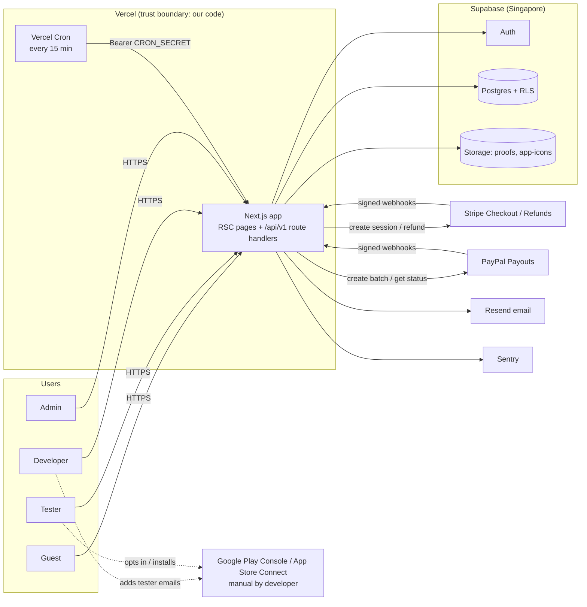

# TRD — TestKo PH Technical Requirements Document

## 0. Document control
| Field | Value |
|---|---|
| Document | `TRD.md` (02) |
| Version | 0.2.0 · draft |
| Date | 2026-10-11 |
| Upstream | PRD 0.2.0 |
| Downstream | APP_FLOW, DATABASE_SCHEMA, IMPLEMENTATION_PLAN |
| Version policy | No library versions are asserted here. TASK-001 pins the then-current stable releases in `package.json`/lockfile and records them in `docs/ec2build/STACK_VERSIONS.md`. |

## 1. Architecture decision records
| ADR | Decision | Options considered | Trade-offs | Revisit when |
|---|---|---|---|---|
| ADR-001 | **Single Next.js (App Router, TypeScript) full-stack app on Vercel**: Server Components for reads, Route Handlers under `/api/v1` for all mutations and webhooks | (a) Next.js monolith; (b) SPA + separate Node/Fastify API; (c) Laravel/Rails | (a) one deploy, SSR for shareable listing, fewest moving parts for a solo operator; vendor coupling to Vercel conventions. (b) more ops. (c) fine but no stated preference and weaker fit with Supabase SDKs | > 3 engineers or need for long-running workers |
| ADR-002 | **Supabase** Postgres + Auth + Storage; clients have SELECT-only RLS; writes via service-role in server code calling `svc_*` PL/pgSQL functions | (a) Supabase; (b) Neon + Auth.js + S3; (c) Firebase | (a) managed auth/storage/RLS + SQL transactions for money; (c) weak for relational money invariants | Supabase pricing/limits become binding |
| ADR-003 | **Stripe Checkout (hosted)** + Refunds API + webhooks for developer payments | Checkout vs Payment Element vs Payment Links | Hosted Checkout keeps card data off our servers (PCI SAQ A, A-022); less UI control | Need for saved cards / subscriptions |
| ADR-004 | **PayPal Payouts** batches submitted only after admin approval; webhooks + polling reconcile | Automatic payouts on request vs admin-approved batches | Admin approval = fraud gate (R-06) at the cost of latency (target ≤ 3 business days) | Fraud rate measured low for 3 months |
| ADR-005 | **Append-only ledger** (`ledger_entries`) for tester money; balance = SUM | Mutable balance column | Auditable, race-safe with row locks; slightly more query cost (negligible at scale) | — |
| ADR-006 | **Scheduled jobs via Vercel Cron → `POST /api/v1/internal/cron/:job`** (every 15 min) with `CRON_SECRET`; all job SQL idempotent | Supabase pg_cron + Edge Functions; external worker | Single codebase; sub-daily cron requires Vercel Pro (A-016, verify plan limits at TASK-001) | Jobs exceed function timeout → move to pg_cron/worker |
| ADR-007 | **Verification by check-ins + developer verdict + auto-pass + disputes** (C-006) | Play Developer API checks; self-report | No store API dependency; evidence trail; manual effort | R2 store API integration |
| ADR-008 | **Resend** for transactional email + Supabase Auth SMTP | Supabase default SMTP (rate-limited, not for production), SES, Postmark | Simple API; provider-specific | Deliverability issues |
| ADR-009 | **Postgres-backed fixed-window rate limiting** (`svc_rate_limit_hit`) | Upstash Redis | No extra vendor; one extra DB round-trip per mutation | > 200 req/s sustained |
| ADR-010 | **Zod** schemas shared between route handlers and forms (`src/lib/validation`) | Yup, Valibot | Ubiquitous, type inference | — |
| ADR-011 | **UI: Tailwind CSS + shadcn/ui (Radix primitives)** | MUI, Chakra | Accessible primitives, own the code, small bundle | — |

## 2. System context


### 2.1 Trust boundaries
| Boundary | Crossing | Controls |
|---|---|---|
| Browser → Next.js | All user input | Supabase session cookie (HttpOnly, Secure, SameSite=Lax), CSRF: route handlers require `Origin` = `NEXT_PUBLIC_APP_URL` for non-GET; Zod validation; rate limits |
| Browser → Supabase (direct) | Auth calls + RLS-filtered SELECTs with anon key | RLS deny-by-default; no write grants |
| Next.js → Supabase service role | All writes | Key server-only (`server-only` import guard); never in client bundles (CI grep check) |
| Stripe/PayPal → webhooks | Untrusted payload | Signature verification, raw body, idempotency table, re-fetch object from provider before money state changes |
| Cron → jobs | Internal | `Authorization: Bearer ${CRON_SECRET}`, constant-time compare |

## 3. Components and modules
| Component | Path | Responsibility | Related |
|---|---|---|---|
| Pages (public) | `src/app/(public)/` | Landing UI-001, listing UI-007/008, legal UI-026 | FR-009, FR-015, FR-032 |
| Pages (auth) | `src/app/(auth)/` | UI-002…UI-005 | FR-001, FR-002 |
| Pages (tester) | `src/app/(app)/tests/`, `wallet/`, `settings/` | UI-006, UI-009…UI-011 | FR-003, FR-004, FR-016…FR-022 |
| Pages (developer) | `src/app/(app)/dev/` | UI-012…UI-016 | FR-005…FR-014 |
| Pages (admin) | `src/app/(admin)/admin/` | UI-018…UI-024 | FR-008, FR-023…FR-030 |
| API route handlers | `src/app/api/v1/**/route.ts` | API-002…API-024 | §5 |
| Supabase clients | `src/lib/supabase/{browser,server,admin}.ts` | anon browser, cookie-bound server, service role (server-only) | ADR-002 |
| Auth/authz guard | `src/server/auth.ts` | `requireUser()`, `requireRole(role)`, `requireActive()` | NFR-001 |
| Services | `src/server/services/{campaigns,enrollments,checkins,verdicts,disputes,payouts,refunds,settlement,notifications,audit,settings}.ts` | Orchestrate validation → svc_* RPC → side effects | FR-005…FR-031 |
| Integrations | `src/server/integrations/{stripe,paypal,email}.ts` | Typed provider adapters with timeouts/retries | FR-007, FR-013, FR-023, FR-027 |
| Jobs | `src/server/jobs/*.ts` | JOB-001…JOB-008 | §8 |
| Error mapping | `src/server/http.ts`, `src/server/db-errors.ts` | Envelope, DB exception → HTTP | §5.3 |
| Validation | `src/lib/validation/*.ts` | Zod schemas | ADR-010 |
| Money/time utils | `src/lib/money.ts`, `src/lib/time.ts` | cents formatting, Asia/Manila display | NFR-009 |
| UI kit | `src/components/ui/*` (shadcn), `src/components/*` | DESIGN components | DESIGN §6 |
| DB | `supabase/migrations`, `supabase/tests` (pgTAP), `supabase/seed.sql` | DATABASE_SCHEMA | |

### 3.1 Repository structure
```
testko-ph/
  .github/workflows/ci.yml
  docs/ec2build/            # copy of this package (source of truth for agents)
  e2e/                      # Playwright specs
  public/
  src/
    app/ (public) (auth) (app) (admin) api/v1/...
    components/ components/ui/
    lib/ supabase/ validation/ money.ts time.ts
    server/ auth.ts http.ts db-errors.ts rate-limit.ts services/ integrations/ jobs/
    styles/tokens.css
  supabase/ config.toml migrations/ tests/ seed.sql
  tests/ unit/ integration/
  .env.example  vercel.json  package.json  pnpm-lock.yaml  tsconfig.json  eslint.config.mjs  vitest.config.ts  playwright.config.ts
```
Standards: TypeScript `strict: true`, `noUncheckedIndexedAccess: true`; ESLint (next + typescript-eslint) + Prettier; no `any` without justification comment; conventional commits.

## 4. Environments, configuration and secrets
| Env | Hosting | DB | Stripe | PayPal |
|---|---|---|---|---|
| local | `pnpm dev` | Supabase CLI local stack (Docker) | test mode + `stripe listen` | sandbox |
| preview | Vercel preview per PR | Supabase staging project (or branch) | test mode | sandbox |
| staging | Vercel `staging` branch | Supabase staging | test mode | sandbox |
| production | Vercel production | Supabase production (Singapore) | live (blocked by OD-001) | live (blocked by OD-002) |

Environment variables (`.env.example` contains names and fake examples only):
| Name | Scope | Example |
|---|---|---|
| `NEXT_PUBLIC_APP_URL` | public | `http://localhost:3000` |
| `NEXT_PUBLIC_SUPABASE_URL` | public | `http://127.0.0.1:54321` |
| `NEXT_PUBLIC_SUPABASE_ANON_KEY` | public | `eyJ...example` |
| `SUPABASE_SERVICE_ROLE_KEY` | server secret | `eyJ...example` |
| `STRIPE_SECRET_KEY` | server secret | `sk_test_example` |
| `STRIPE_WEBHOOK_SECRET` | server secret | `whsec_example` |
| `PAYPAL_CLIENT_ID` / `PAYPAL_CLIENT_SECRET` | server secret | `example` |
| `PAYPAL_API_BASE` | server | `https://api-m.sandbox.paypal.com` |
| `PAYPAL_WEBHOOK_ID` | server | `WH-example` |
| `RESEND_API_KEY` | server secret | `re_example` |
| `EMAIL_FROM` | server | `TestKo PH <no-reply@example.com>` |
| `CRON_SECRET` | server secret | 32+ random bytes |
| `AUDIT_IP_SALT` | server secret | 32+ random bytes |
| `SENTRY_DSN` / `NEXT_PUBLIC_SENTRY_DSN` | server/public | `https://example@sentry.io/1` |
| `ADMIN_ALERT_EMAIL` | server | `ops@example.com` |

Secrets live in Vercel encrypted env vars and Supabase dashboard; never committed (`.gitignore` already excludes `.env*` except `.env.example`). Env is validated at boot by `src/lib/env.ts` (Zod) — app fails fast on missing vars.

## 5. API contracts
### 5.1 Conventions
- Base path `/api/v1`; JSON in/out; `Content-Type: application/json` except uploads (`multipart/form-data`).
- Auth: Supabase session cookie; handler calls `requireUser()`; **401** `UNAUTHENTICATED` when absent/expired; **403** `FORBIDDEN` when role/ownership fails; suspended users get **403** `ACCOUNT_SUSPENDED` on mutations.
- Non-GET requests require same-origin `Origin` header (**403** `BAD_ORIGIN`), except webhooks and cron.
- IDs are UUID v4; invalid → **422** `VALIDATION_FAILED`.
- Error envelope: `{"error":{"code":"CAMPAIGN_FULL","message":"Human readable","details":{},"requestId":"req_..."}}`.
- Pagination: cursor-based `?cursor=<opaque>&limit=20` (max 50); response `{"items":[...],"nextCursor":null|"..."}`.
- Idempotency: mutating money endpoints accept optional `Idempotency-Key` header (UUID); server additionally relies on DB state guards. Duplicate → same final state; second call may return **409** `INVALID_STATE`.
- Rate-limit exceed: **429** `RATE_LIMITED` + `Retry-After`.
- Money amounts: integer cents + `currency:"USD"`.
- Cross-user data: RLS lets a user read only their own `profiles` row. Endpoints that must show another user's display name (roster API-009, review UI-016 data via API-011/API-012 reads, dispute views for the tester/developer) first verify ownership with the user-scoped client, then read **only** `display_name` (+ the enrollment's `store_email` snapshot) with the service-role client. No other profile fields are returned.
- Versioning: breaking changes → `/api/v2`; additive fields allowed in v1.
- Timeouts: provider calls 10 s with 2 retries (exponential backoff 250 ms, 1 s) for idempotent calls only.

### 5.2 Endpoint catalogue
| ID | Method & path | Consumer | Auth | Request | Success | Errors | Data | FR |
|---|---|---|---|---|---|---|---|---|
| API-001 | Supabase Auth: `signUp`, `signInWithPassword`, `signOut`, `resetPasswordForEmail`, `updateUser`, `verifyOtp` via `/auth/callback` route | UI-002…UI-004 | public / session | email, password, `options.data {display_name, terms_version, age_confirmed}` | session cookie | invalid credentials (generic), email not confirmed, 429 | auth.users, DB-001 trigger | FR-001 |
| API-002 | `GET /me` · `PATCH /me` · `POST /me/roles` · `PUT /me/paypal-email` | UI-005, UI-006, UI-011 | user | PATCH `{display_name?, country_code?, notify_new_campaigns?}`; roles `{roles:["tester"|"developer"]}`; paypal `{email, current_password}` | 200 profile + roles + flags | 403 FORBIDDEN_ROLE, 409 PAYPAL_EMAIL_TAKEN, 401 REAUTH_FAILED, 422 | DB-001, DB-002 | FR-002, FR-004 |
| API-003 | `GET /me/tester-identities` · `PUT /me/tester-identities/:platform` · `DELETE /me/tester-identities/:platform` | UI-006, UI-008 | tester | `{store_email}` | 200 identity | 409 IDENTITY_TAKEN, 409 IDENTITY_IN_USE, 422 | DB-003 | FR-003 |
| API-004 | `POST /campaigns` · `PATCH /campaigns/:id` · `GET /dev/campaigns` · `GET /dev/campaigns/:id` · `POST /campaigns/:id/icon` (multipart) | UI-012, UI-013, UI-015 | developer, owner | campaign fields (FR-005) | 201/200 campaign incl. `quote {price_per_slot_cents, total_cents}` | 409 CAMPAIGN_LOCKED, 422 OPT_IN_URL_MISMATCH, 422 INVALID_FILE | DB-004, DB-018 | FR-005, FR-006 |
| API-005 | `POST /campaigns/:id/checkout` | UI-013, UI-014 | developer, owner | `{}` | 200 `{checkoutUrl}` | 409 INVALID_STATE, 422 VALIDATION_FAILED (incomplete campaign), 502 PROVIDER_UNAVAILABLE | DB-004, DB-005, DB-015 | FR-006, FR-007 |
| API-006 | `POST /webhooks/stripe` | Stripe | signature | raw body, `Stripe-Signature` | 200 `{received:true}` | 400 BAD_SIGNATURE; 500 (forces Stripe retry) | DB-005, DB-006, DB-014 | FR-007, FR-013 |
| API-007 | `GET /campaigns?platform=&sort=&cursor=` · `GET /campaigns/:id` | UI-007, UI-008 | public | query | listing items (no opt-in URL); detail adds `viewer {enrollment?, canJoin, reasons[]}`; opt-in URL + instructions only when viewer enrolled with access_granted+ or owner/admin | 404 | v_campaign_listings, DB-004, DB-007 | FR-009, FR-015 |
| API-008 | `POST /campaigns/:id/enrollments` · `POST /enrollments/:id/withdraw` · `GET /me/enrollments?status=` | UI-008, UI-009, UI-010 | tester | `{}` / `{confirm:true}` | 201 enrollment / 200 | 409 CAMPAIGN_FULL, ALREADY_ENROLLED, OWN_CAMPAIGN, ENROLLMENT_LIMIT, INVALID_STATE; 422 IDENTITY_REQUIRED | DB-007 | FR-016, FR-019 |
| API-009 | `GET /dev/campaigns/:id/roster` · `GET /dev/campaigns/:id/roster.csv?status=applied` · `POST /dev/campaigns/:id/access` · `POST /enrollments/:id/release` | UI-015 | developer, owner | access `{enrollment_ids: uuid[] (1..100)}`; release `{reason}` | 200 roster / CSV `text/csv` / `{granted[],skipped[]}` | 403, 409 INVALID_STATE | DB-007, DB-008, DB-013 | FR-010 |
| API-010 | `POST /dev/campaigns/:id/start` | UI-015 | developer, owner | `{}` | 200 campaign | 409 NOT_ENOUGH_ACTIVE_TESTERS (`details {active, required}`), INVALID_STATE | DB-004, DB-007, DB-008 | FR-011 |
| API-011 | `GET /enrollments/:id/checkins` · `POST /checkins/:id/submit` (multipart: `proof` file, `feedback`) · `POST /checkins/:id/flag` · `GET /checkins/:id/proof-url` | UI-010, UI-015, UI-016, UI-020 | tester owner (submit); developer owner/admin (flag, proof-url) | file ≤5 MB png/jpeg/webp (magic bytes verified), feedback 20–1000 (not for opt_in) | 200 check-in; proof-url `{url, expiresIn:120}` | 409 CHECKIN_NOT_OPEN, CHECKIN_WINDOW_CLOSED, ACCESS_NOT_GRANTED; 422 INVALID_FILE, FEEDBACK_REQUIRED | DB-008, DB-017 | FR-017, FR-018, FR-026 |
| API-012 | `POST /enrollments/:id/verdict` | UI-016 | developer, owner | `{verdict:"pass"|"fail", reason?}` | 200 enrollment | 409 VERDICT_FINAL, INVALID_STATE; 422 REASON_REQUIRED | DB-007, DB-010 | FR-012, FR-021 |
| API-013 | `POST /enrollments/:id/dispute` · `GET /admin/disputes?status=` · `POST /admin/disputes/:id/resolve` | UI-010, UI-020 | tester owner / admin | `{reason}` / `{outcome:"upheld"|"rejected", note}` | 201 / 200 | 409 DISPUTE_WINDOW_CLOSED, ALREADY_DISPUTED, INVALID_STATE | DB-009, DB-007, DB-010 | FR-024 |
| API-014 | `GET /me/wallet` · `GET /me/ledger?cursor=` | UI-011 | tester | — | `{available_cents, pending_cents, min_payout_cents, open_payout?, can_request, blockers[]}` | — | wallet_balances, DB-010, DB-011 | FR-020 |
| API-015 | `POST /me/payouts` · `GET /me/payouts` · `POST /me/payouts/:id/cancel` | UI-011 | tester, active | `{amount_cents}` | 201 payout | 422 BELOW_MINIMUM_PAYOUT; 409 PAYOUT_ALREADY_OPEN, INSUFFICIENT_BALANCE, PAYOUT_EMAIL_HOLD, PAYPAL_EMAIL_REQUIRED | DB-011, DB-010 | FR-022 |
| API-016 | `GET /admin/campaigns?status=` · `GET /admin/campaigns/:id` · `POST /admin/campaigns/:id/review` · `POST /admin/campaigns/:id/cancel` | UI-019 | admin | `{decision:"approve"|"reject", reason?}` | 200 | 409 INVALID_STATE; 422 REASON_REQUIRED | DB-004, DB-006, DB-013 | FR-008, FR-014 |
| API-017 | `GET /admin/payouts?status=` · `POST /admin/payouts/approve` · `POST /admin/payouts/:id/reject` · `POST /admin/payouts/:id/sync` | UI-021 | admin | approve `{payout_ids: uuid[] (1..500)}`; reject `{reason}` | approve 202 `{sender_batch_id, submitted[], skipped[]}` | 502 PROVIDER_UNAVAILABLE (payouts remain `requested`), 409 INVALID_STATE | DB-011, DB-010, DB-013 | FR-023 |
| API-018 | `POST /webhooks/paypal` | PayPal | signature verified via PayPal verify-webhook-signature API | raw body + `PAYPAL-*` headers | 200 | 400 BAD_SIGNATURE; 500 → PayPal retries | DB-011, DB-010, DB-014 | FR-023 |
| API-019 | `GET /admin/users?q=` · `POST /admin/users/:id/suspend` · `POST /admin/users/:id/reinstate` · `POST /admin/users/:id/roles` · `POST /admin/users/:id/ledger-adjustments` | UI-022 | admin | `{reason}` / `{grant:[], revoke:[]}` / `{amount_cents, note}` | 200 | 409 LAST_ADMIN; 422 | DB-001, DB-002, DB-010, DB-013 | FR-025 |
| API-020 | `GET /admin/settings` · `PUT /admin/settings` | UI-023 | admin | `{values:{key:value}}` validated per key | 200 | 422 INVALID_SETTING (e.g., reward ≥ price) | DB-015, DB-013 | FR-029 |
| API-021 | `POST /internal/cron/:job` (`job` ∈ checkins, campaigns, refunds, payments, payouts, retention, notifications, reconcile) | Vercel Cron | `Bearer CRON_SECRET` | — | 200 `{job, processed, errors}` | 401 | many | FR-011…FR-018, FR-013, FR-023 |
| API-022 | `GET /me/notifications?cursor=` · `POST /me/notifications/read` | UI-017, header badge | user | `{ids?: uuid[], all?: true}` | 200 | — | DB-012 | FR-027 |
| API-023 | `POST /me/deletion` | UI-006 | user, re-auth | `{current_password, forfeit_balance?:boolean}` | 202 | 409 DELETION_BLOCKED (`details.blockers[]`) | DB-001, DB-003, DB-017 | FR-031 |
| API-024 | `POST /dev/campaigns/:id/cancel` | UI-012, UI-015 | developer, owner | `{reason}` | 200 `{campaign, refund?}` | 409 INVALID_STATE | DB-004, DB-006 | FR-014 |
| API-025 | `GET /admin/overview` · `GET /admin/audit-logs?action=&entity=&cursor=` | UI-018, UI-024 | admin | — | counts / log page | — | many, DB-013 | FR-028, FR-030 |

### 5.3 Error code registry (DB exception → HTTP)
| Code | HTTP | Code | HTTP |
|---|---|---|---|
| UNAUTHENTICATED | 401 | NOT_FOUND | 404 |
| FORBIDDEN, FORBIDDEN_ROLE, BAD_ORIGIN, ACCOUNT_SUSPENDED, OWN_CAMPAIGN, ROLE_REQUIRED | 403 | VALIDATION_FAILED, INVALID_FILE, OPT_IN_URL_MISMATCH, IDENTITY_REQUIRED, FEEDBACK_REQUIRED, REASON_REQUIRED, BELOW_MINIMUM_PAYOUT, INVALID_SETTING, INVALID_ARGUMENT | 422 |
| INVALID_STATE, CAMPAIGN_LOCKED, CAMPAIGN_FULL, ALREADY_ENROLLED, ENROLLMENT_LIMIT, IDENTITY_TAKEN, IDENTITY_IN_USE, PAYPAL_EMAIL_TAKEN, NOT_ENOUGH_ACTIVE_TESTERS, ACCESS_NOT_GRANTED, CHECKIN_NOT_OPEN, CHECKIN_WINDOW_CLOSED, VERDICT_FINAL, DISPUTE_WINDOW_CLOSED, ALREADY_DISPUTED, PAYOUT_ALREADY_OPEN, INSUFFICIENT_BALANCE, PAYOUT_EMAIL_HOLD, PAYPAL_EMAIL_REQUIRED, DELETION_BLOCKED, LAST_ADMIN | 409 | RATE_LIMITED | 429 |
| REAUTH_FAILED | 401 | PROVIDER_UNAVAILABLE | 502 |
| BAD_SIGNATURE | 400 | INTERNAL | 500 (no internal detail leaked) |

### 5.4 Example contract — API-015 `POST /api/v1/me/payouts`
```http
POST /api/v1/me/payouts
Cookie: sb-...; Origin: https://app.example.com
Content-Type: application/json

{"amount_cents": 2800}
```
201:
```json
{"payout":{"id":"7b1e...","amount_cents":2800,"currency":"USD","status":"requested","paypal_email":"m***@gmail.com","requested_at":"2026-11-02T03:12:00Z"},
 "wallet":{"available_cents":0,"pending_cents":350}}
```
422: `{"error":{"code":"BELOW_MINIMUM_PAYOUT","message":"Minimum payout is US$25.00.","details":{"min_cents":2500},"requestId":"req_..."}}`

## 6. Authentication, authorisation and sessions
- Supabase Auth email+password, email confirmation required, `@supabase/ssr` cookie sessions refreshed in `middleware.ts`; server code uses `supabase.auth.getUser()` (validates with Auth server) — never trust `getSession()` alone on the server.
- Password policy: min 10 chars; enable leaked-password protection if available on the plan (verify at TASK-004).
- Session: Supabase defaults (access token ~1 h, refresh rotation). Sign-out = `signOut({scope:'local'})` + cookie clear. Account deletion / suspension / password change → `signOut({scope:'global'})` via admin API.
- Re-authentication for PayPal email change and deletion: server verifies `current_password` via `signInWithPassword` against the same email (rate-limited 5/15 min).
- Role model: `user_roles` (tester, developer, admin). Guards: `requireRole('developer')` + ownership check (campaign.developer_id = user.id) in every developer route; admin routes under `/api/v1/admin/*` and `(admin)` layout call `requireRole('admin')`.
- Defence in depth: `svc_*` functions re-check ownership/state given actor id.
- Admin bootstrap: first admin is granted by a one-off SQL run by the owner in production (documented in runbook, TASK-028), never by an endpoint.

## 7. Integrations
### 7.1 Stripe (FR-007, FR-013)
- Create session: `stripe.checkout.sessions.create({ mode:'payment', line_items:[{ price_data:{ currency:'usd', unit_amount: price_per_slot_cents, product_data:{ name:`Closed test: ${app_name} (${platform})` } }, quantity: tester_slots }], client_reference_id: campaign.id, metadata:{ campaign_id }, payment_intent_data:{ metadata:{ campaign_id } }, customer_email: developer email, success_url: `${APP_URL}/dev/campaigns/${id}/checkout/success?session_id={CHECKOUT_SESSION_ID}`, cancel_url: `${APP_URL}/dev/campaigns/${id}/checkout/cancel`, expires_at: now+24h }, { idempotencyKey: `checkout:${campaign.id}:${attempt}` })`.
- Before creating, snapshot prices (FR-006) and insert `campaign_payments(pending)`; if an unexpired pending session exists, return its URL.
- Webhook events handled: `checkout.session.completed` (if `payment_status==='paid'`), `checkout.session.async_payment_succeeded` → `svc_mark_payment_paid`; `checkout.session.async_payment_failed` → payment failed; `checkout.session.expired` → payment expired + campaign back to `draft`; `charge.refunded` → update refund rows/`refunded_cents`; `charge.dispute.created` → admin alert + audit; others → `ignored`.
- Verification: `stripe.webhooks.constructEvent(rawBody, sig, STRIPE_WEBHOOK_SECRET)`; route reads `await req.text()`.
- Refunds: `stripe.refunds.create({ payment_intent, amount, metadata:{refund_id} }, { idempotencyKey: `refund:${refund.id}` })`.
- Availability risk: OD-001.

### 7.2 PayPal Payouts (FR-023)
- OAuth2 client-credentials token cached in memory until expiry − 60 s.
- Create batch: `POST {PAYPAL_API_BASE}/v1/payments/payouts` with `sender_batch_header {sender_batch_id: <uuid>, email_subject, email_message}`, `items[] {recipient_type:'EMAIL', receiver: paypal_email, amount:{value:'28.00', currency:'USD'}, sender_item_id: payout.id, note}`. Store `paypal_sender_batch_id` on all payouts **before** the call; set `processing` after 201 with `payout_batch_id`.
- Duplicate `sender_batch_id` error → fetch batch and reconcile (AC1 FR-023).
- Status: webhooks `PAYMENT.PAYOUTS-ITEM.SUCCEEDED|UNCLAIMED|RETURNED|FAILED|BLOCKED|REFUNDED|DENIED|HELD|CANCELED`; map → paid / unclaimed / returned / failed / failed / returned / failed / (no change) / returned. Lookup by `sender_item_id`.
- Webhook verification: `POST /v1/notifications/verify-webhook-signature` with headers + `PAYPAL_WEBHOOK_ID`; only `verification_status === 'SUCCESS'` accepted.
- Polling (JOB-004): `GET /v1/payments/payouts/{payout_batch_id}` for payouts `processing` > 6 h or `unclaimed`.
- Exact event names and fields **must be confirmed against current PayPal docs at TASK-018** (not verified here).

### 7.3 Email (Resend)
Templates in `src/server/email/templates/*.tsx`; notification service writes DB-012 then sends email (non-blocking; failures logged + retried by JOB-007 via `emailed_at is null`).

## 8. Background jobs (Vercel Cron every 15 min → API-021)
| Job | Route `:job` | Work | Idempotency |
|---|---|---|---|
| JOB-001 | `checkins` | `svc_job_mark_missed`; send window-open and 12 h-before-grace reminders (tracked via notification type + check-in id) | status guards; reminder dedupe key |
| JOB-002 | `campaigns` | `svc_job_end_testing`, `svc_job_auto_pass`, `svc_job_expire_recruiting`, then for `svc_job_settle_ready` ids → `svc_settle_campaign` | status guards |
| JOB-003 | `payments` | pending payments past `expires_at` → retrieve session; expired → payment expired, campaign draft | session status |
| JOB-004 | `payouts` | reconcile `processing`/`unclaimed` payouts with PayPal | sender_item_id |
| JOB-005 | `retention` | delete proofs 90 d after completion/cancel; purge notifications 180 d, rate_limits 1 d; redact webhook payloads 90 d | deterministic |
| JOB-006 | `refunds` | execute `refunds` in `pending`/`failed` (attempts < 5, backoff 15 min × 2^attempts) | Stripe idempotency key `refund:<id>` |
| JOB-007 | `notifications` | send unsent emails (`emailed_at is null`, < 24 h old), fan-out "new campaign" emails in batches of 100 | emailed_at |
| JOB-008 | `reconcile` (daily 02:00 Asia/Manila) | compare Stripe paid sessions vs campaign_payments, PayPal items vs payouts, ledger invariants; email report to admin | read-only |

Each job: run under 60 s budget, process ≤ 200 rows per invocation, log `{job, processed, durationMs}`; alert if last success > 2 h (NFR-007) via heartbeat row in `platform_settings` key `ops.last_job_<name>` (written by service, excluded from admin edit UI).

## 9. Storage and uploads
- Proof upload: route handler parses multipart (limit 5 MB at the reader), checks magic bytes (PNG/JPEG/WebP) — never trust `Content-Type`; re-encodes? **No** (keep original for evidence); computes SHA-256; uploads with service role to `proofs/{campaign}/{enrollment}/{checkin}.{ext}` (upsert false); calls `svc_record_checkin`; if RPC fails → delete object.
- Signed read URLs 120 s, generated after `can_view_enrollment` check.
- Icons: same validation, max 1 MB, public bucket, path includes random UUID to bust caches.

## 10. Security
### 10.1 Threat model (STRIDE summary)
| Threat | Asset | Mitigation | Test |
|---|---|---|---|
| Spoofing: account takeover → change PayPal email → steal balance | Ledger | Re-auth for email change, 48 h payout hold, notification to account email, admin payout review | TEST-021 |
| Tampering: client sets price/reward | Payments | Server snapshot from settings; DB CHECK total | TEST-007 |
| Tampering: forged webhook | Payments/payouts | Signature verification, provider re-fetch, idempotency | TEST-009, TEST-024 |
| Repudiation: admin actions | Money | Immutable audit_logs | TEST-027 |
| Info disclosure: tester store emails / proofs leaked | PII | RLS, signed URLs, roster only for owner, CSV audit | TEST-005 |
| Info disclosure: opt-in links scraped | Developer apps | Hidden until access granted | TEST-012 |
| DoS: upload floods | Storage | Rate limits, size limits | TEST-016 |
| Elevation: user grants self admin | All | Roles endpoint rejects admin; only admin API; RLS no writes | TEST-003 |
| Fraud: multi-account testers, duplicate proofs | Money | Unique emails, hash flags, admin review | TEST-017 |
| Fraud: developer chargeback after payouts | Money | Hold period, dispute alert, account flag | runbook |
| Race: double payout / double reward | Ledger | Row locks, partial unique indexes | TEST-020, TEST-022 |
| SSRF / open redirect | Server | No server fetch of user URLs; redirects only to internal paths or Stripe session URL | TEST-008 |
| XSS via descriptions/feedback | Users | React escaping; no `dangerouslySetInnerHTML`; CSP | ZAP |

### 10.2 OWASP controls
CSP (`default-src 'self'`; `img-src 'self' data: <supabase storage host>`; `connect-src 'self' <supabase host> <sentry host>`; `frame-ancestors 'none'`), HSTS, `X-Content-Type-Options: nosniff`, `Referrer-Policy: strict-origin-when-cross-origin`, `Permissions-Policy` minimal. Dependency audit (`pnpm audit --audit-level=high`) and secret scanning (gitleaks) in CI. Logs never contain passwords, tokens, full PayPal emails (masked `m***@gmail.com`) or webhook secrets. IP addresses stored only as `sha256(AUDIT_IP_SALT + ip)`.

## 11. Observability
- Structured logs (`pino`-style JSON) with `requestId` (from `x-vercel-id` or generated), `userId`, route, status, duration.
- Sentry for server/client errors with PII scrubbing.
- Metrics derived from DB (admin overview UI-018) — no separate metrics stack in MVP.
- Alerts (email to `ADMIN_ALERT_EMAIL` + in-app admin notification): webhook event `failed`, refund `failed` after 5 attempts, payout `failed/returned` spike (> 3 in 24 h), job heartbeat stale > 2 h, AMOUNT_MISMATCH, `charge.dispute.created`.
- Uptime monitor on `/api/health` (returns DB connectivity) — provider chosen at TASK-027.

## 12. Reliability, performance and capacity
| Target | Value |
|---|---|
| Availability | 99.5 %/month (NFR-004) |
| p95 latency | < 500 ms for API-007/008/014 (NFR-005) |
| RPO / RTO | 24 h (5 min with PITR) / 4 h |
| Capacity | 10k users, 200 concurrent campaigns, 2k check-ins/day — well within a single small Postgres instance |
Listing page uses ISR-free dynamic rendering with `revalidate=60` on the public route; slot counts are approximate in the list and exact on detail/join.

## 13. Cost estimate (ASSUMPTION — verify current pricing before committing)
| Item | Assumed plan | Note |
|---|---|---|
| Vercel | Pro (cron frequency, team) | per-seat monthly |
| Supabase | Pro (backups, no pausing) | monthly + usage |
| Resend | free tier initially | upgrade with volume |
| Sentry | free/dev tier | |
| Stripe | per-transaction % + fixed fee; refunds do not return the original fee (verify) | absorbed by platform (A-005) |
| PayPal Payouts | per-item fee (verify current schedule) | absorbed by platform (A-005) |
At US$5/slot with US$1.50 platform fee, fees materially reduce margin; OD-005 must model this with real fee schedules.

## 14. CI/CD and quality gates
`.github/workflows/ci.yml` on PR and main:
1. `pnpm install --frozen-lockfile`
2. `pnpm lint` (0 errors) · `pnpm typecheck` (`tsc --noEmit`, 0 errors)
3. `pnpm test` (Vitest unit + integration; coverage ≥ 80 % lines for `src/server/**`)
4. `supabase start` → `supabase db reset` → `supabase test db` (pgTAP: all pass)
5. `pnpm build`
6. `pnpm test:e2e` (Playwright against local stack, Stripe/PayPal mocked via adapter fakes; axe: 0 serious/critical)
7. `pnpm audit --audit-level=high` (0 high/critical, or documented exception) · gitleaks (0 findings) · grep guard: `SUPABASE_SERVICE_ROLE_KEY` not referenced outside `src/lib/supabase/admin.ts`/env
Deploy: Vercel preview per PR; staging on `staging` branch; production on `main` **only after manual approval** + migrations applied via `supabase db push` by an approved operator (TASK-027/TASK-028). Rollback: Vercel instant rollback to previous deployment; DB uses forward-fix migrations (no destructive down migrations in production).

## 15. Testing strategy
| Level | Tool | Scope |
|---|---|---|
| DB | pgTAP | RLS isolation, svc_* state machines, constraints, concurrency-sensitive guards |
| Unit | Vitest | validation schemas, money/time utils, error mapping, provider adapters (mocked HTTP) |
| Integration | Vitest + local Supabase | route handlers end-to-end with fake Stripe/PayPal adapters; webhook signature tests with Stripe test helpers |
| E2E | Playwright (chromium, webkit, Pixel 7 emulation) | FLOW-001…FLOW-015 happy + key negative paths; axe |
| Load | k6 (indicative) | API-007/008/014 at 50 req/s on staging |
| Security | OWASP ZAP baseline on staging | no High |

## 16. Accessibility & performance engineering
Radix primitives, semantic HTML, `next/font` self-hosted, image optimisation for icons, route-level code splitting, Lighthouse CI budget: performance ≥ 85 mobile on UI-001/UI-007, accessibility ≥ 95.

## 17. API ↔ FR ↔ component ↔ task links
See `TRACEABILITY.md`. Implementation tasks: API-001 → TASK-008; API-002 → TASK-009; API-003 → TASK-010; API-004 → TASK-011; API-005/006 → TASK-012; API-024 → TASK-013; API-016 → TASK-014; API-007/008 → TASK-015; API-009/010 → TASK-016; API-011 → TASK-017; API-021 → TASK-018 (job bodies also in TASK-012, 013, 021, 023, 024); API-012/013 → TASK-019; API-014/015 → TASK-020; API-017/018 → TASK-021; API-019/020/025 → TASK-022; API-022 → TASK-007; API-023 → TASK-023.

## 18. Unresolved technical questions
| # | Question | Impact | Owner |
|---|---|---|---|
| TQ-1 | Confirm Vercel plan cron frequency limit and function max duration | JOB cadence | Owner @ TASK-001 |
| TQ-2 | Confirm current PayPal Payouts webhook event names/fields and sandbox behaviour | FR-023 | Agent @ TASK-021 |
| TQ-3 | Confirm Stripe account country (OD-001) and whether USD settlement is supported | FR-007 | Owner |
| TQ-4 | Supabase plan with PITR? | RPO | Owner |
| TQ-5 | Leaked-password protection availability on chosen Supabase plan | FR-001 | Agent @ TASK-008 |
